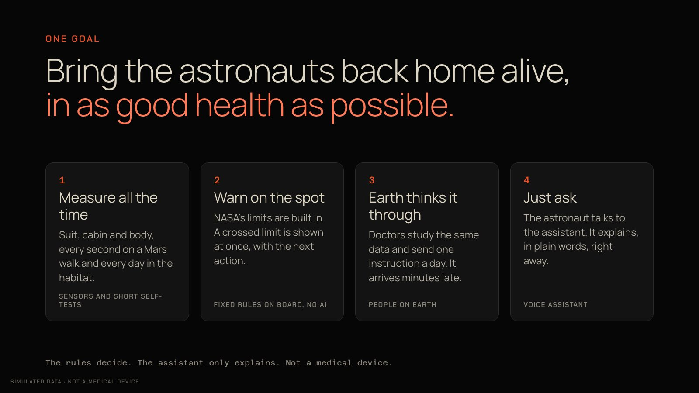
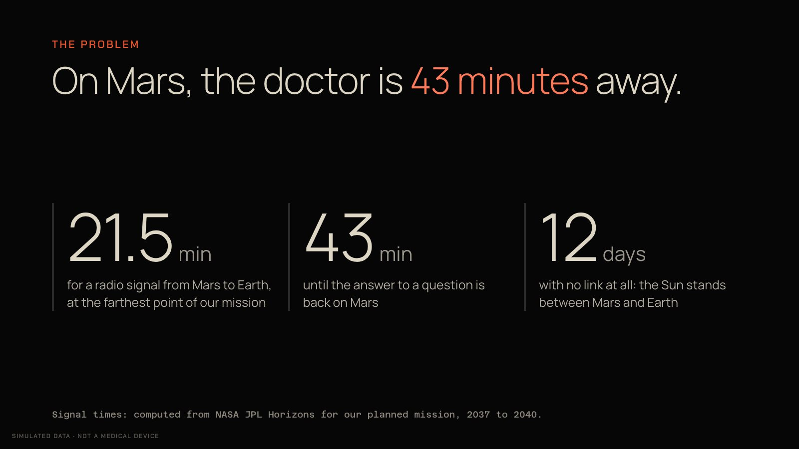
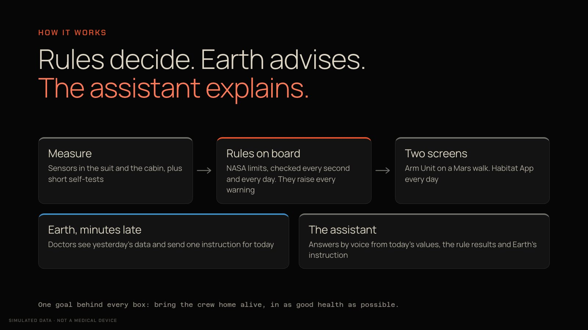
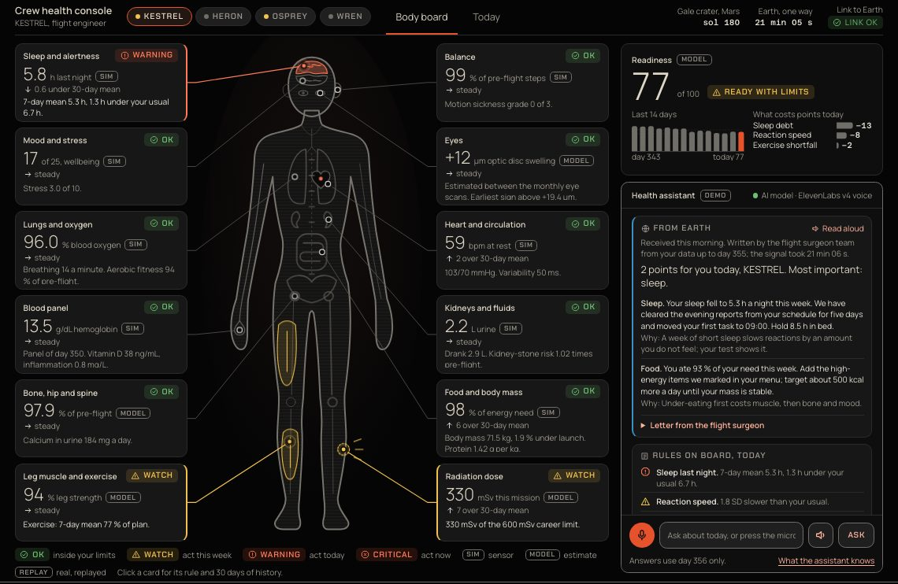
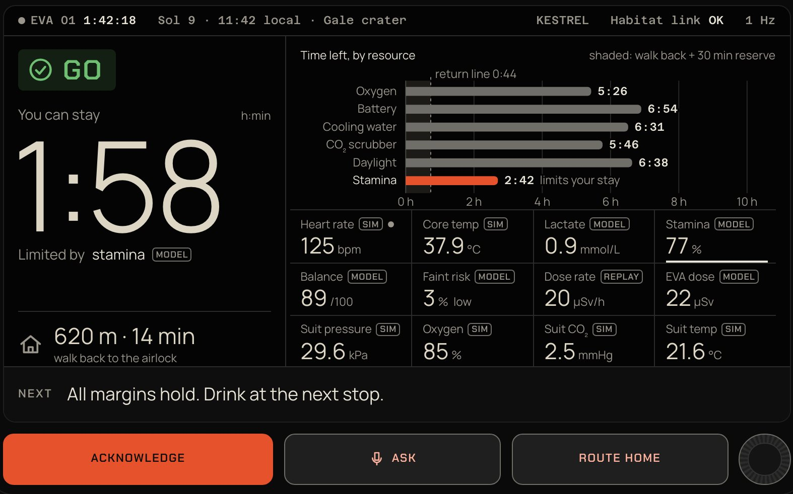
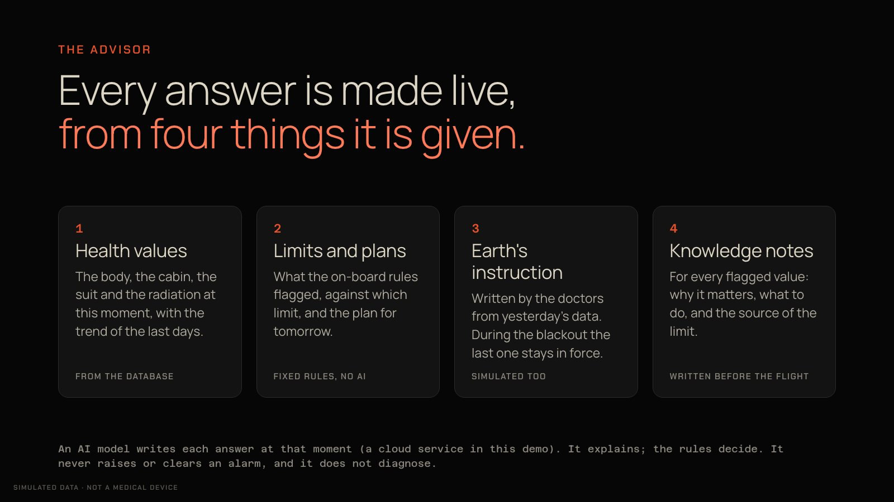
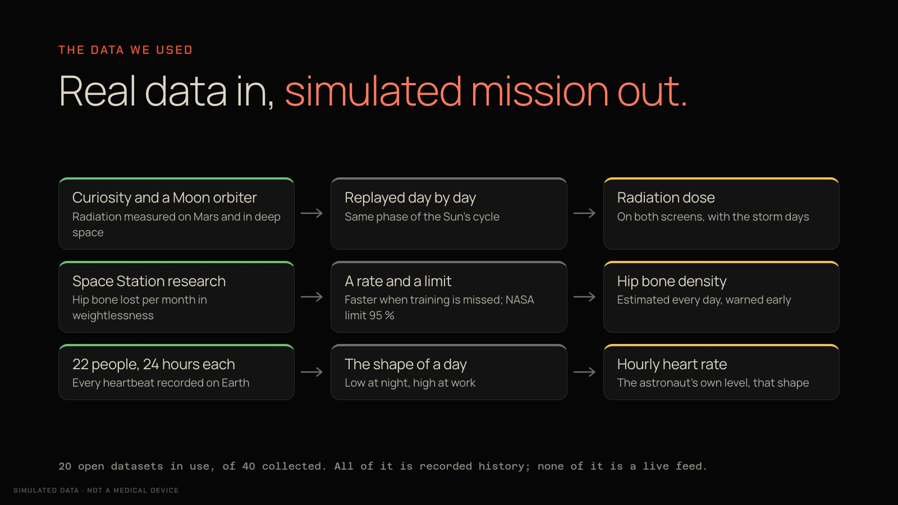
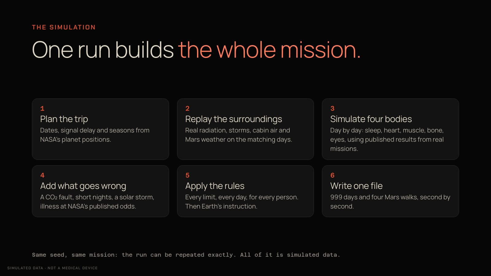
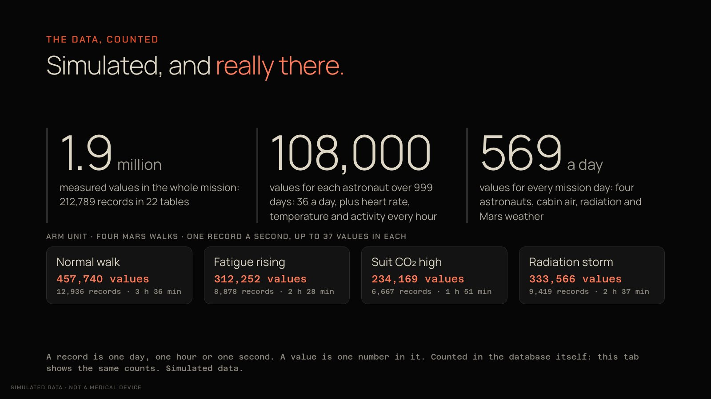
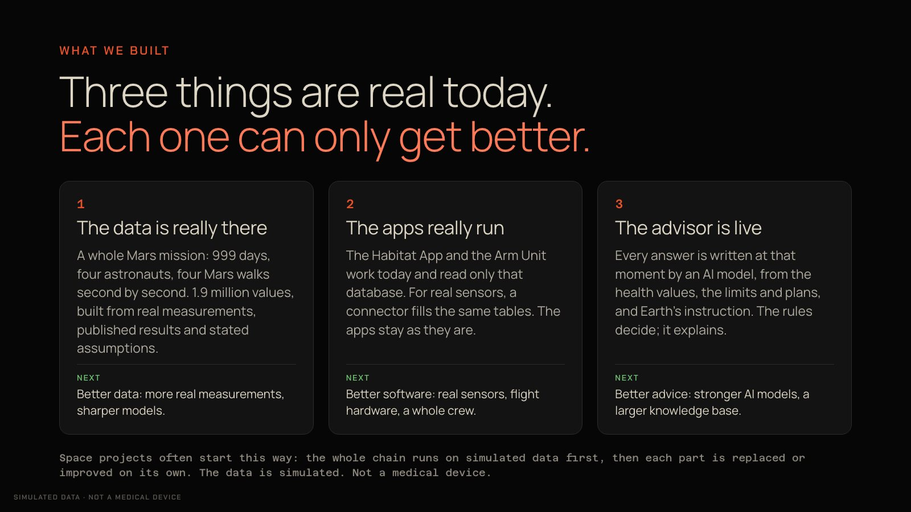

# Health Signal

**Crew health on Mars, without waiting for Earth.** Our mission: bring the astronauts back from Mars alive, in as good health as possible.

[**Website**](https://healthsignal.space) · [**Habitat App**](https://healthsignal.space/habitat.html) · [**Arm Unit**](https://healthsignal.space/arm_unit.html) · [Manuals](#manuals) · [Documentation](docs/README.md)

Team Health Signal · NASA Space Apps Challenge 2026 · Challenge: *Create Health Monitoring Software for Astronauts on Space Missions*



## The problem

On Mars, a question to the doctor on Earth and its answer take up to 43 minutes, and for about 12 days there is no link at all. The crew must judge their own health and act on it.



## What Health Signal does

Health Signal measures body and environment around the clock, warns on the spot with limits built into fixed rules, shows Earth's delayed daily instruction, and lets the astronaut simply ask an assistant, by voice or in writing. **The rules decide; the AI only explains.** It is not a medical device.



## Two working apps on one simulated mission

**Habitat App, the daily view.** A body figure with twelve regions, a readiness score, charts over time, Earth's instruction and the assistant. Every value is shown against the astronaut's own normal and against its limit.



**Arm Unit, the suit's forearm screen.** During a Mars walk it reads body, suit and radiation every second and shows one word (Go, Caution, Return), how long the astronaut can stay and the next step. Four complete walks can be played, one of them in a solar storm.



**The assistant, in both apps.** Real-time voice to voice: press the microphone, ask, and hear the answer. It is given only the values of that moment, the rule results and Earth's instruction, and it never raises or clears a warning.



## Built from real data

Nobody has flown to Mars, so no health data from such a mission exists. Instead of inventing numbers, we built one complete mission from real measurements: 999 days, four fictional astronauts, 76 values, 212,789 records with about 1.9 million measured values, and four Mars walks second by second. Every value is labelled with how it was made: REAL, REPLAY, MODEL, SIM or COMPUTED. Always: simulated, built from real data.







## A framework that gets better part by part

Three things work today, and each can be improved on its own: better data (add a dataset, generate the mission again), better software (real sensors need only a connector into the same tables; not built yet), better advice (a stronger AI model, a larger knowledge base).



## Manuals

Practical user manuals for anyone who wants to use the apps, with screenshots. Each starts with how the apps use AI and how to connect your own limited OpenRouter and ElevenLabs keys.

- [Habitat App manual (PDF)](mocks/manuals/health_signal_habitat_app_manual.pdf): choose a day and a crew member, read readiness, the body figure, Earth's instruction and the rules on board, ask by voice or typing.
- [Arm Unit manual (PDF)](mocks/manuals/health_signal_arm_unit_manual.pdf): play the four Mars walks second by second, read the unit, beeps, ask by voice or typing.

## Use of AI

Health Signal shows what a very small team can do when people lead and AI agents accelerate: real data and space-medicine science, brought into a working product at a pace that was not possible before. We set the goal, the story and the architecture, chose which data to trust, directed the look, reviewed and tested the results and took the decisions. AI agents, working in parallel under that direction, did the heavy lifting.

**In full:**

- Research and data: agents (Claude Code, Anthropic's Claude models) searched and read NASA documents and datasets and wrote the tools that fetch them. We selected the 20 datasets; every limit traces to its source document.
- Simulation: agents wrote the generator's code from our specification. Its numbers are computed from the real datasets and stated models, not produced by a language model. The written analyses of key days and the knowledge notes were drafted with AI and reviewed by us.
- Software: agents wrote the code of the website, both apps and the server. We reviewed, ran and corrected it, with a human in the loop and automated browser tests.
- Text and design: documentation, manuals and these texts were drafted with AI and edited by us; colours, icons and the logo mark were made as code with AI under our direction.
- Inside the product and the film: the assistant is an AI language model with a synthetic voice (no real person's); it only explains. The film is AI-generated.

The idea, the story, the architecture and the framework concept are ours. We did not choose from AI-made options: we architected the solution ourselves and worked iteratively, challenging and improving what the AI suggested. AI was our builder first of all, and also a supporting expert and a critic of our own work. No NASA logos, flags or mission identifiers appear in any generated content.

## How to run it locally

```sh
python3 -I tools/serve_preview.py        # then open http://127.0.0.1:8037/
```

Python 3.9 or newer, standard library only. The server serves the site and both apps from `mocks/` and reads the simulated mission from `data/sim/mission_sim.sqlite`. For live AI answers and the voice, copy `.env.example` to `.env` and add an OpenRouter and an ElevenLabs key (never commit `.env`); without them every screen works and the apps answer from the rules. Details: [docs/07_server_api.md](docs/07_server_api.md).

## Documentation

Start at [docs/README.md](docs/README.md). The main parts:

| Topic | Document |
|---|---|
| The goal, the idea and the system on one page | [00_overview.md](docs/00_overview.md) |
| How the parts fit together | [01_architecture.md](docs/01_architecture.md) |
| The data sources and how each is used | [02_data_sources.md](docs/02_data_sources.md), [03_reference_data.md](docs/03_reference_data.md) |
| The mission plan | [04_mission_plan.md](docs/04_mission_plan.md) |
| The simulation and its database | [05_simulation.md](docs/05_simulation.md), [06_database_schema.md](docs/06_database_schema.md) |
| Server, website and apps | [07_server_api.md](docs/07_server_api.md), [08_apps.md](docs/08_apps.md) |
| The assistant and the voice | [09_assistant.md](docs/09_assistant.md) |
| Labels: how each value was made | [11_provenance.md](docs/11_provenance.md) |

The website itself carries the same material for visitors: How it works, Mission, Risks, Measures, Data, Simulation and Database (every table searchable and downloadable).

## What is in this repository

| Folder or file | What it is |
|---|---|
| `mocks/` | The website and both apps (HTML, CSS, JavaScript), the user manuals (PDF) and the film. The pages read the simulated mission in the browser |
| `data/sim/mission_sim.sqlite` | The simulated mission: 22 tables. It holds no raw data |
| `tools/serve_preview.py` | The small server: website, the assistant and the voice (keys stay on the server) |
| `tools/sim/`, `tools/generate_mission_sim.py`, `tools/mission_planner.py` | The code that builds the mission plan and the simulated mission. It needs the source data, which is not part of this repository, so it shows how the data was made rather than running from a fresh clone |
| `docs/` | The documentation, with illustrations in `docs/images/` |
| `LICENSE`, `THIRD_PARTY_NOTICES.md` | Our licence and the licences of everything that is not ours |

The source data and its databases are not included: three of the examined datasets may not be redistributed, and the others can be downloaded from the sources listed in [THIRD_PARTY_NOTICES.md](THIRD_PARTY_NOTICES.md) and on the website's Data tab.

## Licence

Copyright 2026 Team Health Signal. Licensed under the Apache License 2.0 ([LICENSE](LICENSE)), the licence NASA applies to Space Apps solutions when none is named. Third-party code, fonts and data keep their own licences, listed in [THIRD_PARTY_NOTICES.md](THIRD_PARTY_NOTICES.md).

Not a medical device. The data is simulated, built from real data.
