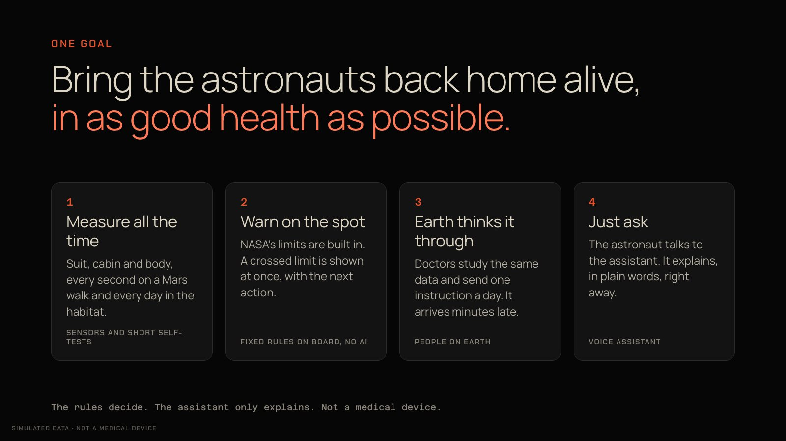
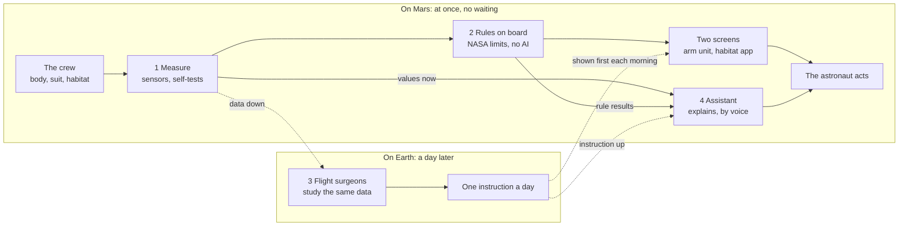
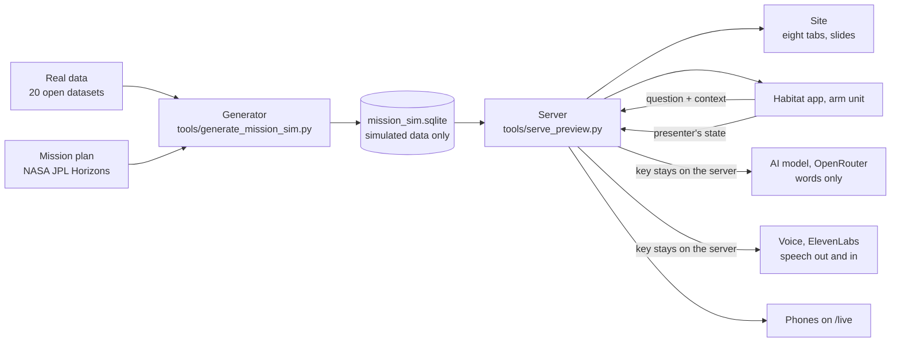
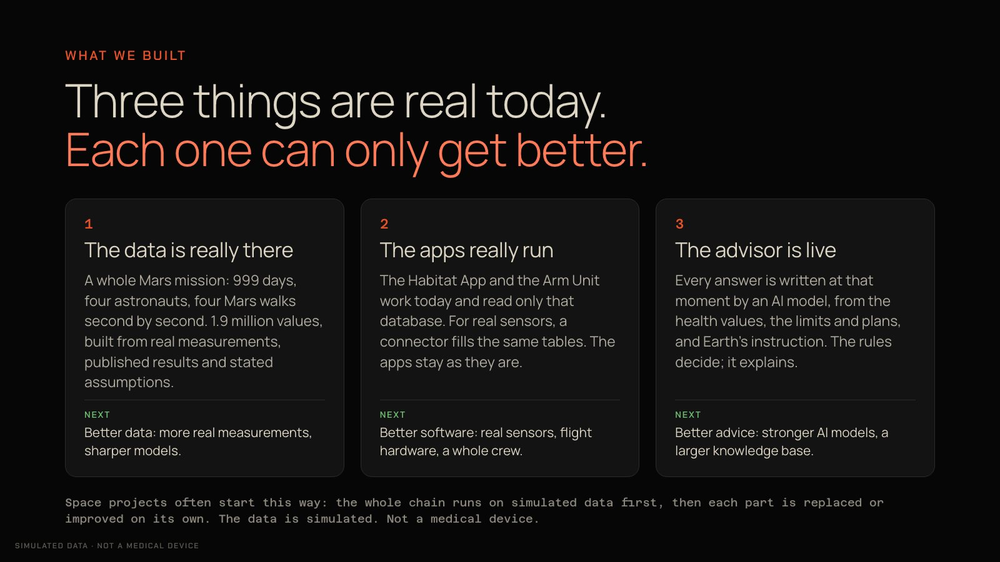

# Overview



> The whole project on one page: the goal, the idea, who decides what, how it is built, what is real, and where to look.

## 1. Purpose

**Everything works around one goal: bring the astronauts back home alive, in as good health as possible.**

On Mars a question to the doctor and its answer take up to 43 minutes, and for 12 days there is no link at all. A crew cannot wait that long. Our project is a health monitor for that crew: it measures all the time, warns on the spot, and lets the astronaut simply ask.

## 2. Scope

- **In:** one simulated 2037 Mars mission (999 days, four fictional crew members); two apps on it (an arm unit for Mars walks, a habitat app for every day); an assistant that explains, by text or voice; a site that explains the idea, the data and the simulation; a presentation mode with slides; a live view of the arm unit on the audience's phones.
- **Out:** real astronaut data, medical diagnosis, hardware. It is **not a medical device**: rules decide, the AI only explains. Uses on Earth (§4) are a vision, not built.
- **Challenge (likely; the final pick is the parent's):** *Create Health Monitoring Software for Astronauts on Space Missions*. Backup: *Build a Junior Astronaut Mission Trainer*.

## 3. How it works

### 3.1 The idea in four steps

1. **Measure all the time.** Suit, cabin and body: every second on a Mars walk, every hour and day in the habitat. Sensors and short self-tests.
2. **Warn on the spot.** NASA's limits are built in. A crossed limit is shown at once, with the next action. Fixed rules on board, no AI.
3. **Earth thinks it through.** Doctors study the same data and send one instruction a day. It arrives minutes late and shows its age.
4. **Just ask.** The astronaut talks to the assistant. It answers in plain words from today's values, the rule results and Earth's instruction.

### 3.2 The idea as blocks



The dotted lines are the radio link: 10 to 21.5 minutes each way during the stay on Mars, and 12 days of silence when the Sun stands between Mars and Earth (`04_mission_plan.md`).

### 3.3 Who decides what

| Part | Does | Never does |
|---|---|---|
| Rules on board | Raise and clear every warning. Set readiness. Say go or no-go for a Mars walk. Write tomorrow's plan | Use AI. Guess. Wait for Earth |
| Earth | Study the trends. Send one detailed instruction a day | Arrive in time for an emergency |
| Assistant | Explain and answer questions, by voice or on screen. Say where each statement comes from | Raise or clear an alarm. Diagnose. Invent a value |
| The astronaut | Decides and acts, with the crew medical officer for anything medical | Have to read pages of analysis |

### 3.4 How it is built



Nobody has flown to Mars, so the mission is simulated. One run of the generator turns real data and published results into one database file. The site, both apps and the assistant read only that file.

### 3.5 What is real today, and what comes next



The statement for the pitch (parent, 2026-11-14, D-21). Three things work today, and each can be improved on its own:

| | Real today | What comes next |
|---|---|---|
| **1. The data is really there** | A whole simulated mission, value by value: 999 days, four astronauts, four Mars walks second by second. Built from real measurements, published results, trends and stated assumptions. It is simulated data, and every value exists in the database | Better data: more real measurements, sharper models |
| **2. The apps really run** | The habitat app and the arm unit work and read only that database. To use real sensors and the astronaut's own measurements, a connector writes into the same tables and the same rules check them; the apps stay as they are. **The connector is not built; no real sensor is attached** | Better software: real sensors, flight hardware, a whole crew |
| **3. The advisor is live** | Every answer is written at that moment by an AI model from four things it is given: the health values, the limits and plans (rule results), Earth's instruction (simulated too) and the knowledge notes for whatever is flagged. The rules decide; the assistant explains (`09_assistant.md`) | Better advice: stronger AI models, a larger knowledge base |

Space projects often start this way: the whole chain runs on simulated data first, then each part is replaced or improved on its own.

**How much data** (counted in `data/sim/mission_sim.sqlite` on 2026-11-14; the Database tab counts the same numbers live under "How much data is this?"). A record is one row: one day, one hour or one second. A value is one filled field in it, not counting the keys.

| | Records | Values |
|---|---|---|
| Whole file, 22 tables (with rule results, plans, Earth's instructions) | 212,789 | |
| Measured values, whole mission (body, cabin and outside, Mars walks) | 164,143 | 1,906,335 (about 1.9 million) |
| One astronaut, 999 days (38 daily fields, 3 values every hour, a blood and urine panel every 28 days) | 25,317 | about 108,250 (108,223 to 108,269) |
| One astronaut, one day (average) | 25 | 108 |
| One mission day, all together (four astronauts plus cabin and outside) | 125 | 569 |
| Arm unit, Normal walk (day 181), 3 h 36 min | 12,936 | 457,740 |
| Arm unit, Fatigue rising (day 354), 2 h 28 min | 8,878 | 312,252 |
| Arm unit, Suit CO₂ high (day 481), 1 h 51 min | 6,667 | 234,169 |
| Arm unit, Radiation storm warning (day 622), 2 h 37 min | 9,419 | 333,566 |
| Arm unit, all four walks (one record a second, up to 37 values in each) | 37,900 | 1,337,727 |

## 4. Big picture: from Mars to Earth

> **A vision, not built.** Everything in §1–§3 is the Mars system on simulated data. This section says where the same approach could go next. Full version with settings, business model and roadmap: `../deliverables/strategy.md` §5.

On Mars a crew lives with a stream of health and environment data and no doctor at hand. Many people on Earth are in the same position: they wear and own more sensors than ever, yet often have no doctor, expert or direct support nearby. Examples: crews on polar stations, ships, offshore sites, mines and expeditions; people living alone and people who want to age healthily; people with a chronic condition between two doctor visits; villages and regions with few doctors. WHO counts about 4.6 billion people not fully covered by essential health services in 2023 ([WHO fact sheet](https://www.who.int/news-room/fact-sheets/detail/universal-health-coverage-%28uhc%29)) and projects a shortfall of 11 million health workers by 2030 ([WHO](https://www.who.int/health-topics/health-workforce)).

| Building block | On Mars (our design) | On Earth (vision) |
|---|---|---|
| One picture | Sensors plus the astronaut's own measurements on one dashboard | Wearables, home devices and workplace sensors plus the person's own measurements |
| Own normal | Each value against the astronaut's baseline | Each value against the person's baseline |
| Limits with a source | NASA-STD-3001 and published research | Clinical guidelines and occupational exposure limits |
| Rules act on the spot | Warning and next action, no AI | The same, up to "call your clinic" or emergency services |
| Expert advice, later | Earth's daily instruction from the flight surgeons | A clinician's or coach's asynchronous review |
| An assistant that explains | Never decides, names its source | The same |
| Learning from outcomes | Not built | Outcomes tracked, rules tuned toward better health, a person approves every change |

**Who would pay (vision):** operators of remote sites and occupational health services (B2B); care providers, telehealth platforms and insurers (B2B2C); individuals, as a longevity tier for general wellness. **First step:** a trial with a crew in isolation, which tests the Mars idea and the first Earth market at once.

**Honesty:** on Earth this would be decision support and self-care guidance that escalates to clinicians. Real medical use needs clearance as a medical device (EU MDR, FDA); the hackathon build is not one.

## 5. Where to look

| Tab (file in `mocks/`) | Answers | Spec |
|---|---|---|
| Overview (`index.html`) | What is the problem, what is the goal; at the end, From Mars to Earth (vision, §4) | `08_apps.md` |
| How it works (`system.html`) | The idea and the system as blocks, who decides what, one day step by step | this page, `01_architecture.md` |
| Mission (`mission.html`) | The planned 2037 mission: dates, signal delay, blackout, radiation | `04_mission_plan.md` |
| Risks (`risks.html`) | NASA's 22 health risks in three tiers | `08_apps.md` |
| Measures (`measures.html`) | The 76 values, each with its limit and source | `06_database_schema.md` |
| Data (`sources.html`) | The 20 datasets we chose: why, what we took, where it shows | `02_data_sources.md`, `03_reference_data.md` |
| Simulation (`simulation.html`) | How the mission is made: six steps, scenarios, checks | `05_simulation.md` |
| Database (`database.html`) | The simulated mission as one SQLite file, open to explore | `06_database_schema.md` |
| Habitat app (`habitat.html`) | Every day of the mission for one crew member | `08_apps.md`, `09_assistant.md` |
| Arm unit (`arm_unit.html`) | Every second of four Mars walks | `08_apps.md`, `09_assistant.md` |

Other parts: the server (`07_server_api.md`), the look (`10_design.md`, `design/`), what we hand in (`deliverables/README.md`), the team's link list (`/launch/`).

## 6. Run it

```sh
python3 -I tools/serve_preview.py     # http://127.0.0.1:8037/   (add ?present=1 for presentation mode)
```

## 7. What is real and what is simulated

| What | Label | Where it comes from |
|---|---|---|
| Mission dates, signal delay, blackout | COMPUTED (3 values) | NASA JPL Horizons |
| Radiation, storms, cabin air, Mars weather | REPLAY (11 values) | Real measurements, shown again on the matching mission day |
| Values a sensor would measure: heart rate, sleep, blood oxygen | SIM (45 values) | Generated from published results and shapes learned from real people |
| Estimates no sensor measures: bone density, stamina, readiness | MODEL (17 values) | Published rates and our stated assumptions |
| Warnings, readiness, plans, Earth's instruction | Rules | Fixed code in the generator, limits with a named source |
| The assistant's answers and its voice | AI | A language model and a synthetic voice, reached through our server |

All data is recorded history or simulated. Nothing is a live feed. Details: `11_provenance.md`.

## 8. Team

A parent (builds with AI coding agents; owner of every decision) and our 12-year-old co-designer (decides what looks good, names and draws, asks the questions a young astronaut would ask, tests on a phone). Under the Space Apps rules for minors he is never named, shown or heard in the submission.

## 9. Decisions and assumptions

See `13_decisions.md`. Key ones: rules decide and AI explains (D-01); one simulated mission instead of real body data (D-02); two apps on one mission (D-06); the one goal (D-15).

## 10. Open questions

- Final challenge choice.
- Demo format for the submission: 30-second video or up to 7 slides (only one is allowed).
- Team name, project name and logo (the co-designer's choice; working names Signal Crew and HealthSignal).
- The voice needs an ElevenLabs key in `.env`; without it nothing is spoken and answers stay on screen (`09_assistant.md`).

## 11. Change log

| Date | Change |
|---|---|
| 2026-11-13 | Created |
| 2026-11-14 | Rewritten around the one goal: the idea and the system as blocks, who decides what, where to look |
| 2026-11-14 | §3.5 added: what is real today (data, apps, advisor), what comes next, and how much data the mission holds |
| 2026-11-14 | §4 added: big picture, from Mars to Earth (vision: the blocks mapped 1:1, settings, who would pay, regulatory note); later sections renumbered |
