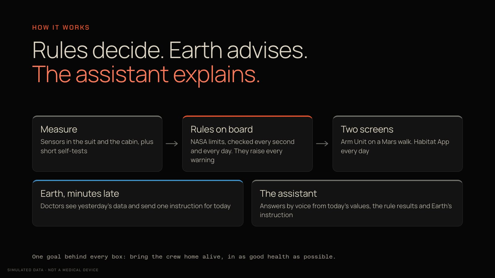
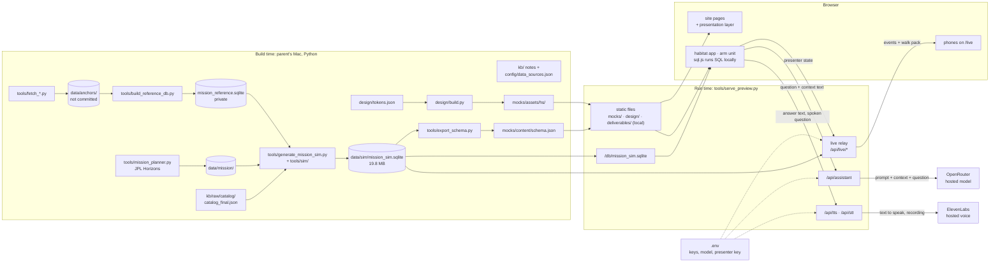

# Architecture



> The map of the whole system: which parts exist, where each runs, what it reads and writes, how it is hosted, how the AI model is reached, and what keeps the keys safe.

## 1. Purpose

This spec lets a person or an AI agent find their way around the project before changing it. It names every component with its code path, shows how data moves from research notes to a screen, and states the security rules that must hold after any change. Details live in the part specs; this page links to them.

## 2. Scope

- **In:** components, tech stack with versions, hosting (today and planned), the LLM setup, the security model, data flow, what works offline.
- **Out:** the content of the data sources ([`02_data_sources.md`](02_data_sources.md)), the reference data ([`03_reference_data.md`](03_reference_data.md)), the mission plan ([`04_mission_plan.md`](04_mission_plan.md)), the generator ([`05_simulation.md`](05_simulation.md)), table columns ([`06_database_schema.md`](06_database_schema.md)), every server route ([`07_server_api.md`](07_server_api.md)), page behaviour ([`08_apps.md`](08_apps.md)), prompts ([`09_assistant.md`](09_assistant.md)), the look ([`10_design.md`](10_design.md)).

## 3. How it works

### 3.1 System diagram



### 3.2 Data flow from research to screen

1. **Research.** Notes in `kb/`; every candidate source is registered in `config/data_sources.json` and tested by `tools/check_sources.py` ([`02_data_sources.md`](02_data_sources.md)).
2. **Real data.** The fetch tools download historical datasets to `data/anchors/`. `tools/build_reference_db.py` turns them into `data/reference/mission_reference.sqlite`. Three body datasets in it may not be redistributed, so it stays private (`.gitignore`) ([`03_reference_data.md`](03_reference_data.md)).
3. **Mission plan.** `tools/mission_planner.py` computes dates, light delay and the blackout from JPL Horizons into `data/mission/` ([`04_mission_plan.md`](04_mission_plan.md)).
4. **Simulation.** `tools/generate_mission_sim.py` (code in `tools/sim/`) reads the reference database, the plan and `kb/raw/catalog/catalog_final.json`. It writes `data/sim/mission_sim.sqlite` and `data/sim/SUMMARY.json`. Seed 2037, about 3 seconds. The generator also computes every rule result, the plan, Earth's instruction and the walk states ([`05_simulation.md`](05_simulation.md), [`06_database_schema.md`](06_database_schema.md)).
5. **Serving.** `tools/serve_preview.py` sends the database file as it is (19.8 MB, about 3.0 MB gzip-compressed, measured 2026-11-13).
6. **Reading.** In the browser, `mocks/assets/simdb.js` loads sql.js and the whole database, then each page runs plain SQL against it. Pages only show results; they decide nothing.
7. **Asking.** `mocks/assets/assistant.js` builds a text context from the database for the chosen moment. The server adds the instructions and calls OpenRouter. Without a model, the browser builds a short briefing by rules ([`09_assistant.md`](09_assistant.md)).
8. **Speaking and listening.** The answer text goes to `POST /api/tts`; the server calls ElevenLabs and returns the audio. A spoken question is recognised by the browser, or recorded and sent to `POST /api/stt`. Without the voice service nothing is spoken and the answer stays on screen ([`09_assistant.md`](09_assistant.md) §4.5).
9. **Live view.** The presenter's arm unit posts its state to the server; phones receive it as server-sent events and load a small per-walk pack instead of the database ([`07_server_api.md`](07_server_api.md)).
10. **Presenting.** For the presenter, `mocks/assets/nav.js` loads `bodyfig.js`, `slides.js`, `sr1.js` and `present.js`: a Present switch, one to three slides per tab, the QR code and the Live switch for the phones ([`08_apps.md`](08_apps.md) §4.5).

### 3.3 What runs offline

| Part | Without internet | Why |
|---|---|---|
| Generator | Works | Reads local files only |
| Server, site, both apps, rule results, rule-built briefing | Work | sql.js and the database are local |
| AI answers | Fail, page falls back to the rule-built briefing | OpenRouter is a hosted service |
| Fonts | Pages that load `assets/site.css` use the local `.woff2` files; `arm_unit.html`, `habitat.html` and `mission.html` do not load it and fall back to system fonts unless the fonts are installed | Every page also links Google Fonts |
| Voice output | No fallback voice: the answer is shown on screen | The assistant's voice is ElevenLabs, a hosted service |
| Voice input | Probably fails | The pages use the browser's speech recognition; in Chrome this normally runs on Google's servers (not verified for the current Chrome version). The fallback, a recording sent to `/api/stt`, needs ElevenLabs |
| Phones on `/live` | Need a network path to the server | Tunnel or hosted address |
| Pages opened as `file://` | Only `index.html`, `mission.html` and `risks.html` work | Browsers block a `file://` page from fetching the database; `simdb.js` then shows a banner |

## 4. Interfaces

### 4.1 Components

| Component | Code path | Language / tech | Runs where | Reads | Writes |
|---|---|---|---|---|---|
| Source registry and checks | `config/data_sources.json`, `tools/check_sources.py`, `tools/data_explorer.py` | Python, `certifi` | Parent's Mac | Public APIs, keys from `.env` | `kb/raw/source_status.md`, `data/explorer/` |
| Dataset downloads | `tools/fetch_anchor_datasets.py`, `tools/fetch_environment_history.py`, `tools/fetch_body_datasets.py` | Python; the body fetch also uses `numpy`, `pandas`, `openpyxl` | Parent's Mac | Public archives | `data/anchors/` (not committed) |
| Reference database | `tools/build_reference_db.py` | Python, `sqlite3` | Parent's Mac | `data/anchors/` | `data/reference/mission_reference.sqlite` (private) |
| Mission planner | `tools/mission_planner.py` | Python, `numpy` | Parent's Mac | JPL Horizons | `data/mission/` (`mission_plan.json`, `mission_calendar.csv`, `mission_plan.html`) |
| Mission generator | `tools/generate_mission_sim.py`, `tools/sim/` (`base`, `learn`, `env`, `body`, `rules`, `story`, `eva`) | Python, `numpy` | Parent's Mac | Reference database, `data/mission/`, `kb/raw/catalog/catalog_final.json` | `data/sim/mission_sim.sqlite`, `data/sim/SUMMARY.json` |
| Design build | `design/build.py` | Python, Pillow, python-pptx | Parent's Mac | `design/tokens.json` | `design/tokens.css`, `design/templates/slides.*`, copies in `mocks/assets/hs/` |
| Risk content embed | `mocks/content/embed_risks.py` | Python stdlib | Parent's Mac | `mocks/content/risks.json` | Inline block in `mocks/risks.html` |
| Preview server | `tools/serve_preview.py` | Python stdlib, optional `certifi` | Mac today; VPS containers planned | `mocks/`, `design/`, `deliverables/` (local only), the database, `.env` | Nothing on disk. Live state in memory, access log on stderr |
| Content pages | `mocks/index.html`, `system.html`, `mission.html`, `risks.html`, `measures.html`, `sources.html`, `simulation.html`, `database.html`, `context.html` | HTML, CSS, vanilla JS, inline SVG | Browser | Database (measures, sources, simulation, database, context), `content/schema.json` (database), or inline text and data (index, system, mission, risks) | Nothing |
| Schema export | `tools/export_schema.py` | Python stdlib | Parent's Mac | `SCHEMA` in `tools/sim/base.py`, the database | Generated part of `docs/06_database_schema.md`, `mocks/content/schema.json` |
| Habitat app | `mocks/habitat.html` | Vanilla JS, SVG, sql.js | Browser (a desk or wall screen in the story) | Database, `/api/assistant` | URL only |
| Arm unit | `mocks/arm_unit.html` | Vanilla JS, SVG, Web Audio, sql.js | Browser (a forearm screen in the story) | Database, `/api/assistant`, `/api/live/*` | Presenter: `POST /api/live/publish`; `sessionStorage` (`presenterKey`, `hs.liveState`, `hs.liveOn`); `localStorage.liveUrl` |
| Live audience view | `/live` (the arm unit page in audience mode) | Vanilla JS, `EventSource` | Phones | `/api/live/pack`, `/api/live/events`, `/api/live/state`, `/api/live/time` | Nothing |
| Shared browser modules | `mocks/assets/simdb.js`, `assistant.js`, `nav.js`, `site.css` | JS, CSS | Browser | Database; `/api/assistant`, `/api/tts`, `/api/stt` (assistant) | Nothing |
| Presentation layer | `mocks/assets/present.js`, `slides.js`, `sr1.js`, and the body figure `bodyfig.js` shared with the habitat app (loaded by `nav.js` for the presenter only) | Vanilla JS | Presenter's browser | `/api/health`, `/api/live/key`, `/api/live/info` | `localStorage["hs.present"]`; re-posts the stored live state to `/api/live/publish` |
| Team link list | `launcher/index.html` at `/launch/` | Plain HTML | Trusted browsers | `/api/launch/info`, `/api/health`, `/api/live/info` | Nothing |
| Assistant model | OpenRouter, default `anthropic/claude-haiku-5.5` | Hosted LLM | OpenRouter's cloud | Prompt, context, question, last 6 turns | Answer text |
| Assistant voice | ElevenLabs: text to speech (`eleven_v4` first) and speech to text (`scribe_v3` first) | Hosted voice service | ElevenLabs' cloud | The answer text to speak; a recording of the question | Audio (MP3); the recognised text |

### 4.2 Tech stack

| Layer | What | Version (where the code or this Mac shows it) |
|---|---|---|
| Python | All tools and the server | 3.12.3 on the parent's Mac (2026-11-13). The server needs at least 3.9 (`str.removeprefix`). No `requirements.txt` or lock file |
| Server modules | `http.server` (`ThreadingHTTPServer`, `BaseHTTPRequestHandler`), `argparse`, `gzip`, `hashlib`, `hmac`, `ipaddress`, `json`, `mimetypes`, `os`, `pathlib`, `queue`, `secrets`, `sqlite3`, `ssl`, `sys`, `threading`, `time`, `urllib.request`, `urllib.parse`, `urllib.error` | Stdlib |
| Third-party Python | `certifi` (CA bundle for python.org builds on macOS; optional in the server) | 2024.02.02 |
| | `numpy` (generator, planner, body fetch) | 1.26.4 |
| | `pandas`, `openpyxl` (body fetch only) | Not pinned |
| | Pillow, python-pptx (design build only) | 12.3.0, 1.0.2 |
| Database | SQLite file, one per mission run | Built by Python `sqlite3` |
| SQLite in the browser | sql.js (SQLite compiled to WebAssembly), `mocks/vendor/sqljs/`, MIT, with `SHA256SUMS` | 1.13.0 |
| QR code | qrcode-generator, `mocks/vendor/qrcode/qrcode.js`, MIT, loaded only when the presenter opens the QR screen | 1.4.4 |
| Front end | Plain HTML, CSS custom properties, vanilla JavaScript. No framework, no npm, no build step. All charts are hand-drawn inline SVG | n/a |
| Browser APIs | `fetch`, `EventSource`, Web Audio, `Audio` element, Web Speech (`SpeechRecognition` / `webkitSpeechRecognition` for listening only, language `en-GB`), `getUserMedia` and `MediaRecorder` (recording fallback), Fullscreen, Screen Orientation lock, Wake Lock, `sessionStorage`, `localStorage` | n/a |
| Presenter remote | `mocks/assets/sr1.js`: the SR-1 key mappings of a Logitech Spotlight remote (a copy of the parent's drop-in script) | n/a |
| Fonts | Manrope 300/400/600, Chakra Petch 600, Azeret Mono 500 (SIL OFL). Local `.woff2` in `mocks/assets/hs/fonts/` via `hs/tokens.css`; every page also links the Google Fonts stylesheet | Files from `design/fonts/` |
| Design tokens | `design/tokens.json` → `design/build.py` → `design/tokens.css`, `mocks/assets/hs/tokens.css` | v0.1 (`design/README.md`) |

### 4.3 Hosting

| | Today | Planned (D-07, `kb/24` §3b, `kb/10`) |
|---|---|---|
| Where | The parent's Mac: `http://127.0.0.1:8037/` | The parent's VPS, two containers |
| Site | Same process | Container 1, address `healthsignal.space` |
| Live stream | Same process | Container 2, address `live.healthsignal.space`, started with `--host 0.0.0.0 --public-url https://live.healthsignal.space` and a fixed `LIVE_PRESENTER_KEY` |
| Public access | None. Demo fallback: `ngrok http 8037` on the laptop and `--public-url` with the tunnel address | Cloudflare tunnels (`cloudflared`). The domain was bought at Cloudflare on 2026-11-11 |
| Process model | One process, threads | One process per container: the live state is held in memory and cannot be shared between workers |
| Status | Works | **Planned, not built.** No Dockerfile, compose file, tunnel configuration or dependency file in the repository. Tunnels not created. Not tested with real phones |

Each container needs `tools/serve_preview.py`, `mocks/`, `design/`, the prebuilt `data/sim/mission_sim.sqlite` and its environment variables. It does not need the reference database. Both containers run the same server code, so both serve the whole site and both have a live relay.

**Now (2026-11-14): always on, tailnet only.** The preview server runs all the time on the parent's Mac (LaunchAgent `space.healthsignal.preview`) and is reachable from the owner's Tailscale devices at `https://<machine>.<tailnet>.ts.net:8037` (Tailscale Serve, HTTPS, tailnet only); the start page for the team is `/launch/`. Details and the trust rule: `07_server_api.md` §4.5b. The public hosting below is still the plan for the submission.

### 4.4 LLM setup

| Item | Value | Source in code |
|---|---|---|
| Provider | OpenRouter, `https://openrouter.ai/api/v1/chat/completions` (OpenAI-compatible chat API) | `ask_model()` in `tools/serve_preview.py` |
| Key | `OPENROUTER_API_KEY` from `.env`, else the process environment | `KEY` |
| Model | `OPENROUTER_MODEL` from `.env`, else the environment, else `anthropic/claude-haiku-5.5`. Chosen for speed: a spoken answer came back in 1.6 s in a test on 2026-11-14; `anthropic/claude-sonnet-5.5` took 3.6 s | `MODEL` |
| Call | One non-streaming request per question: `temperature` 0.3, `max_tokens` 600, timeout 60 s, header `X-Title: Mars crew health preview`. An answer cut off by the token limit is shortened to its last whole sentence | `ask_model()` |
| Reported model | The `model` field of OpenRouter's reply, shown in the apps | `ask_model()` |
| Unused variable | `ANTHROPIC_API_KEY` is listed in `.env.example` but nothing in the server reads it | `.env.example` |
| Build-time AI | Claude Code on the parent's subscription wrote code, content and docs. It ships as static files and costs nothing at run time (D-01) | `12_ai_usage_log.md` |

The screenshots of 2026-11-11 show "AI connected: claude-sonnet-4.5", the default at that time. Prompts, context and guardrails: [`09_assistant.md`](09_assistant.md).

### 4.4b Voice setup

| Item | Value | Source in code |
|---|---|---|
| Provider | ElevenLabs, `https://api.elevenlabs.io` (`ELEVENLABS_API_BASE` overrides) | `el_call()` in `tools/serve_preview.py` |
| Key | `ELEVENLABS_API_KEY` from `.env`, else the process environment. Sent only in the `xi-api-key` header to ElevenLabs | `EL_KEY` |
| Voice | `ELEVENLABS_VOICE_ID` if set; else the deepest-sounding male English voice of the account, picked from `GET /v2/voices`; else a fixed fallback id | `el_voice()` |
| Speech model | `ELEVENLABS_MODEL` if set, then `eleven_v4`, `eleven_v3`, `eleven_multilingual_v2`: the first that answers is kept | `speak()` |
| Recognition model | `ELEVENLABS_STT_MODEL` if set, then `scribe_v3`, `scribe_v2` | `transcribe()` |
| Without a key | `/api/tts` and `/api/stt` reply 503; nothing is spoken, answers stay on screen | `voice()` |
| Status | Tested on 2026-11-14 against a local stand-in for the ElevenLabs API. **Not yet tested against the real service: `.env` holds no ElevenLabs key** | [`07_server_api.md`](07_server_api.md) §8 |

### 4.5 Security model

**Keys stay on the server.** The server reads `.env` once at start. The OpenRouter key goes only into the `Authorization` header of the call to OpenRouter, the ElevenLabs key only into the `xi-api-key` header of the call to ElevenLabs. Neither is ever sent to a browser or printed. Error replies name only the exception type, never the request or the key.

**What can be read through the server** (checked on 2026-11-13 against a local instance):

| Reachable | Not reachable |
|---|---|
| Files in `mocks/` with an allowed extension (`.html .css .js .json .png .svg .wasm .ico .txt .woff2 .jpg .webp .pptx .pdf`) | `.env` and any path part starting with a dot |
| Files in `design/` with an allowed extension, under `/design/` (default `styleguide.html`) | Anything outside `mocks/`, `design/`, `deliverables/` and the database: `kb/`, `tools/`, `data/reference/`, `config/` |
| Files in `deliverables/` under `/deliverables/` (default `board.html`), **only for a browser on the same machine** | Files with other extensions, such as `.py`, `.md`, `.ttf`, `SHA256SUMS`, `LICENSE` |
| `data/sim/mission_sim.sqlite` at `/db/mission_sim.sqlite` | Path tricks (`/../.env`, `/%2e%2e/.env`): the resolved path must stay inside its base folder |
| The `/api/...` routes in [`07_server_api.md`](07_server_api.md) | |

**Trust levels.**

- *Trusted local:* a browser on the same machine talking to the server directly. The client address must be `127.0.0.1` or `::1`, the `Host` must be `127.0.0.1` or `localhost`, and no forwarding header may be present (`X-Forwarded-*`, `Forwarded`, `X-Real-Ip`, `Cf-Connecting-Ip`, `Cf-Ray`, `True-Client-Ip`, `Via`, `Ngrok-Trace-Id`). A tunnel also connects from `127.0.0.1`, which is why the headers are checked.
- *Exposed:* the server was started with `--public-url` or with a `--host` other than loopback. Then nothing is trusted local.
- *Tailnet:* a device on the owner's Tailscale network, through Tailscale Serve. Counts as trusted too ([`07_server_api.md`](07_server_api.md) §4.5b). "Trusted" below means trusted local or tailnet.
- *Presenter:* the request carries the presenter key in `X-Presenter-Key`. It is compared with `hmac.compare_digest`.

**Presenter key.** `LIVE_PRESENTER_KEY` from `.env` or the environment, else a random `secrets.token_urlsafe(16)` made at each start. The server prints it once inside the presenter link, after `#key=`. Browsers never send the part after `#`, so it does not appear in requests or access logs. The page moves it to `sessionStorage` and removes it from the address bar. A trusted local browser can also fetch it from `/api/live/key`.

**Rules.**

| Action | Allowed for |
|---|---|
| AI answers (`/api/assistant`, and `ai: true` in `/api/health`) | Trusted, or presenter. Visitors of a public server get the rule-built briefing, so they cannot spend AI credits |
| The assistant's voice (`/api/tts`, `/api/stt`, and `voice: true` in `/api/health`) | Trusted, or presenter. Visitors without their own key get no voice, so they cannot spend our voice credits |
| The Present switch and the presentation layer | Trusted, or presenter (`presenter: true` in `/api/health`). Anyone can switch on the slides with `?present=1`; the live stream still needs the key |
| Publishing the live state | Presenter only, also on the local machine |
| `/deliverables/`, `/launch/`, `/dash/*`, `/docs/*` | Trusted only (404 otherwise) |
| Any POST | Same origin only: if an `Origin` header is sent, its host must equal `Host` |
| Static files, database, live events, packs | Everyone who can reach the server |

**Limits.** AI: 20 questions per 60 s for the whole server; body at most 42,000 bytes; question cut to 600 characters, context to 30,000, history to the last 6 turns of 1,500 characters. Voice: 40 calls per 60 s for the whole server; text cut to 1,500 characters; a recording of 500 bytes to 8 MB; the last 80 spoken clips are kept in memory, so reading the same text again costs nothing. Live: 30 publishes per second, state at most 6,000 bytes, 600 open phone streams, 50 queued messages per phone. Details: [`07_server_api.md`](07_server_api.md).

**Headers.** Files get `X-Content-Type-Options: nosniff` and `Cache-Control`. There is no Content Security Policy. TLS comes from the tunnel.

**Personal data.** The crew is fictional. There is no analytics or cookie. Visitors' browsers do request the Google Fonts stylesheet, which sends their address to Google. A spoken question is real audio of the person asking: the browser's speech recognition sends it to the browser maker's service, and the recording fallback sends it through our server to ElevenLabs. Our server stores no recording.

## 5. Run it

```sh
python3 -I tools/generate_mission_sim.py   # rebuild the database (needs the private reference database)
python3 -I tools/serve_preview.py          # http://127.0.0.1:8037/ ; prints the presenter link
python3 -I design/build.py                 # after a change to design/tokens.json
python3 -I mocks/content/embed_risks.py    # after a change to mocks/content/risks.json
```

Never serve the project root with a plain static server: it would expose `.env`.

## 6. Data and provenance

| What | Label | Source |
|---|---|---|
| Every value in the apps | REPLAY, SIM, MODEL or COMPUTED, per `variable.kind` (11, 45, 17 and 3 of 76) | Generator ([`05_simulation.md`](05_simulation.md), [`11_provenance.md`](11_provenance.md)) |
| Rule results, plan, Earth's instruction, walk states | SIM (made by rules in the generator) | `tools/sim/rules.py`, `tools/sim/story.py`, `tools/sim/eva.py` |
| Assistant answers | AI | OpenRouter model, from the context text |
| Rule-built briefing | Rules, no AI | `Assistant.briefing()` in `mocks/assets/assistant.js` |
| Mission dates, delay, blackout | COMPUTED | JPL Horizons via `tools/mission_planner.py` |

No live data reaches the apps. Everything a page shows comes from the one database file or from text written into the page.

## 7. Decisions and assumptions

- Rules decide, AI only explains; runtime AI only through a server-side proxy, keys never in the browser (`13_decisions.md`, D-01).
- Two apps on one simulated mission (D-06).
- Hosting on the parent's VPS behind Cloudflare tunnels, domain `healthsignal.space` (D-07).
- Live audience view on phones (D-08).
- One token source for site, apps, slides and video (D-12).
- Assumption: a laptop browser can load the 19.8 MB database at once; phones cannot, so they get per-walk packs.
- Assumption: one presenter and a few dozen phones at a time. The global AI rate limit and the in-memory relay are sized for that, not for public traffic.

## 8. Open questions

1. **Hosting is not built.** No Dockerfile, compose file, `cloudflared` configuration or `requirements.txt` exists. The two addresses and the stream through a Cloudflare tunnel are untested (`kb/24` §3b).
2. **Two containers, one program.** Both containers would run the full server. The presenter page publishes to a relative `api/live/publish`, so the presenter link must be opened on `live.healthsignal.space`, and that container needs `OPENROUTER_API_KEY` for AI answers during the demo. The site container would also expose an idle `/live`. Decide: one container or two, and which keys go where.
3. **Stale hosting line in `kb/10`.** One item still names an older hosting idea; the next item and `kb/24` say `healthsignal.space` (D-07).
4. **Fonts.** `kb/24` §5 says the site loads fonts from Google Fonts and needs internet once. Since the design module (2026-11-13) local fonts ship in `mocks/assets/hs/fonts/`, but every page still links Google Fonts, and `arm_unit.html`, `habitat.html` and `mission.html` do not load `site.css`. Remove the Google link and load the local fonts everywhere: works offline and sends no visitor address to Google.
5. **Rebuilding the database needs private data.** The generator reads `data/reference/mission_reference.sqlite`, which is git-ignored and may not be published. A fresh clone or the VPS cannot regenerate the mission; they need the prebuilt `mission_sim.sqlite`. `data/sim/` is not in `.gitignore`, so the 19.8 MB file would be committed. Confirm this is intended (`14_publishing.md` is not written yet).
6. **No dependency list.** `numpy` is required by the generator; `certifi`, Pillow, python-pptx, `pandas` and `openpyxl` by other tools. Nothing pins them.
7. **"On board" wording versus a hosted model. Partly closed 2026-11-14:** the habitat app's badge now says "DEMO" with a tooltip that names the cloud model, and `system.html` says the same in its last line. Still open: `index.html` says "A voice assistant running on board"; the habitat app's badge says "ON BOARD" with the tooltip "Runs on the habitat computer". The model actually runs at OpenRouter. `kb/16` and `kb/24` §4.4 ask for an honest label such as "in the mission: an on-board model; in this demo: a hosted model".
8. **Default model is being retired. Closed 2026-11-14:** the default is now `anthropic/claude-haiku-5.5`, tested through OpenRouter. Before: the model reference in Claude Code (cached 2026-11-03) lists Claude Sonnet 4.5 as deprecated, retiring 2026-11-30. Global judging happens after that date. Set `OPENROUTER_MODEL` explicitly to a current model and test it before submission. Whether OpenRouter keeps the old name working is unknown.
9. **Inline token copies.** `arm_unit.html`, `habitat.html` and `mission.html` carry their own copy of the colour tokens instead of `assets/hs/tokens.css` (`design/README.md` §5).
10. **Source counts differ. Closed 2026-11-14:** `mocks/sources.html` now shows the chain: 57 sources looked at, 40 datasets collected, 20 used. Before: `index.html` says "20 open datasets in use, of 40 collected" (from table `source_use`); `CLAUDE.md` speaks of 57 registered sources in `config/data_sources.json`. Both may be right for different lists; [`02_data_sources.md`](02_data_sources.md) should explain.
11. **Doc tooling is missing. Closed:** `tools/check_docs.py` and the `sync-docs` skill exist. Before: `docs/README.md` refers to `tools/check_docs.py` and a `sync-docs` skill in `.claude/skills/`; neither exists yet.
12. **Voice is untested against the real service.** No ElevenLabs key is in `.env`. Whether `eleven_v4` answers on the standard text-to-speech route for our account is unknown; the server falls back by itself. Add the key and test both apps before the pitch.

## 9. Change log

| Date | Change |
|---|---|
| 2026-11-13 | Created from the code and notes of 2026-11-11 to 2026-11-13, including the `/deliverables/` route added on 2026-11-13 |
| 2026-11-14 | Always-on service and tailnet access added to hosting |
| 2026-11-14 | Body figure as one shared drawing (`mocks/assets/bodyfig.js`) for the habitat app and the slides |
| 2026-11-14 | Voice (ElevenLabs, server-side), new default model, presentation layer, new pages (`system.html`, `simulation.html`, `database.html`), schema export for the site; four open questions closed or narrowed |
