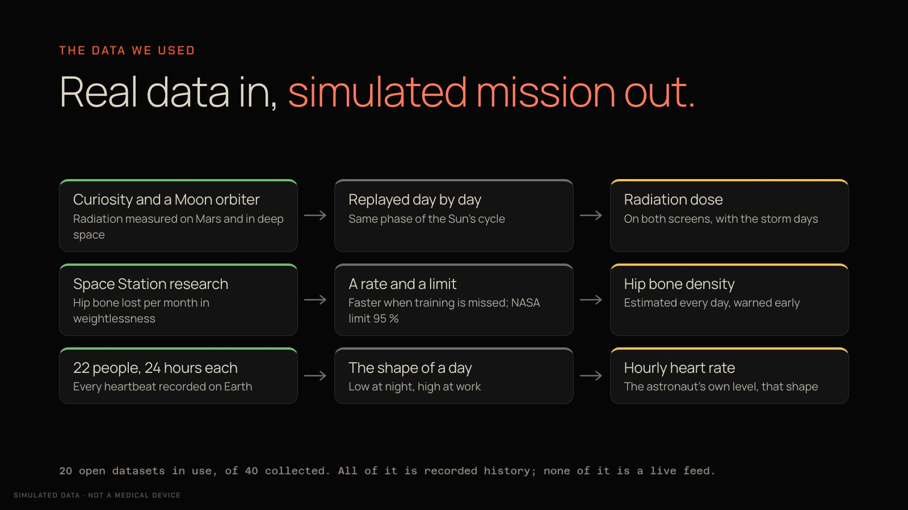
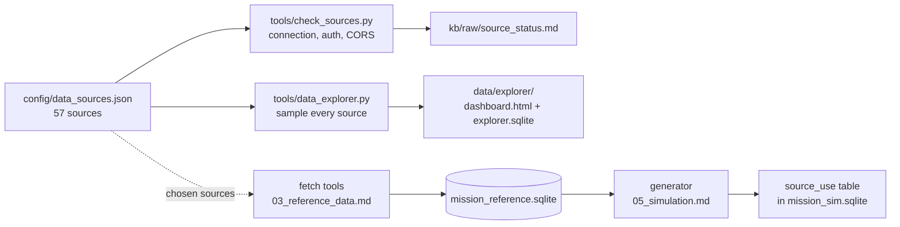

# Data sources



> The registry of every data source we tested, how it is checked and explored, and the short list of sources the simulated mission actually uses, with owner, licence and whether we may pass the data on.

**What the site shows (since 2026-11-14).** Only the data we chose. The Data tab (`mocks/sources.html`) lists the 20 sources the simulation uses: what each is, why we chose it, what we took from it and which values it feeds. It reads the table `source_use`; the "why" and "what we took" texts are hand-written in the page (`WHY`). Four worked chains show the way from a real measurement to a value on the screen: radiation (replayed), bone density (modelled), heart rate through a day (a shape learned), reaction speed (a size learned). The page gives the funnel: 57 sources looked at, 40 datasets collected, 20 used, 76 simulated values. The registry of 57 sources and the explorer dashboard (4.1 to 4.4, `/dash/explorer`, team only) are our research notebook. They are not part of the product and not linked from the site.

## 1. Purpose
The project shows a simulated Mars mission built on real measurements. Judges, the submission form and anyone reusing the code need to know which real data sits behind each number, who owns it, and what its licence allows. This spec is that list. It also tells an AI agent where to add a new source and which data must never be published.

## 2. Scope
- In: the registry `config/data_sources.json`; the connection check (`tools/check_sources.py`); the planning dashboard (`tools/data_explorer.py`); the sources used by the simulated mission; licence flags; the NASA and non-NASA split for the submission.
- Out: how the history is downloaded and stored (`03_reference_data.md`); how the generator uses it (`05_simulation.md`); the mission dates (`04_mission_plan.md`); what goes into the public repository (`14_publishing.md`).

## 3. How it works

1. Every source we considered is one entry in the registry, with a test URL and a planning profile.
2. `check_sources.py` calls each test URL and writes a status table.
3. `data_explorer.py` saves a real sample of each source and builds an offline dashboard, so we can decide what to use.
4. The sources we chose are downloaded in full by the fetch tools and loaded into the reference database (`03_reference_data.md`).
5. The generator records, for every reference dataset, how it was used (or `not used`) in the table `source_use` of `mission_sim.sqlite`.

## 4. Interfaces

### 4.1 The registry: `config/data_sources.json`
Top-level keys: `_about`, `categories` (11), `sources` (57), `profile_codes` (meaning of the codes below).

| Field | Meaning | Values today |
|---|---|---|
| `id` | Unique id, used by all tools | e.g. `msl_rad_pds` |
| `name`, `provider` | What it is and who runs it | |
| `category` | Topic | `radiation_spaceweather` 19, `health_human` 8, `evidence_literature` 6, `crew_context` 4, `earth_context` 4, `credentials` 4, `catalog_discovery` 3, `visual_3d` 3, `iss_environment` 2, `ephemeris_comms` 2, `mars_moon_env` 2 |
| `auth` | Credential needed | `none` for 49 sources; others name a variable in `.env` (`NASA_API_KEY`, `NCBI_API_KEY`, `FIRMS_MAP_KEY`, `EARTHDATA_TOKEN`, `OPENROUTER_API_KEY`) |
| `test` | `method`, `url`, `expect`: the call the check makes. `{VAR}` placeholders are filled from `.env` | |
| `browser_direct` | Whether a browser may call it directly (CORS) | `true` or `false` |
| `relevance` | For the health challenge | `H` 17, `M` 26, `L` 14 |
| `use` | What we would use it for | text |
| `docs` | Documentation link (13 sources) | URL |
| `profile.live` | How fresh it is | `ARCHIVE` 12, `SEARCH` 10, `NEAR-RT` 9, `STATIC` 8, `LIVE` 6, `PERIODIC` 5, `KEY` 4, `COMPUTE` 2, `TILES` 1 |
| `profile.access` | How to get it | `WHOLE`, `FILES`, `WINDOW`, `PAGED`, `STREAM`, `TILES`, `LIB`, `KEY` |
| `profile.store` | Storage class (4.2) | `TS` 18, `TABLE` 14, `NONE` 8, `EVENT` 7, `DOC` 6, `FILE` 4 |
| `profile.cadence`, `coverage`, `volume`, `how`, `limits`, `extract` | Planning facts in words | |
| `profile.twin_use` | What it feeds in the mission (`environment:`, `body:`, `mission:`, `knowledge:`, `context:`, `none:`) | text |

### 4.2 Storage classes (`profile.store`)
Rule: numbers with a time or a subject go into SQLite; documents stay files (`kb/23` §2).

| Class | Meaning | Where it lives | Sources |
|---|---|---|---|
| `TS` | Time series | SQLite table `obs` (one row per time and value) | 18 |
| `EVENT` | Event list | SQLite table `event` (start, peak, end, size) | 7 |
| `TABLE` | Records or measurements | Own SQLite table (for people: `subject_obs`) | 14 |
| `DOC` | PDFs, papers, pages | Files; SQLite `document` holds only an index | 6 |
| `FILE` | Images, 3D models | Files only | 4 |
| `NONE` | Nothing to store (library, map tiles, credential check) | – | 8 |

### 4.3 Checking: `tools/check_sources.py`
- Calls every test URL with the credentials from `.env` (never printed) and reports status, HTTP code, latency, browser CORS, and live ISS values where available.
- Writes `kb/raw/source_status.md` (human) and `config/source_status.json` (machine).
- **Last written 2026-11-03**, when the registry had 41 sources: 39 OK, 2 FAIL (DONKI). It has not been re-run since the registry grew to 57 (see Open questions).

### 4.4 Exploring: `tools/data_explorer.py`
- Fetches a real sample of every source, normalises it into `data/explorer/explorer.sqlite` (tables `source`, `call`, `dataset`, `field`, `sample_row`, `observation`, `event`, `document`) and writes the offline page `data/explorer/dashboard.html`. Raw samples go to `data/explorer/samples/<id>/` (git-ignored; data only, never execute).
- Latest run 2026-11-10 (all 57 sources): 53 OK, 3 WARN, 1 FAIL. WARN: DONKI flare endpoint returns 404; ISS Live partial pressures (including ppCO₂) unchanged for more than 24 h; Mars raw images 4.4 days old. FAIL: the keyless DONKI host (no route).
- `--offline` rebuilds the page from saved samples without network (for the venue).

### 4.5 Sources the simulated mission uses
"Label" says how the data shows up in the mission (`11_provenance.md`). The simulation's own label per value is in `variable.kind` (`06_database_schema.md`). "Redistributable" means we may pass on the raw data in the public repository.

**NASA data** (submission field "NASA Data")

| Source (registry id / dataset id) | Owner | URL | What we take | Licence | Redistributable | Label |
|---|---|---|---|---|---|---|
| JPL Horizons (`jpl_horizons`) | NASA JPL | https://ssd.jpl.nasa.gov/horizons/ | Daily Earth and Mars positions 2026–2052 → mission dates, calendar, signal time, Sun angle, Mars season | Public domain | yes | REAL (computed astronomy; `COMPUTED` in the database) |
| MSL RAD, Curiosity (`msl_rad_pds` / `msl_rad`) | NASA PDS PPI | https://pds-ppi.igpp.ucla.edu/data/MSL-M-RAD-3-RDR-V1.0/ | Daily surface dose on the replayed day (variation on Mars); the hourly record of 2017-09-10 to 2017-09-13 as the storm curve | Public domain | yes | REPLAY |
| LRO CRaTER (`lro_crater_pds` / `crater`) | NASA PDS PPI, Univ. of New Hampshire | https://pds-ppi.igpp.ucla.edu/data/lro-crater/data-der-hk/ | Day-to-day dose variation and storm days in deep space. Our own derivation from housekeeping counters: used for variation, not absolute dose | Public domain | yes | REPLAY |
| OMNI2 proton flux (`omni_hapi` / `omni`) | NASA SPDF | https://cdaweb.gsfc.nasa.gov/hapi/info?id=OMNI2_H0_MRG1HR | Daily maximum flux above 10 MeV on the replayed day → storm level in deep space | Public domain; acknowledge OMNIWeb | yes | REPLAY |
| DONKI solar particle events (`donki_api_nasa` / `donki_sep_events`) | NASA CCMC | https://api.nasa.gov/DONKI/SEP | The real far-side event of 2017-04-18 named behind the scripted Mars storm | Public domain (download manifest) | yes | CACHED (fetched 2026-11-10), used as REPLAY |
| OSDR Environmental Data App, ISS cabin air (`osdr_eda_api` / `iss_env`) | NASA OSDR | https://visualization.osdr.nasa.gov/eda/api/missions/ | Hourly CO₂, temperature and humidity from 10 payload-mission windows, tiled over the mission, CO₂ rescaled to today's limit | Public domain | yes | REPLAY |
| Curiosity REMS weather (`mars_weather_rems` / `mars_weather`) | NASA JPL; instrument by CAB (CSIC-INTA) | https://mars.nasa.gov/rss/api/?feed=weather&category=msl&feedtype=json | Mars year 33 daily temperature, pressure, UV, sunrise and sunset, matched by season | Public domain | yes | REPLAY |
| Inspiration4 blood count and chemistry, OSD-569 and OSD-575 (`osdr_i4_clinical` / `i4_cbc`, `i4_cmp`) | NASA OSDR | https://osdr.nasa.gov/bio/repo/data/studies/OSD-569 | Pre-flight means of 4 real crew, as a check on our crew baselines | NASA open data; cite the study | yes | REAL (check only) |
| IMM ranking of medical conditions (`nasa_imm_ranking`) | NASA | https://www.nasa.gov/wp-content/uploads/2026/08/ranking-of-medical-conditions-by-probability.pdf | Probability of each condition on a 36-month planetary mission → medical events | NASA, public | yes | MODEL |
| NASA-STD-3001 and OCHMO technical briefs (`nasa_std_3001_vol1`) | NASA OCHMO | https://www.nasa.gov/ochmo/ | Limits for cabin air, radiation, bone, fitness, suit CO₂ and heat (rule tag `NASA`) | NASA, public | yes | source of limits |

**Other data** (submission field "Space Agency Partner & Other Data"; none of our sources is a partner space agency)

| Source (registry id / dataset id) | Owner | URL | What we take | Licence | Redistributable | Label |
|---|---|---|---|---|---|---|
| NOAA solar proton event list (`ncei_sep_list`, `noaa_sep_list` / `noaa_sep_events`) | NOAA SWPC, hosted by NCEI | https://www.ngdc.noaa.gov/stp/space-weather/interplanetary-data/solar-proton-events/SEP%20page%20code.html | Names and dates of the replayed storms | Public domain (download manifest) | yes | CACHED, used as REPLAY |
| **SILSO sunspot number** (`silso_sunspots` / `sunspots`) | Royal Observatory of Belgium | https://www.sidc.be/SILSO/ | 13-month smoothed sunspot number → our cycle-26 projection → choice of the replay window (`04_mission_plan.md`). Not copied into the simulation | **CC BY-NC 4.0** | **no** (non-commercial only; must not be bundled in an Apache-2.0 repository) | MODEL |
| NOAA solar-cycle forecast (`swpc_solar_cycle` / part of `sunspots`) | NOAA SWPC | https://services.swpc.noaa.gov/json/solar-cycle/predicted-solar-cycle.json | Official forecast to 2030-12, shown next to our projection | Public domain | yes | MODEL (context) |
| MMASH 24-hour recordings (`physionet_open` / `mmash_24h`) | PhysioNet | https://physionet.org/content/mmash/1.0.0/ | 24-hour heart-rate shape from 22 people | ODbL 1.0 (attribution; share-alike for the database) | yes, with attribution | MODEL (learned shape) |
| ACTES cycle tests (`physionet_open` / `cycle_graded_actes`) | PhysioNet | https://physionet.org/content/actes-cycloergometer-exercise/1.0.0/ | Heart rate against oxygen uptake, 18 tests | ODC-By 1.0 | yes, with attribution | MODEL (learned shape) |
| Graded tests with lactate (no registry entry / `graded_tests_lactate_tcd`) | Trinity College Dublin, on Zenodo | https://zenodo.org/records/10841412 | Lactate against relative heart rate, 833 tests | CC BY 4.0 | yes, with attribution | MODEL (learned shape) |
| Sleep deprivation, reaction time (no registry entry / `sleepdep_eeg_behaviour`) | OpenNeuro ds004902 | https://openneuro.org/datasets/ds004902 | Reaction-time slowing after one night awake, 68 sessions | CC0 | yes | MODEL (learned shape) |
| Graded head-down tilt (no registry entry / `hdt_graded_hrv`) | Zenodo | https://zenodo.org/records/22116030 | Direction of heart rate and HRV under fluid shift (sanity check only) | CC BY 4.0 | yes, with attribution | check only |
| NHANES 2013–2014 (`nhanes_cdc` / `nhanes_2013_2014_baseline`) | US CDC / NCHS | https://wwwn.cdc.gov/nchs/nhanes/continuousnhanes/default.aspx?BeginYear=2013 | Medians and quartiles of 2,537 adults aged 30–55 → crew baselines | US Government work, public domain; NCHS rules: statistical use only, no re-identification | yes (we keep aggregates only) | MODEL (baseline) |

Also behind the numbers, not a dataset: our indicator catalog (`kb/13`, 72 indicators with models and thresholds compiled from NASA standards and papers). Its sources are cited per row in the catalog.

**LIVE:** no source is read live by the apps or the generator today. ISS Live cabin air and NOAA SWPC feeds are in the registry for a possible live tile; that is planned, not built.

### 4.6 In the reference database but not used by the simulation
ISS TEPC dose (validation reference only), GOES storm months, Oulu neutron monitor (NMDB: free for science and education with acknowledgement), four more Inspiration4 panels, and 13 more Earth body datasets (including the three in 4.7). The full list with licences is the table `source_use` (rows with `how = 'not used'`).

### 4.7 Licence flags
- **Three PhysioNet datasets may not be redistributed** (PhysioNet Contributor Review Health Data License 1.5.0): `treadmill_maxtest_uma` (University of Malaga treadmill tests), `orthostatic_challenge_nirs` (sit-to-stand, 9 subjects), `sleepdep_cantab` (24-h sleep deprivation, CANTAB). They sit in `data/anchors/body/`, `data/reference/tidy/` and `data/reference/mission_reference.sqlite`, all git-ignored. The simulation does not use them.
- **SILSO is CC BY-NC 4.0.** Its values sit in places that are **not** git-ignored today: the raw files `data/anchors/solar/sunspots/SN_*.csv`, `data/reference/solar_cycle_projection.json` (564 monthly values), `data/mission/mission_plan.html`, `data/reference/reference.html`, and the public site page `mocks/mission.html` (chart series "Observed (13-month smoothed, SILSO)"). See Open questions.
- **Attribution needed** when we publish anything derived: MMASH (ODbL), ACTES (ODC-By), the Zenodo sets (CC BY 4.0), OMNI (acknowledge OMNIWeb), NHANES (cite CDC/NCHS), Inspiration4 (cite the studies). Citations are in `data/anchors/MANIFEST_environment.json` and `data/anchors/MANIFEST_body.json`.

## 5. Run it
```sh
set -a; source .env; set +a                      # load keys (never print them)
python3 -I tools/check_sources.py                # all sources → kb/raw/source_status.md
python3 -I tools/check_sources.py swpc iss       # only ids containing these words
python3 -I tools/data_explorer.py                # sample all sources → data/explorer/ (1–2 min)
python3 -I tools/data_explorer.py --offline      # rebuild the dashboard from saved samples
open data/explorer/dashboard.html
```
To add a source: add an entry to `config/data_sources.json` with `id`, `test` and a full `profile` (including `store`), run both tools, then follow `03_reference_data.md` if it should be downloaded. If the simulation then uses it, add its two lines (why we chose it, what we took) to `WHY` in `mocks/sources.html`; without them the page falls back to the note in `source_use`.

## 6. Data and provenance
- REPLAY: radiation variation, storms, cabin air and Mars weather are real measurements moved onto the mission dates (2015-08-05 to 2018-02-13 replayed onto launch to Earth landing).
- MODEL: levels, body models, medical odds, the solar-cycle projection.
- REAL: the mission calendar (computed from JPL ephemerides) and the Inspiration4 baseline check.
- CACHED: DONKI and the NOAA event list are snapshots from 2026-11-10.
- No LIVE source in use.

## 7. Decisions and assumptions
- Documents stay files; only numbers go into SQLite (`kb/23` §2).
- Real astronauts: mission context yes, body data no (`13_decisions.md`, D-03). The only real crew data used is the Inspiration4 pre-flight mean, as a check.
- Datasets that may not be redistributed are used, if at all, only to learn aggregates locally; today none of the three is used.

## 8. Open questions
- **SILSO in public files.** `mocks/mission.html` (the public site) and four files outside the ignore list carry SILSO values. `.gitignore` lists `data/anchors/environment/`, but that folder does not exist: the environment downloads sit in `data/anchors/radiation/`, `solar/`, `mars/`, `iss_cabin/`, `iss_tepc/` and `spaceweather/`. Decide: drop the observed SILSO line from the mission chart (or use a public-domain series), and git-ignore `data/anchors/solar/`, `data/reference/solar_cycle_projection.json` and the two HTML overviews. Note that NOAA's observed sunspot number is SILSO's number republished; check its terms before using it instead.
- **Status report is stale.** `kb/raw/source_status.md` dates from 2026-11-03 (41 sources). Re-run `check_sources.py` on 2026-11-14.
- **Registry gaps.** Three datasets the simulation uses have no registry entry: `graded_tests_lactate_tcd` and `hdt_graded_hrv` (Zenodo) and `sleepdep_eeg_behaviour` (OpenNeuro). The registry has only one PhysioNet entry (`physionet_open`) for ten PhysioNet datasets in the reference database.
- **Two id systems.** Registry ids (`lro_crater_pds`) and reference dataset ids (`crater`) differ; the table in 4.5 is the only mapping. Consider a `dataset_ids` field in the registry.
- **Licence lost for two event lists.** `donki_sep_events` and `noaa_sep_events` have a licence in the download manifest but an empty licence in the reference database and in `source_use`.
- **ISS Live** air-composition items looked frozen on 2026-11-10 (`kb/12`). Re-check before promising any live tile.

## 9. Change log
| Date | Change |
|---|---|
| 2026-11-13 | Created |
| 2026-11-14 | Top section: the site shows only the 20 chosen sources (`mocks/sources.html`); the 57-source registry and explorer are research only |
