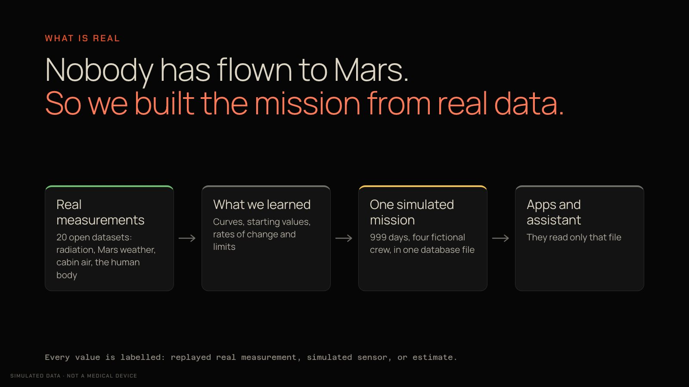
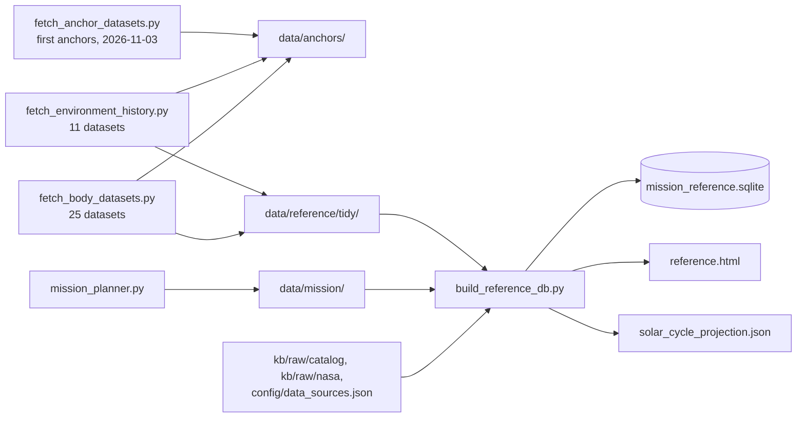

# Reference data



> The real history behind the simulated mission: how it is downloaded, where it is stored, what the reference database holds, and what must never be published.

**The reference database itself is never published.** It contains three datasets that may not be redistributed. This spec is public; the file `data/reference/mission_reference.sqlite` stays on the parent's machine.

## 1. Purpose
The generator (`05_simulation.md`) needs real measurements to replay and real recordings to learn shapes from. Four tools download that history from public archives, tidy it into one long format, and load it with the mission plan and the indicator catalog into one read-only SQLite file. The generator reads only that file and `data/mission/`.

## 2. Scope
- In: `tools/fetch_anchor_datasets.py`, `tools/fetch_environment_history.py`, `tools/fetch_body_datasets.py`, `tools/build_reference_db.py`; the folders `data/anchors/` and `data/reference/`; the tables of `mission_reference.sqlite`; what may and may not be committed.
- Out: which sources exist and their licences (`02_data_sources.md`); the mission plan (`04_mission_plan.md`); the simulated output (`05_simulation.md`, `06_database_schema.md`).

## 3. How it works

1. **First anchors** (`fetch_anchor_datasets.py`, 2026-11-03): small sets to calibrate against. Groups `osdr` (Inspiration4 labs), `tepc` (one ISS dosimeter week), `horizons` (Earth–Mars light time 2026–2033), `seplist` (NOAA storm list), `donki` (DONKI storm history, needs `NASA_API_KEY`). Writes `data/anchors/MANIFEST.json` with URL, sha256, size and date.
2. **Environment history** (`fetch_environment_history.py`): 11 datasets, ids `sunspots`, `neutron`, `sep_events`, `goes`, `omni`, `mars_weather`, `iss_env`, `tepc`, `msl_rad`, `crater`. MSL RAD is read with HTTP range requests on the per-sol files (48 MB instead of about 330 GB, `kb/12`). Raw files go to `data/anchors/<topic>/`, tidy CSVs (`t_utc,series_id,value`) and event lists to `data/reference/tidy/`, one entry per dataset to `data/anchors/MANIFEST_environment.json`. Nothing is interpolated or invented: missing values stay missing.
3. **Body datasets** (`fetch_body_datasets.py`): 25 open, de-identified datasets (6 Inspiration4 tables and 19 Earth studies). Rules in the code: open access only (no login, no data-use agreement), continuous signals downsampled to at most 1 Hz, licence and citation recorded per dataset, and `redistribute=false` for the PhysioNet Contributor Review licence. Raw files go to `data/anchors/body/<id>/`, long tables (`dataset_id, subject_id, t_label, t_rel_days, t_rel_seconds, variable, value, unit, ref_low, ref_high`) to `data/reference/tidy/<id>.subjects.csv`, details to `data/anchors/MANIFEST_body.json`.
4. **Build** (`build_reference_db.py`): reads only local files and writes the database, an overview page and the solar-cycle projection used by the mission plan page.

## 4. Interfaces

### 4.1 Folders
Sizes as measured on disk on 2026-11-13.

| Path | What | Size | Git-ignored |
|---|---|---|---|
| `data/anchors/body/` | Raw body datasets (25) | 368 MB | **yes** (three sets may not be redistributed) |
| `data/anchors/iss_tepc/` | ISS dosimeter 2010–2018 | 68 MB | no |
| `data/anchors/radiation/` | MSL RAD, LRO CRaTER, Oulu neutron monitor | 48 MB | no |
| `data/anchors/spaceweather/` | NOAA storm list, DONKI history, GOES months, OMNI | 12 MB | no |
| `data/anchors/iss_cabin/` | ISS cabin air (OSDR EDA) | 4.5 MB | no |
| `data/anchors/solar/` | SILSO sunspot files and NOAA cycle files | 3.5 MB | **no, but should be** (SILSO is CC BY-NC) |
| `data/anchors/mars/` | Curiosity REMS weather | 1.7 MB | no |
| `data/anchors/osdr/`, `ephemeris/` | First anchors (Inspiration4 CSVs, light time) | 0.5 MB | no |
| `data/anchors/MANIFEST*.json`, `README.md` | Provenance per file and dataset | 0.5 MB | no |
| `data/reference/tidy/` | Tidy tables, one or two files per dataset | 160 MB | **yes** |
| `data/reference/mission_reference.sqlite` | The reference database | 329 MB | **yes** (`data/reference/*.sqlite`) |
| `data/reference/reference.html` | Overview page with a small chart per series | 0.5 MB | no |
| `data/reference/solar_cycle_projection.json` | Observed sunspot number, NOAA forecast, our cycle-26 projection (monthly 1996–2042) | 17 KB | **no, but should be** (holds SILSO values) |

`kb/23` §9 gives the raw download sizes as 140 MB (environment) and 268 MB (body); the body folder is larger on disk because it also holds unpacked archives.

### 4.2 Tables of `mission_reference.sqlite`
Built 2026-11-10 22:36 UTC (table `build_info`). Row counts from that build.

| Table or view | Rows | One row per | Holds |
|---|---|---|---|
| `dataset` | 36 | dataset | Title, kind, domain, provenance, population, URL, licence, citation, notes, rows, time span, `redistribute` flag, status, raw size |
| `series` | 144 | time series | Variable, unit, cadence, platform, location, statistics (n, min, median, mean, max) |
| `obs` | 1,176,523 | time and series | `series_id`, `t_utc`, `value`: all environment time series |
| `event` | 814 | event | Solar proton events from the NOAA and DONKI lists: start, peak, end, size |
| `subject_obs` | 1,673,570 | measurement of a person | All body datasets in long format (see step 3 above) |
| `subject_variable` | 1,021 | dataset and variable | Unit, description, counts, range |
| `ephemeris_daily` | 9,192 | day 2026–2051 | Earth–Mars distance, one-way light time, Sun angle, link state, Mars season and year |
| `mission_calendar` | 999 | mission day | Copy of `data/mission/mission_calendar.csv` |
| `mission_plan` | 22 | key | Copy of `data/mission/mission_plan.json` |
| `mission_option` | 44 | window and option | Copy of `missions_compared.csv` |
| `mission_window_outbound`, `mission_window_return` | 72 each | window and option | Copies of `windows_*.csv` |
| `indicator` | 72 | body or exposure indicator | The indicator catalog (`kb/raw/catalog/catalog_final.json`, `kb/13`): models, rates, thresholds, sources |
| `imm_condition_ranking` | 1,176 | mission type, sex and condition | NASA IMM probability of at least one case (6 mission types × 98 conditions × 2) |
| `imm_condition_probability_wide` | 98 | condition | The same, one column per mission type |
| `source` | 57 | registry source | Copy of `config/data_sources.json` with the storage class |
| `document` | 191 | document file | Index only (path, collection, title, type, size); the files stay where they are |
| `build_info` | 3 | key | Build time, builder, note |
| view `v_series` | 144 | series | Series with dataset and statistics |
| view `v_body` | 1,021 | dataset and variable | Body variables with dataset title and population |
| view `v_mission_phase` | 5 | phase | First and last day, days, light-time range, blackout days |

**Series the generator reads** (so do not rename them without changing `tools/sim/`): `lro_crater.microdosimeter.dose.daily`, `msl_rad.surface.dose_e.daily`, `msl_rad.surface.dose_e.hourly`, `omni.p_gt10.daily_max`, `iss_cabin.<window>.co2.hourly` / `.temp.hourly` / `.rh.hourly`, `rems.*` (`air_temp_max`, `air_temp_min`, `pressure`, `uv_index`, `sunrise_lmst`, `sunset_lmst`, `solar_longitude`). From `subject_obs` it reads `mmash_24h`, `graded_tests_lactate_tcd`, `cycle_graded_actes`, `sleepdep_eeg_behaviour`, `hdt_graded_hrv`, `nhanes_2013_2014_baseline`, `i4_cbc`, `i4_cmp`; from `imm_condition_ranking` the rows of the 36-month planetary mission. `build_reference_db.py` itself reads `silso.ssn.smoothed13` and `swpc.ssn.predicted` for the solar projection.

## 5. Run it
```sh
set -a; source .env; set +a                                   # only the DONKI group needs a key
python3 -I tools/fetch_anchor_datasets.py                     # first anchors (or: osdr tepc horizons seplist donki)
python3 -I tools/fetch_environment_history.py                 # all 11 environment datasets, about 1 h (mostly msl_rad)
python3 -I tools/fetch_environment_history.py --tidy-only msl_rad   # rebuild tidy files from the cache, no network
python3 -I tools/fetch_body_datasets.py                       # all 25 body datasets; existing files are kept
python3 -I tools/fetch_body_datasets.py --list                # dataset ids
python3 -I tools/fetch_body_datasets.py --tidy-only           # re-tidy from files on disk
python3 -I tools/build_reference_db.py                        # → mission_reference.sqlite, reference.html (about 3 min, kb/23)
```
Both fetch tools resume from their cache. Run `tools/mission_planner.py` before the build so the mission tables are current (`04_mission_plan.md`). Downloaded files are data only: never execute anything from `data/anchors/`.

## 6. Data and provenance
- Everything in the database is REAL history, except the mission tables, which are computed from JPL Horizons. Nothing in it is simulated astronaut data (`build_info.note`).
- The only real astronaut body data is Inspiration4: four people on a three-day flight. Long-mission changes come from published rates in the indicator catalog (`kb/23` §5, §8).
- **Defects found in source data, repaired in the tidy tables only** (raw files untouched, `kb/23` §8): the Inspiration4 blood-count file has one record (C003, L-92) shifted by one row; ISS TEPC days that read exactly zero (instrument off) are excluded, which corrected the old 0.46 mSv/day figure to a median of 0.71 mSv/day; DONKI lists several records per storm; one NOAA event has its peak before its start.
- CRaTER dose is our own derivation from housekeeping counters, because the official dose product was offline: use it for variation and storm timing, not absolute dose (`dataset.status` says `PARTIAL`).

### What may not be committed
| Item | Why | Covered by `.gitignore` |
|---|---|---|
| `data/reference/mission_reference.sqlite` | Holds the three PhysioNet datasets with no redistribution | yes |
| `data/reference/tidy/` | Same | yes |
| `data/anchors/body/` | Same (raw files) | yes |
| `data/anchors/solar/sunspots/SN_*.csv` | SILSO, CC BY-NC 4.0 | **no** |
| `data/reference/solar_cycle_projection.json` | 564 monthly SILSO values | **no** |
| `data/reference/reference.html` | Charts of the SILSO series | **no** |
| Other `data/anchors/` folders | Public-domain data, but large (about 140 MB); re-downloadable | **no** (the ignore line `data/anchors/environment/` matches no folder) |

## 7. Decisions and assumptions
- Two SQLite files on purpose: `data/explorer/explorer.sqlite` holds a small sample of every source, for deciding; `mission_reference.sqlite` holds the full prepared history, for building (`kb/23` §2).
- Documents stay files; SQLite only indexes them.
- Only open-access data, with licence and citation recorded per dataset. Restricted archives (NASA LSDA and LSAH, TRISH EXPAND, Twins Study, bed-rest campaigns) were not requested (`kb/23` §5).

## 8. Open questions
- **Fix `.gitignore` before the first public commit:** add `data/anchors/solar/`, `data/reference/solar_cycle_projection.json` and `data/reference/reference.html`; replace `data/anchors/environment/` with the real folders, or ignore `data/anchors/` and keep only the manifests and `README.md`. See also `14_publishing.md`.
- Two body datasets are loaded with 0 rows (`centrifuge_orthostatic_tolerance`, `cooling_methods_heat`, status `RAW`): the raw files are there but no tidy table was written. Unused today.
- `kb/23` §4 planned to replay the MSL RAD cruise dose for deep space; the generator uses CRaTER variation on NASA's effective-dose rate instead, and the cruise series is unused (`05_simulation.md`).
- `kb/23` §4 speaks of 14 ISS cabin-air windows with CO₂, temperature and humidity. In the database 14 windows have hourly temperature, 11 humidity and only 10 CO₂; the generator needs all three, so it replays 10 windows (11,039 hours, `kb/25` §3). `kb/23` should say so.
- Rebuild order is circular: `build_reference_db.py` reads `data/mission/mission_plan.json`, and `mission_planner.py` reads the solar projection the build writes. Run the planner, the build, then the planner again for a complete mission page.

## 9. Change log
| Date | Change |
|---|---|
| 2026-11-13 | Created |
