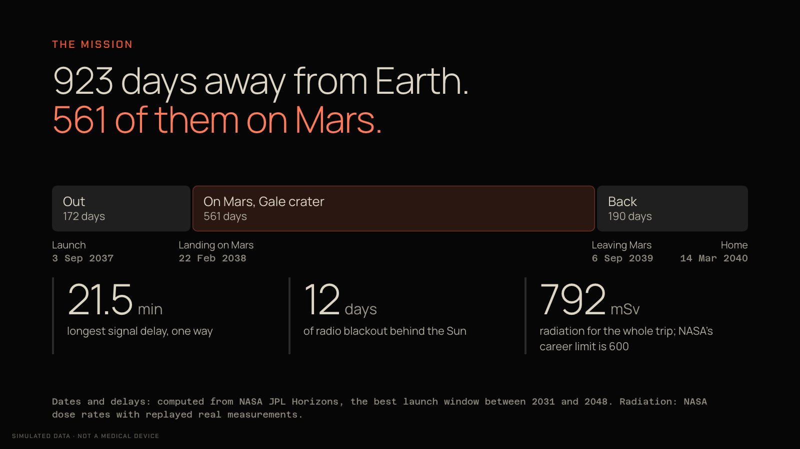

# Mission plan



> The planned 2037 crewed Mars mission: how the dates were found from real planetary positions, the numbers that follow (signal delay, blackout, seasons, radiation budget), and the files every other part reads.

## 1. Purpose
The health story depends on timing: how long the crew is weightless, when the link to Earth is slow or gone, when Mars has its dust season, how much radiation adds up. So the simulated mission flies on real dates that a real mission could use. `tools/mission_planner.py` finds those dates from JPL ephemerides and writes a daily calendar that the generator (`05_simulation.md`) and the apps use.

## 2. Scope
- In: `tools/mission_planner.py`, its method, the chosen mission and its numbers, the outputs in `data/mission/`, the solar-cycle projection, the first radiation budget.
- Out: rockets, landers, propulsion and launch periods (the parent's assumption: they exist); the simulated environment and body (`05_simulation.md`).

## 3. How it works
1. **Ephemerides.** Daily heliocentric ecliptic J2000 state vectors of Earth (`399`) and Mars (`499`) from the JPL Horizons API, 2026-11-01 to 2052-01-01 (JPL DE441, per `mission_plan.json`). Cached in `data/mission/ephemeris/`; delete the files to fetch again.
2. **Windows.** For each Earth–Mars opposition the planner grids departure dates against flight times of 70 to 400 days (2-day steps) and solves Lambert's problem for each pair: universal variables, zero revolutions, prograde, planets as points. Each arc gives the hyperbolic excess speed v∞ at both ends and the launch energy C3.
3. **Choice per window.** Within assumed transport limits (`CAPS`, ours, see section 7) the planner picks the shortest transfer each way, then pairs an outbound leg with a return in the next window (long stay, also called conjunction class). It also keeps minimum-energy and faster variants for comparison.
4. **Calendar.** For the chosen window (`window=2037` in `plan()`), it builds one row per day from 30 days before launch to 45 days after Earth landing. The ship position comes from propagating the Lambert arc (Kepler). Each day gets distance to Earth and Sun, one-way and two-way light time, the Sun–Earth–ship angle and the link state, Mars season (Ls, formula of Allison & McEwen 2000), Mars year, gravity and sunlight.
5. **Outputs** are written to `data/mission/`, including the page `mission_plan.html`. If `data/reference/solar_cycle_projection.json` exists (written by `tools/build_reference_db.py`), the page also shows the solar-cycle chart.

## 4. Interfaces

### 4.1 Outputs in `data/mission/`
| File | Rows | What |
|---|---|---|
| `ephemeris/earth_helio_ecliptic_2026-2052_daily.csv`, `ephemeris/mars_…csv` | daily | Cached Horizons vectors (km, km/s), plus the request URL in `*.source.txt` |
| `windows_outbound.csv`, `windows_return.csv` | 72 each | Transfer options per window and leg |
| `missions_compared.csv` | 44 | Complete missions, 11 windows (2026 to 2048) × 4 options |
| `mission_calendar.csv` | 999 | The chosen mission, day -30 to day 968 |
| `earth_mars_lighttime_2026-2051_daily.csv` | 9,192 | Earth–Mars distance, light time, Sun angle, link state and Mars season for every day 2026–2051 |
| `mission_plan.json` | – | The chosen mission: dates, durations, energy, communication, season, landing site, assumptions, alternatives |
| `mission_plan.html` | – | Orbit view with a day slider, light-delay chart, window comparison, solar-cycle chart |

`mission_calendar.csv` columns: `date_utc`, `mission_day`, `phase` (`prelaunch`, `outbound`, `surface`, `return`, `recovery`), `sol`, `dist_earth_au`, `dist_sun_au`, `light_time_min`, `sun_earth_probe_deg`, `mars_ls_deg`, `round_trip_min`, `sun_probe_earth_deg`, `comm` (`ok`, `degraded`, `blackout`; empty on Earth), `mars_year`, `mars_season`, `gravity_g`, `solar_flux_rel_1au`, `earth_mars_au`.

Read by: `tools/sim/base.py` (`load_calendar()` reads `mission_calendar.csv`; `generate_mission_sim.py` reads `mission_plan.json` for the `meta` table) and `tools/build_reference_db.py` (copies all files into the reference database, `03_reference_data.md`).

### 4.2 The chosen mission
All values from `data/mission/mission_plan.json` (generated 2026-11-10 22:31 UTC).

| Event | Date (UTC) | Mission day |
|---|---|---|
| Launch from Earth | 2037-09-03 | 0 |
| Mars landing, Gale crater | 2038-02-22 | 172 |
| Farthest from Earth: 21.5 min one way | 2038-10-05 | 397 |
| No link (Sun in the way) | 2038-10-27 to 2038-11-07 | 419 to 430 |
| Dust season starts (Ls 180°) | 2039-01-30 | 514 |
| Leave Mars | 2039-09-06 | 733 |
| Earth landing | 2040-03-14 | 923 |

| Quantity | Value |
|---|---|
| Durations | out 172 days, Mars 561 days (546 sols), back 190 days; total 923 days; deep space 362 days |
| Earth departure | v∞ 4.45 km/s, C3 19.8 km²/s², 4.06 km/s from low Earth orbit |
| Mars arrival | v∞ 3.95 km/s, entry 6.32 km/s |
| Mars departure | v∞ 4.49 km/s |
| Earth arrival | v∞ 4.33 km/s, entry 11.89 km/s |
| One-way signal time | 9.97 min at landing, 21.54 min at most (2038-10-05), 10.20 min at departure |
| Link | blackout 12 days (2038-10-27 to 2038-11-07); degraded or blackout 32 days (2038-10-17 to 2038-11-17) |
| Mars season | landing at Ls 19.8° (northern spring), Mars year 45; departure at Ls 314.3°; 220 days of dust season on the surface (2039-01-30 to 2039-09-06) |
| Landing site | Gale crater (Aeolis Palus), 4.59° S, 137.44° E: Curiosity has measured weather and radiation there since 2012 |
| Check | Lambert arcs close on the target planet to within 1 km (`mission_plan.json` reports 0 km) |
| Short-stay alternative | a direct return after 30–60 days on Mars would enter Earth's atmosphere at 21.1–22.6 km/s, so it is not used |

### 4.3 Why 2037
Long-stay missions with the same assumed transport limits (`missions_compared.csv`, option "reference"):

| Window | Launch | Earth landing | Total days | Deep-space days |
|---|---|---|---|---|
| 2033 | 2033-05-09 | 2035-11-03 | 908 | 276 |
| 2035 | 2035-07-20 | 2038-01-15 | 910 | 294 |
| **2037** | **2037-09-03** | **2040-03-14** | **923** | **362** |
| 2039 | 2039-10-09 | 2042-04-27 | 931 | 412 |
| 2041 | 2041-11-16 | 2044-06-06 | 933 | 426 |
| 2043 | 2043-12-26 | 2046-07-13 | 930 | 410 |
| 2046 | 2046-02-08 | 2048-08-18 | 922 | 358 |
| 2048 | 2048-04-11 | 2050-10-08 | 910 | 290 |

2037 fits the parent's "10 to 15 or more years" and has the fewest deep-space days of the 2037–2043 windows; it also flies while the Sun is still fairly active, when cosmic radiation is lower than at the quiet Sun of 2039–2043 (`kb/22` §3). Decision: `13_decisions.md`, D-04.

### 4.4 Solar activity: our projection for cycle 26
- No official forecast reaches the mission: NOAA's ends in 2030-12 (`kb/22` §5).
- Our projection (MODEL, not a forecast), computed in `tools/build_reference_db.py` (`solar_projection()`): cycle 26 starts in 2031-01 (`CYCLE26_MINIMUM`, the month after the NOAA forecast ends) and follows the average shape of cycles 12 to 24 (13 cycles, SILSO 13-month smoothed sunspot number). Projected peak: 2034-09.
- The mission then flies in cycle years 6.7 (launch), 7.1 (Mars landing), 8.7 (departure) and 9.2 (Earth landing): after the maximum, while activity falls. Timing is uncertain by a year or two; the strength is unknown.
- The same years of the last complete cycle (24) are 2015-08 to 2018-02. The generator replays them: mission date minus 8,065 days (2039-10-10 ↔ 2017-09-10, `ANALOG_SHIFT_DAYS` in `tools/sim/base.py`), about 265 months.

### 4.5 First radiation budget (published rates, before any simulation)
From `kb/22` §6, rates from the indicator catalog (`kb/13`, `rad_dose_rate`). NASA's 600 mSv career limit is set on effective dose, so that column is the one the apps use.

| Phase | Days | NASA effective dose | Measured dose equivalent (MSL RAD) |
|---|---|---|---|
| Outbound | 172 | 1.4 mSv/day → 241 mSv | 1.84 mSv/day → 316 mSv |
| Mars surface | 561 | 0.5 mSv/day → 281 mSv | 0.64 mSv/day → 359 mSv |
| Return | 190 | 1.4 mSv/day → 266 mSv | 1.84 mSv/day → 350 mSv |
| **Mission** | 923 | **about 790 mSv**; 600 passed on return day 56 (day 789) | **about 1,025 mSv**; 600 passed on sol 432 |

The simulation, which adds replayed day-to-day variation and storms, gives 792 mSv and passes 600 mSv on day 786 (`05_simulation.md`). Scaled by the solar-cycle phase, the measured-instrument budget rises to about 1,170 mSv (`kb/22` §5). Either way the mission ends above the limit, in line with NASA's own figure of about 1 Sv for a long stay (`kb/22` §6).

## 5. Run it
```sh
python3 -I tools/mission_planner.py            # windows + plan (default "all"); rewrites data/mission/
python3 -I tools/mission_planner.py windows    # scan the windows only
python3 -I tools/mission_planner.py plan       # build the chosen mission and calendar
```
To explore another mission, change `CAPS` or `window=` in `plan()`. After a change: run `tools/build_reference_db.py`, run the planner again (so the page picks up the solar chart), then `tools/generate_mission_sim.py`, because the generator reads the calendar.

## 6. Data and provenance
| Value | Label | Source |
|---|---|---|
| Positions, distances, light time, link state, Mars season | REAL (computed astronomy; `COMPUTED` in the simulation database) | JPL Horizons ephemerides |
| Launch, landing and departure dates | MODEL (a reference plan, not a flight plan) | Lambert solution within our assumed limits |
| Cycle-26 projection | MODEL | Our average-cycle projection from SILSO data |
| Radiation budget | MODEL | Published rates (`kb/13`), `kb/22` §6 |

## 7. Decisions and assumptions
- **Transport limits are ours** and adjustable (`CAPS`): Earth departure C3 ≤ 20 km²/s², Mars arrival v∞ ≤ 4.0 km/s, Mars departure v∞ ≤ 4.5 km/s, Earth arrival v∞ ≤ 4.5 km/s (entry about 12 km/s).
- Patched conics, planets as points; dates are UTC days from TDB vectors (offset at most 70 s). No launch period, parking orbit, aerocapture or propulsion design.
- **Long stay** (conjunction class), like NASA's Mars Design Reference Architecture 5.0 (NASA/SP-2009-566) pattern of about six months out, about 500 days on Mars, about six months back (`kb/22` §1).
- **Landing site** Gale crater: our choice, so that real Curiosity weather and radiation can be replayed for the same place.
- **Link rule** (ours): Sun–Earth–ship angle under 2° = no link, under 5° = degraded.
- **Solar cycle 26** resembles the average of cycles 12 to 24, starting 2031-01.
- Checks reported in `kb/22` §8: the 2033 and 2035 minimum launch energies (C3 9.0 and 10.4 km²/s²) match published values; oppositions match the almanac within 1–2 days; the season formula gives Ls 0.05° on 2024-11-12, the published start of Mars year 38.

## 8. Open questions
- **Departure day convention.** The calendar counts 2039-09-06 (day 733, sol 546) as the last `surface` day; phase `return` starts on day 734. `mission_plan.json` gives 190 return days; the calendar has 189 `return` days and 562 `surface` days (against 561 in the plan). In the simulation, `meta.day_mars_departure` and the "Mars departure" label are day 734 (2039-09-07), one day after the planned departure date. Decide which day is departure and align the planner and the generator.
- **Link rule not verified.** Check the 2° and 5° angles against a JPL source before quoting them (`kb/22` §8).
- **DRA 5.0 comparison.** Check which launch year DRA 5.0 uses for its crew example before quoting it (`kb/22` §3).
- **Docstring out of date.** The tool's docstring says it scans 2032–2050; the outputs hold windows from 2026 to 2048.
- **Rebuild order is circular** (planner → reference build → planner) for the solar chart on the page.
- The page `mission_plan.html` and the site copy `mocks/mission.html` embed observed SILSO values (CC BY-NC 4.0); see `02_data_sources.md`.

## 9. Change log
| Date | Change |
|---|---|
| 2026-11-13 | Created |
