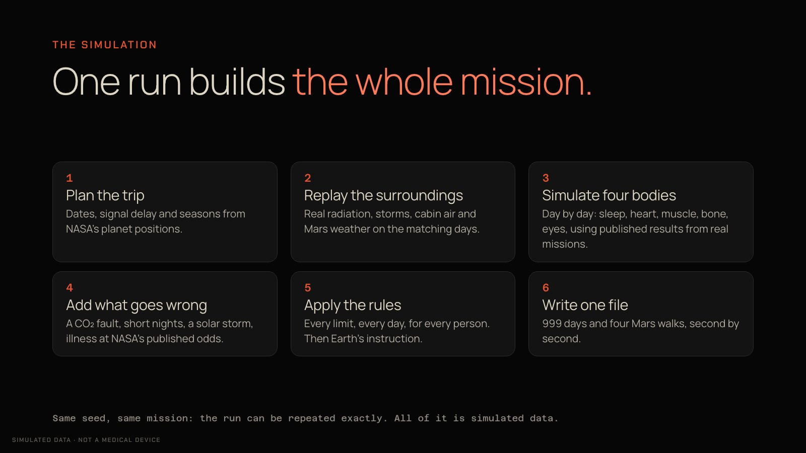

# Simulation: the mission generator



> One seeded Python run turns real history and published rates into a complete simulated Mars mission: 999 days, four fictional crew, rule results, Earth's daily instruction and four Mars walks second by second. The apps and the assistant read only its output.

**On the site.** The Simulation tab (`mocks/simulation.html`) tells this spec in plain words: six steps with what goes in and which tables come out, the scenarios, six checks against real crews, and what is assumed. The Data tab (`mocks/sources.html`) shows which real data feeds which value; the Database tab (`mocks/database.html`) opens the result table by table.

## 1. Purpose
No human has flown to Mars, so no dataset of such a trip exists. The generator builds one that is honest about where every number comes from: real measurements replayed on the mission dates, published rates for the body, small models where nothing better exists, and rules with sourced thresholds. Because the whole mission is in one file, the apps can jump to any day or second and behave "as if live".

## 2. Scope
- In: `tools/generate_mission_sim.py` and `tools/sim/` (`base`, `learn`, `env`, `body`, `rules`, `story`, `eva`); how each value is made; rules and readiness; Earth's instruction; snapshot days; the four walks; run time; reproducibility; assumptions; how to change and regenerate.
- Out: table and column definitions (`06_database_schema.md`); the reference data it reads (`03_reference_data.md`); mission dates (`04_mission_plan.md`); how the apps and the assistant show the data (`08_apps.md`, `09_assistant.md`).

## 3. How it works

### 3.1 Build order (`main()` in `tools/generate_mission_sim.py`)
1. `base.new_db()` creates all tables in `data/sim/mission_sim.sqlite.tmp`.
2. `base.load_calendar()` reads `data/mission/mission_calendar.csv` (999 days, day -30 to 968). It sets the gravity the crew feels by phase (1, 0, 0.38, 0, 1 g) and the replayed real date (mission date minus 8,065 days).
3. `learn.learn_all()` learns 7 shapes and baselines from the reference database and writes `learned_param`.
4. `env.build()` makes the environment per day and hour, plus environment events.
5. `body.build()` plans the EVAs, draws illnesses, and runs each crew member day by day: daily values, hourly heart rate and temperature, lab panels, the EVA log, readiness and its costs.
6. Airlock dips: on each EVA day the cabin oxygen drops by 0.95 mmHg at 09:00 and 0.85 mmHg at 13:00 per team, and the daily mean and minimum are recomputed.
7. `rules.assess()` applies every rule to every person and day.
8. `rules.write_all()` writes the rule results, tomorrow's plan, and Earth's instruction for every day and person.
9. `story.build()` writes the 24 snapshot days and puts the flight surgeon's letter into Earth's instruction on those days.
10. `eva.build()` runs the four second-by-second walks.
11. All remaining tables are written (`day`, `crew`, `variable`, `source_use`, `meta`, ...), the file is compacted (`VACUUM`), swapped into place (`base.publish()`), and `data/sim/SUMMARY.json` is written with counts and checks.

### 3.2 Seed and random streams
- `SEED = 2037` (`tools/sim/base.py`).
- `base.rng_for(name)` gives each purpose its own NumPy random stream, seeded from SHA-256 of `"2037:<name>"`. Streams: `env`, `body:C1` … `body:C4`, `conditions:C1` …, `eva:<day>:<team>`, `eva1hz:<scenario>`. A change in one part therefore does not reshuffle the random numbers of another.

### 3.3 What each module makes
| Module | Makes | Tables |
|---|---|---|
| `base.py` | Paths, constants (seed, replay shift, atmosphere, dose rates, storm shielding factors, crew list, EVA teams), random streams, the schema | schema of all tables |
| `learn.py` | Shapes and baselines from real data; only aggregates leave the reference database | `learned_param` |
| `env.py` | Radiation, storms, cabin air, Mars weather, link events | `env_day`, `env_hour`, `event` (env and mission) |
| `body.py` | Crew state per day and hour, labs, illnesses, EVA schedule and log, readiness | `body_day`, `body_hour`, `lab`, `readiness_cost`, `eva`, `event` (crew) |
| `rules.py` | The value dictionary, rule results, tomorrow's plan, Earth's instruction | `variable`, `assessment`, `plan`, `uplink` |
| `story.py` | Snapshot days: analysis, questions, letters | `snapshot`, `uplink.narrative`, `day.key_label` |
| `eva.py` | Four Mars walks second by second, with the arm-unit rules | `eva_scenario`, `eva_sample`, `eva_event`, `eva_text` |
| `generate_mission_sim.py` | Order of the run, airlock dips, the crew table, `source_use`, `meta`, `SUMMARY.json` | `day`, `crew`, `source_use`, `meta` |

### 3.4 How each kind of value is made
Every value has one label in `variable.kind` (`06_database_schema.md`): `COMPUTED` 3, `REPLAY` 11, `SIM` 45, `MODEL` 17. `SIM` stands for a sensor the real mission would have; `MODEL` is an estimate that even a real mission could not measure directly. A second column, `variable.method`, says how the generator makes it: `computed` 4, `replay` 13, `model` 55, `learned` 4.

**Calendar (computed).** Dates, phase, sol, signal time, link state, Mars season and distances come from `04_mission_plan.md`. Mission day 0 = launch 2037-09-03; 172 = Mars landing; 734 = first day of the `return` phase; 923 = Earth landing.

**Environment (replay and model, `env.py`).**

| Value | Level | Day-to-day variation |
|---|---|---|
| Dose in deep space | NASA effective-dose rate 1.4 mSv/day (`DOSE_TRANSIT`) | LRO CRaTER daily dose on the replayed day, as a ratio to the phase median, clipped to 0.75–1.25 |
| Storm in deep space | CRaTER excess above 1.6 × the phase median | Storm dose = excess × 1.5 (quality factor) × 5 % in the cabin or 1.5 % in the shelter (our assumption). Shelter 20 h when the excess is above 5 mGy/day, 12 h above 1 |
| Storm level | NOAA S-scale on OMNI's daily maximum flux above 10 MeV: S1 ≥ 10 pfu, S2 ≥ 100, S3 ≥ 1,000, S4 ≥ 10,000 | Also at least S1 when the CRaTER excess is above 1 mGy/day |
| Dose on Mars | 0.5 mSv/day (`DOSE_SURFACE`) | Curiosity RAD surface dose on the replayed day, ratio to the phase median. Earth-side storms of the replay are not applied on Mars |
| Storm on Mars | Scripted on 2039-05-18 (day 622) for three days; the replayed date holds a real far-side event (2017-04-18) | Curiosity's hourly dose record of 2017-09-10 to 2017-09-13 at Gale crater; shelter 10, 20 and 6 h; the shelter stops about 60 % of the storm part (our assumption) |
| Cabin CO₂, temperature, humidity | Real ISS hourly records, 10 payload-mission windows in random order, tiled over the mission | Each window rescaled so its 95th percentile of CO₂ is at most 2.6 mmHg (a ship built to today's 3 mmHg limit). Scripted removal fault on days 96–98 |
| Inspired oxygen, pressure | 128.2 mmHg and 56.5 kPa (34 % oxygen, NASA exploration atmosphere, `kb/17`) | Sensor noise; airlock dips on EVA days |
| Mars weather | Curiosity REMS, Mars year 33 (2015-06-18 to 2017-05-06) | The sol with the nearest season angle (Ls) |
| On Earth (before launch, after landing) | CO₂ 0.5 mmHg, inspired oxygen 149.4 mmHg, 101.3 kPa, 22 °C, 45 %, 0.0066 mSv/day | Small daily wave |

Phase reference levels used for the ratios (`SUMMARY.json`): CRaTER 0.345 mGy/day outbound and 0.49 on return, RAD 0.265 on Mars. Result: 792 mSv mission dose, the 600 mSv limit passed on day 786 (`meta`). Every crew member gets the same dose.

**Body (model, `body.py`).** Four fictional crew members (`C1` KESTREL, `C2` HERON, `C3` OSPREY, `C4` WREN; two women, two men, 38–47 years) with personal settings in `PARAMS`. Each value follows its row in the indicator catalog (`kb/13`): weightless, then 0.38 g, then weightless, then 1 g. The numbers are copied into the code with comments; the catalog file itself is not read at run time. Main rules of change:

| Value | How it changes |
|---|---|
| Sleep | Personal mean (6.0–6.9 h in flight, 6.8–7.4 h on Earth, +0.3 h on Mars) plus noise, minus fixed amounts for launch and landing days, storm shelter, high CO₂, back pain, the EVA campaign and low mood |
| Sleep debt | Each day: debt × e^(−1/6) + hours awake beyond 15.84 h (the sustainable wake time, Van Dongen 2003, `kb/13`) |
| Reaction time | Personal base × (1 + learned slowing per hour of debt) × small CO₂, landing and fever effects |
| Body mass | Fluid shift of −1.8 kg in weightlessness (time constant 1.5 days), −0.6 kg on Mars; tissue follows energy eaten |
| Aerobic fitness | −17 % in the first two weeks out (time constant 5 days); then towards −5 % minus up to 15 % for missed exercise; on Mars towards −3 % minus up to 20 % |
| Leg strength | Towards −5 % (−3 % on Mars) minus up to 20 % for missed resistive training |
| Hip bone | −0.20 to −0.50 % a month in weightlessness (per person), up to double without resistive training; 0.4 × that on Mars; recovers with a half-life of 150 days on Earth |
| Optic-disc swelling | Grows towards a personal level (12–58 µm) with a 90-day time constant; halves on Mars; falls to 30 % back on Earth |
| Orthostatic risk | 20 % after two weeks of weightlessness, towards 75 % (time constant 45 days), scaled per person, at most 92 % |
| Balance (tandem walk) | After Earth landing: 39 % on landing day, about 89 % the next day (Clement 2022); after Mars landing 0.8 × that deficit (our assumption) |
| Exercise | Plan 86 min a day in flight (about 600 min a week), 60 on Mars; resistive part 55 %; the main dial for fitness, strength and bone |
| Labs | Every 28 days in flight, before launch, on sol 3 and 1, 7 and 30 days after Earth landing (38 panels per person) |
| Illness and injury | 26 conditions from NASA's ranking for a 36-month planetary mission (`kb/19`): a Poisson draw per condition and person, at most one moderate or major at a time; about 60 events each, most minor. Effect sizes (sleep, energy, exercise, readiness points, EVA ban) are ours |

**Learned shapes (`learn.py`, table `learned_param`).**

| Parameter | From | Sample | Result |
|---|---|---|---|
| `hr_day_shape` | `mmash_24h` | 22 people | 24 hourly heart-rate factors (1.0 asleep to about 1.46 by day) |
| `lactate_curve` | `graded_tests_lactate_tcd` | 833 tests | Lactate = a + b·e^(c(x − 0.6)), x = heart rate / maximum: 0.9 mmol/L up to about 75 % |
| `hr_vo2` | `cycle_graded_actes` | 18 tests | Heart rate rises 51.6 bpm per L/min of oxygen uptake |
| `pvt_sleep_loss` | `sleepdep_eeg_behaviour` | 68 sessions | Reaction time 318 → 356 ms after a night awake: 1.44 % slower per hour of sleep debt |
| `tilt_response` | `hdt_graded_hrv` | 22 people | Direction of heart rate and HRV under head-down tilt (check only) |
| `baseline_nhanes` | `nhanes_2013_2014_baseline` | 2,537 adults aged 30–55 | Medians and quartiles by sex for blood values, pulse, blood pressure, sleep |
| `baseline_i4` | `i4_cbc`, `i4_cmp` | 4 crew | Pre-flight means of real Inspiration4 crew, as a check on our baselines |

**Scripted events** (`origin = 'scripted'` in `event`).

| Days | Event | Why |
|---|---|---|
| 96–98 | CO₂ removal bed degraded; cabin above 3 mmHg | A fault the crew can feel |
| 344–356 (sols 168–180) | EVA campaign of team A (KESTREL, OSPREY): an EVA every second sol, short nights | Builds the sleep debt behind the fatigue walk and the stand-down on sol 180 |
| 354 | KESTREL's readiness held between 71 and 82 | The fatigue walk must go ahead "ready with limits" in every run |
| 622–624 | Solar storm on Mars | The storm walk |
| 800–813 | Resistive exercise device out of order | Strength and bone projections worsen |
| 820–850 | Low-mood stretch for WREN | A behavioural-health case |

### 3.5 Rules, readiness and tomorrow's plan (`rules.py`)
- **Tags.** Every threshold carries a tag: NASA (standard or technical brief), CLIN (clinical guideline), RES (research paper) or INF (our assumption). Rule text and tag are in `variable.rule_text` and `variable.rule_tag`.
- **Rule results** (`assessment`): one row per day, person and flagged value, with `watch`, `warning` or `critical` and a reason in words. Environment rules use crew id `ENV`. A lab result stays valid until the next panel. Today: 10,874 watch, 5,241 warning, 1,950 critical rows.
- **Readiness** (0–100): 100 minus points for sleep debt (up to 20, +4 under 5 h of sleep), reaction speed (12), heart strain (6 + 3), energy and fluids (8 + 2), exercise shortfall (5), symptoms (40), mood and stress (8), balance and standing (30 + 10), cabin air (6), bone trend (2). Bands: 85 and over ready; 70–84 ready with limits; 50–69 restricted; under 50 stand down. Costs per day are in `readiness_cost`. The scoring is ours (tag INF).
- **EVA go or no-go:** one EVA a week per team of two on Mars (not in the first 5 days, the last 4, the blackout or storm days). An EVA goes ahead only if both members have readiness of at least 70 the day before and no illness ban. 157 planned, 143 done, 14 postponed by the rule. The four scenario days go ahead regardless.
- **Tomorrow's plan** (`plan`): written by the on-board rules every day: sleep window, exercise, food, fluids, EVA go or no-go, landing or departure protocol, air, radiation, tests due, see the crew doctor.
- **Radiation is the exception:** the mission total was known to pass the limit before launch, so the rule stages the actual dose (watch 300, warning 480, critical 600 mSv, tag NASA V1 4030 plus INF for the staging) instead of alarming a projection.

### 3.6 Earth's daily instruction (`uplink`)
- One row per day and person. Written from the data of the day before; received the next morning; `delay_min` is that day's one-way signal time.
- Earth looks further than the on-board rules: weekly trends, projections, what is coming (landing protocol 14, 7, 3, 2 and 1 days out; the blackout; departure), and an answer to each blood panel.
- `status`: `received` (3,564 rows), `short` (80: weak link, two items at most), `none` (48: the 12-day blackout, standing orders apply and `age_days` counts up), `in_person` (304: on Earth).
- The last instruction before the blackout adds four standing orders (routine, warnings, no EVA, log everything).

### 3.7 Snapshot days (`story.py`)
On 24 days of the focus astronaut (`C1`) the generator adds a full letter from the flight surgeon (`uplink.narrative`), a written analysis and suggested questions (`snapshot`). Every sentence is built from that day's numbers, so text and data cannot disagree. Days: launch (0), day 2, one month out (30), a minor storm (85), the CO₂ fault (97), the day before Mars landing (171), Mars landing (172), sol 3 (175), the four walk days (181, 354, 481, 622), the sol-180 stand-down (356), before, during and after the blackout (418, 425, 431), the day before leaving Mars (733), the deep-space storm (768), the day the dose passes 600 mSv (786), the exercise-device fault (806), the day before Earth landing (922), Earth landing (923), one week back (930), six weeks back (968). On all other days the rule results, the plan and Earth's short instruction still exist.

### 3.8 The four Mars walks (`eva.py`)
Each walk runs from suit seal to helmet off for the focus astronaut, starting at 10:00 local time: leak check 5 min, pre-breathe 20 min, airlock emptying 8 min, egress, walk to site A (about 620 m), sampling, rest, drilling, walk to site B (about 900 m), instruments, rest, walk back, ingress, airlock filling, body check. A small physiological model is driven by the work rate; the arm-unit rules run every second and the simulated astronaut obeys them.

| Scenario | Day (sol) | What happens | Length | Ends because |
|---|---|---|---|---|
| `nominal` | 181 (9) | Runs to plan; stamina is the shortest resource all the way | 12,936 s (3 h 36) | plan done |
| `fatigue` | 354 (178) | Drilling pushes past what the tired body can hold: a heat cue (ease the pace), then two cues (stop, rest 5 min); cues return, stamina no longer covers the walk home plus the reserve; site B dropped | 8,878 s | stamina |
| `co2` | 481 (301) | Scrubber fault during sampling: caution after 3 min of steady climb, return after 6; peak 8.9 mmHg against a 20 mmHg limit | 6,667 s | CO₂ |
| `storm` | 622 (438) | Dose rate creeps up from minute 44 (Curiosity's real curve in real time); caution at 1.2 × the usual rate, return when the habitat confirms the storm after 10 min | 9,419 s | storm |

- **Stay time** = the shortest of oxygen, battery, cooling water, scrubber, daylight and stamina (and an event limit), minus the walk back and a 30-minute reserve (9 min for event limits: just the walk and the airlock).
- **Cues** (each second, outside): heart rate above 140 bpm for 2 min; core 0.6 °C above the pre-EVA value; lactate 4 mmol/L or more; stamina under 35 %; balance under 65; chance to faint 10 % or more; helmet CO₂ rising faster than 0.15 mmHg a minute for 3 min without effort; dose rate 1.2 × usual. One body cue: ease the pace. Two together: stop, rest 5 min, cooling to maximum (NASA V2 11011 cues).
- **Return** is called when the stay time reaches zero, stamina falls under 20 %, the faint chance reaches 20 %, the core reaches 39.0 °C, the CO₂ climb lasts 6 min, the storm rate lasts 10 min, heat cues come back after a rest, or site B no longer fits the stay time.
- Peak values per walk are in `SUMMARY.json` (`eva`). Peak lactate is 2.7 mmol/L in the fatigue walk and about 1.0 in the others, so the 4 mmol/L cue never fires: the learned curve comes from athletes (`kb/25` §9).
- Constants (all ours): walk speed 0.74 m/s, route 1.148 × the straight line, reserve 30 min, ingress 9 min, sustainable work rate 45 % of maximum (38 % when worn out).

## 4. Interfaces
| Kind | Name | Description |
|---|---|---|
| Input file | `data/reference/mission_reference.sqlite` | Opened read-only (`base.ref()`): series, subject data, IMM probabilities, dataset list (`03_reference_data.md`) |
| Input file | `data/mission/mission_calendar.csv` | The 999-day calendar |
| Input file | `data/mission/mission_plan.json` | Mission name and dates for `meta` |
| Output file | `data/sim/mission_sim.sqlite` | 22 tables, about 20 MB (`06_database_schema.md`) |
| Output file | `data/sim/SUMMARY.json` | Meta, row counts, cabin windows, reference levels, forced days, EVA counts, illness counts, walk summaries, size, run time |
| Library | NumPy | Needed by `tools/sim/` (installed on the parent's Mac: NumPy 1.26.4, Python 3.12.3) |

## 5. Run it
```sh
python3 -I tools/generate_mission_sim.py    # → data/sim/mission_sim.sqlite + SUMMARY.json
python3 -I tools/export_schema.py           # keep 06_database_schema.md in sync
python3 -I tools/serve_preview.py           # look at the result: http://127.0.0.1:8037/
```
- **Run time:** 2.6 s on the parent's Mac (`SUMMARY.json`, 2026-11-11); file size 19.8 MB.
- **Reproducibility:** same seed, same inputs, same values. Changing the reference database or the calendar changes the output.
- **The output is written atomically**, so a running preview server keeps working during a rebuild.

**How to change it**

| To change | Edit |
|---|---|
| Seed, replay shift, atmosphere, dose rates, storm shielding factors, crew list, EVA teams | constants in `tools/sim/base.py` |
| Radiation, storms, cabin air, Mars weather, the CO₂ fault days, the Mars storm date | `tools/sim/env.py` (`SCRUBBER_FAULT_DAYS`, `SURFACE_STORM_DATE`) |
| Crew settings, body models, illness effects, scripted campaign, device fault, low mood | `tools/sim/body.py` (`PARAMS`, `EFFECT`, `CAMPAIGN_SOLS`, `ARED_FAULT`, `LOW_MOOD`) |
| A value's label, unit, thresholds for display, rule text, why, action | `var(...)` rows in `tools/sim/rules.py` |
| A deciding threshold | `assess()` or `lab_status()` in `tools/sim/rules.py` (and the `var(...)` row, to keep the display in step) |
| Plan or Earth's instruction | `plan_for()`, `uplink_for()` in `tools/sim/rules.py` |
| Snapshot days and their texts | `snapshot_days()`, `WHY`, `ASK`, `letter()`, `analysis()` in `tools/sim/story.py` |
| The walks | `script()`, `simulate()`, `SCEN`, `TEXT` in `tools/sim/eva.py` |
| A new table or column | `SCHEMA` in `tools/sim/base.py`, then the code that fills it, then `COLUMN_NOTES` (and `TABLE_NOTES` for a table) in `tools/export_schema.py` |
| The explanation on the site | The six steps (`S`) and the checks in `mocks/simulation.html`; the four chains and the `WHY` texts in `mocks/sources.html`. Both are hand-written: update them when the build order, a model or a source changes |

After any change: regenerate, run `tools/export_schema.py`, compare `SUMMARY.json` with the previous one, check the scripted days still tell their story (kb lesson: hold scripted days steady, `kb/25` §11), and open the habitat app and the arm unit.

## 6. Data and provenance
- REPLAY: radiation variation, deep-space storms, cabin air, Mars weather, the Mars storm curve (real data, moved onto the mission dates).
- MODEL and SIM: everything about the body, the arm-unit physiology, readiness, the dose levels.
- COMPUTED: calendar values from JPL ephemerides.
- Text in `assessment`, `plan`, `uplink`, `snapshot` and `eva_text` is written by rules from the numbers, not by an AI model.
- No individual record from any source is copied into the output; `learned_param` holds only aggregates. SILSO values and the three PhysioNet datasets that may not be redistributed are not used (`02_data_sources.md`).
- Checks against published numbers are listed in `kb/25` §9b (sleep in transit 6.4 h against 6.1 h published; aerobic fitness on flight day 15 at 84 % against about −17 %; balance on landing day 39 %; mission dose 792 against about 790 mSv; and more). They have not been re-run for this spec. Six of them are now computed from the database each time the Simulation tab opens. On 2026-11-14 it showed: sleep on the way to Mars 6.3 h (crew mean; `kb/25` says 6.4), aerobic fitness on flight day 15 at 84 %, leg strength at Mars arrival 92 %, hip bone lost on the way to Mars 0.40 % a month, balance walk on Earth landing day 39 %, mission dose 792 mSv. The published numbers beside them are hand-written in the page, from `kb/25` §9b.
- The crew is fictional. Not a medical device.

## 7. Decisions and assumptions
All ours unless a source is named (`kb/25` §9).
1. **Storm shielding factors are our own**, not a transport calculation: storm dose in the cabin = 5 % (`F_CABIN`) and in the shelter = 1.5 % (`F_SHELTER`) of the thinly shielded CRaTER measurement, times a quality factor of 1.5 (`Q_SPE`); on Mars the shelter stops about 60 % of the storm part. Result for the 2017-09 replay: about 5.0 mSv extra with the shelter, 9.5 mSv without. Replace with a published figure before quoting.
2. **Mars factors:** bone loss at 0.4 × the weightless rate (low end of the catalog range); balance deficit after Mars landing 0.8 × the Earth value; orthostatic risk is given for Earth gravity only. No human data exists at 0.38 g.
3. **The replay assumes the next solar cycle resembles the last** (cycle 24, `04_mission_plan.md`) and that storms reach the ship as they reached Earth.
4. **Cabin CO₂ is rescaled** to today's limit; older ISS records run higher and, replayed raw, raised 58 false warning days (`kb/25` §11).
5. **Effective dose is not what a dosimeter reads.** The apps use NASA's effective-dose rates; an instrument would read about 28 % higher (`kb/22` §6).
6. **Arm-unit physiology is a small model:** sustainable work rate, heat gain per watt, heart-rate drift, the lactate shift on a bad day, stamina and the faint estimate are assumptions.
7. **Greenhouse food** lifting appetite after sol 60 is assumed.
8. **Ferritin:** the direction of change is published, the size is not.
9. **One row per Earth day.** On Mars the sol label is the sol in progress; 562 days hold 546 sols.
10. **Medical events** follow NASA's odds, but their effect sizes on sleep, appetite, exercise and readiness are ours.
11. **Not validated against flight data** beyond the checks in `kb/25` §9b. The validation panel of `kb/11` is still to build.
12. **EVA dose is not added** to the mission dose: all four crew have the same total (792.3 mSv on day 923).

## 8. Open questions
- **Rule says shelter, data says no shelter.** On days 762, 764 and 765 the storm level is S2: the rule (`assessment`) says "shelter, no EVA" and the plan says "Stay in the shelter", but `env_day.shelter_h` is 0, because shelter hours follow the CRaTER excess, not the S-level. Tie the two together.
- **The catalog file is not read.** `generate_mission_sim.py` says it reads `kb/raw/catalog/catalog_final.json`, and `base.CATALOG` points to it, but no code opens it: the numbers are copied into `body.py` and `rules.py`. `kb/13` also carries pending corrections from 2026-11-05 (`kb/20` §6); check that the copied numbers include them.
- **Thresholds live in two places** (`variable` columns for display, `rules.py` and `eva.py` code for deciding). See `06_database_schema.md`.
- **Mars departure day:** the generator's "Mars departure" is day 734 (2039-09-07); the plan says 2039-09-06 (day 733). See `04_mission_plan.md`.
- **`kb/23` and the code differ** on deep-space dose: `kb/23` §4 planned a replay of the MSL RAD cruise dose; the code uses CRaTER variation on NASA's 1.4 mSv/day. `kb/23` §7 planned tables `sim_run`, `sim_obs`, `sim_event`; the code writes the 22 tables of `06_database_schema.md`. The code is current.
- **`kb/25` is slightly stale:** it gives 38,561 `eva_sample` rows (the file has 37,900), "72 EVAs per person" (team A did 74, team B 69) and the storm creep "from minute 45" (code: 44 min).
- **Storm shielding** (assumption 1) needs a published figure before it is quoted in the pitch.

## 9. Change log
| Date | Change |
|---|---|
| 2026-11-13 | Created |
| 2026-11-14 | Pointers to the new Simulation, Data and Database tabs; the six checks the Simulation tab recomputes; `TABLE_NOTES` |
| 2026-11-15 | The generator no longer writes a build date (`meta.generated_utc`) |
