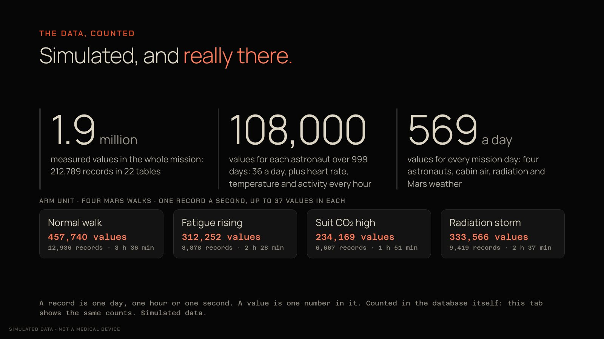
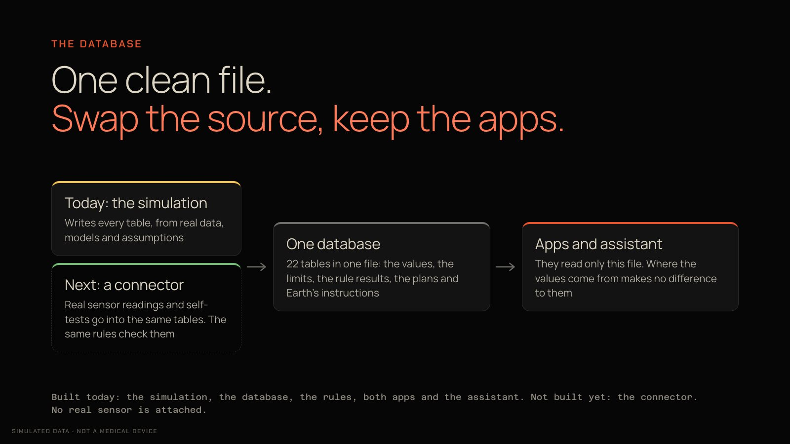
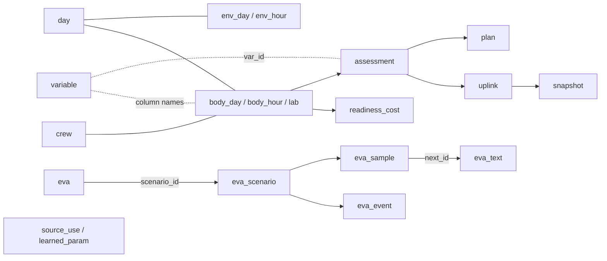

# Database schema of the simulated mission





> Every table and column of `data/sim/mission_sim.sqlite`: what one row is, what each column means, and who reads it. The column reference is generated from the code, so it stays in sync.

## 1. Purpose
`mission_sim.sqlite` is the single contract between the generator and everything that shows the mission: the site, the habitat app, the arm unit, the live view and the on-board assistant. This spec lets a person read the data and lets an AI agent change the generator without breaking a page.

## 2. Scope
- In: the 22 tables of `data/sim/mission_sim.sqlite`, their columns, keys, row counts and meaning; how this doc is kept in sync.
- Out: how the values are made (`05_simulation.md`); the reference database the generator reads (`03_reference_data.md`); routes that serve the file (`07_server_api.md`); how the pages use it (`08_apps.md`, `09_assistant.md`).

## 3. How it works
1. The schema is declared once, as the `SCHEMA` string in `tools/sim/base.py`.
2. `python3 -I tools/generate_mission_sim.py` builds the file into `data/sim/mission_sim.sqlite.tmp` and swaps it in at the end (`base.new_db()`, `base.publish()`), so a page that is loading never sees half a database.
3. The preview server serves it read-only as `/db/mission_sim.sqlite`; the pages open it in the browser with sql.js (`mocks/assets/simdb.js`). The server also reads it for the live view and the assistant.
4. `python3 -I tools/export_schema.py` reads `SCHEMA` (as text, without importing the generator), the `variable` table and the row counts, and rewrites only the part of this doc between the `schema:start` and `schema:end` markers.
5. The same run writes `mocks/content/schema.json`: for each table its group and one-line purpose (`TABLE_NOTES`, `GROUPS`), and for each column its type, key and meaning. The Database tab of the site (`mocks/database.html`) reads that file, so the site and this doc say the same.

**To look at the data, open the Database tab** (`http://127.0.0.1:8037/database.html`): the 22 tables in six groups, each with its columns and meanings, filters by crew, day and walk, 50 rows a page, a read-only SQL box with examples, and a download of the file. `?table=<name>` opens a table directly.

**How much data it holds** (2026-11-14): 212,789 records in 22 tables. The measured values (body, cabin and outside, Mars walks; filled fields without the keys) come to 1,906,335: about 108,250 for each astronaut over 999 days, 569 for one mission day with all four astronauts, and 1,337,727 for the four Mars walks of the arm unit (37,900 records, one a second). The Database tab counts these numbers live from the file; the table is in `00_overview.md` §3.5.

**Swapping the source.** The apps, the rules and the assistant depend only on these tables. A connector that writes real sensor readings and the astronaut's own measurements into `body_day`, `body_hour`, `env_day`, `env_hour`, `lab` and `eva_sample` would replace the generator's values; the rule step of the generator (`tools/sim/rules.py`, run by `tools/generate_mission_sim.py`) would then fill `assessment`, `plan` and `readiness_cost` from them as it does now. Planned, not built: no connector exists and no real sensor is attached.

How the tables hang together (all day-based tables join on `day`, all person-based tables on `crew_id`):



## 4. Interfaces

### 4.1 Tables (hand-written)

Row counts are from the file generated 2026-11-11 (seed 2037). "Read by" lists the files that query the table today.

**Mission and dictionary**

| Table | One row per | What it holds | Read by |
|---|---|---|---|
| `meta` | setting | Mission dates, key mission days, seed, generation time, atmosphere and dose constants, the storm-shielding assumption, the mission dose total and the day it passes 600 mSv, the label legend and the disclaimer | `simdb.js`, `serve_preview.py` |
| `day` | mission day (999: day -30 to 968) | The calendar: date, phase, sol, Mars season, gravity, signal time, link state, distances, the replayed real date, a title on key days | habitat, measures, sources, `assistant.js` |
| `crew` | crew member (4) | Fictional crew: call sign, role, sex, age, height, launch mass, EVA team, pre-launch baseline, personal model settings | `simdb.js` |
| `variable` | measured value (76) | The dictionary every page and the assistant use: label, unit, table and column, provenance label, method, thresholds for display, rule text and tag, why it matters, what to do, how it is simulated | `simdb.js`, `assistant.js`, `serve_preview.py` |

**Environment**

| Table | One row per | What it holds | Read by |
|---|---|---|---|
| `env_day` | day | Cabin air (CO₂ mean and one-hour peak, inspired oxygen mean and low, pressure, temperature, humidity), radiation (dose rate, dose, dose without shelter, shelter hours, storm level, proton flux), Mars weather, sunrise and sunset | habitat, measures, sources, `assistant.js` |
| `env_hour` | day and hour | Cabin CO₂, inspired oxygen, temperature, humidity and dose rate per hour | habitat, sources |

**Body**

| Table | One row per | What it holds | Read by |
|---|---|---|---|
| `body_day` | day and crew member | 33 daily body values, readiness and its band, main activity, symptoms in words | habitat, measures, sources, `assistant.js` |
| `body_hour` | day, crew member and hour | Heart rate, core temperature and activity per hour | habitat, sources |
| `lab` | lab day, crew member and value | Blood and urine panel (9 values, long format), every 28 days in flight and around landings | habitat, measures, sources, `assistant.js` |

**Rules and advice**

| Table | One row per | What it holds | Read by |
|---|---|---|---|
| `assessment` | day, person and flagged value | Rule result: `watch`, `warning` or `critical`, the value looked at, and the reason in words. No row means ok. Crew id `ENV` for environment rules | habitat, `assistant.js` |
| `readiness_cost` | day, person and cost item | Points each item takes off the readiness score of 100 | habitat, `assistant.js` |
| `plan` | day, person and item | Tomorrow's plan written by the on-board rules (sleep, exercise, food, fluids, EVA go or no-go, tests) with the reason | habitat, `assistant.js` |
| `uplink` | day and person | Earth's daily instruction: status, the day it is based on, its age, signal delay, headline, items, and the full letter on snapshot days | `assistant.js` |
| `snapshot` | snapshot day of the focus astronaut (24) | Title, why the day matters, written analysis, suggested questions | habitat, `assistant.js` |
| `event` | event (256) | Medical events, solar storms, the CO₂ fault, link blackout and weak-link days, the exercise-device fault, the EVA campaign, the low-mood stretch, countermeasure changes | habitat, sources, `assistant.js` |

**Mars walks (arm unit)**

| Table | One row per | What it holds | Read by |
|---|---|---|---|
| `eva` | planned EVA (157) | EVA log: day, sol, team, number, planned and actual length, distance, peak heart rate, dose, outcome; 14 rows are `postponed` | habitat, `assistant.js` |
| `eva_scenario` | second-by-second walk (4) | Title, day, sol, length, the second the apps open on, outcome, story text, and the day's values that drive the walk | arm unit, context, `assistant.js`, `serve_preview.py` |
| `eva_sample` | walk and second (37,900) | Everything the arm unit shows each second: task, state, limiting resource, stay time, position, body, suit, consumables, dose, the instruction shown | arm unit, measures, sources, `assistant.js`, `serve_preview.py` |
| `eva_text` | walk and instruction (76) | The 19 instruction texts the unit can show, repeated per walk | arm unit, `assistant.js`, `serve_preview.py` |
| `eva_event` | event in a walk (57) | Task changes, cautions, return calls and actions with the second they happen | arm unit, `assistant.js`, `serve_preview.py` |

**Provenance**

| Table | One row per | What it holds | Read by |
|---|---|---|---|
| `learned_param` | learned parameter (7) | Shapes and baselines learned from real datasets: the numbers, dataset, sample size, method, what uses them | sources |
| `source_use` | dataset and use (40) | Every reference dataset and how the simulation uses it (or `not used`), with licence, URL and the variables it feeds | sources |

### 4.2 Column reference (generated)

Do not edit this part by hand. Meanings of measured values come from the `variable` table; all other meanings from `COLUMN_NOTES` and `COMMON` in `tools/export_schema.py`.

<!-- schema:start -->
<!-- Generated by tools/export_schema.py. Do not edit between the markers: change tools/sim/base.py or the notes in tools/export_schema.py, then re-run. -->

Schema: `SCHEMA` in `tools/sim/base.py`, 22 tables, 266 columns. Row counts and value meanings: `data/sim/mission_sim.sqlite`, seed 2037.

| Table | Rows | Columns | Primary key |
|---|---:|---:|---|
| [`meta`](#meta) | 28 | 2 | `key` |
| [`crew`](#crew) | 4 | 10 | `crew_id` |
| [`variable`](#variable) | 76 | 29 | `var_id` |
| [`day`](#day) | 999 | 15 | `day` |
| [`env_day`](#env_day) | 999 | 20 | `day` |
| [`env_hour`](#env_hour) | 23,976 | 7 | `day`, `hour` |
| [`body_day`](#body_day) | 3,996 | 40 | `day`, `crew_id` |
| [`body_hour`](#body_hour) | 95,904 | 6 | `day`, `crew_id`, `hour` |
| [`lab`](#lab) | 1,368 | 4 | `day`, `crew_id`, `var_id` |
| [`assessment`](#assessment) | 18,065 | 6 | `day`, `crew_id`, `var_id` |
| [`readiness_cost`](#readiness_cost) | 9,623 | 4 | `day`, `crew_id`, `item` |
| [`event`](#event) | 256 | 10 | `event_id` |
| [`plan`](#plan) | 15,233 | 6 | `day`, `crew_id`, `seq` |
| [`uplink`](#uplink) | 3,996 | 9 | `day`, `crew_id` |
| [`snapshot`](#snapshot) | 24 | 6 | `day`, `crew_id` |
| [`eva`](#eva) | 157 | 14 | `eva_id` |
| [`eva_scenario`](#eva_scenario) | 4 | 14 | `scenario_id` |
| [`eva_sample`](#eva_sample) | 37,900 | 39 | `scenario_id`, `t_s` |
| [`eva_text`](#eva_text) | 76 | 3 | `scenario_id`, `next_id` |
| [`eva_event`](#eva_event) | 57 | 6 | none |
| [`learned_param`](#learned_param) | 7 | 6 | `param_id` |
| [`source_use`](#source_use) | 40 | 10 | `dataset_id`, `how` |

#### `meta`

28 rows.

| Column | Type | Key | Meaning |
|---|---|---|---|
| `key` | TEXT | PK | Setting name, e.g. `seed`, `launch_utc`, `day_dose_600`, `dose_total_msv`, `storm_shielding_assumption`, `disclaimer`. |
| `value` | TEXT |  | Setting value, always stored as text (numbers and JSON included). |

#### `crew`

4 rows.

| Column | Type | Key | Meaning |
|---|---|---|---|
| `crew_id` | TEXT | PK | Crew member id, `C1` to `C4`. `C1` (KESTREL) is the focus astronaut of the apps. |
| `call_sign` | TEXT |  | Fictional call sign: KESTREL, HERON, OSPREY, WREN. |
| `role` | TEXT |  | Role on board, e.g. `flight engineer`, `commander`. |
| `sex` | TEXT |  | `F` or `M`. Selects sex-specific lab cut-offs and NASA condition odds. |
| `age` | INTEGER |  | Age at launch, years. |
| `height_cm` | REAL |  | Height, cm. |
| `launch_mass_kg` | REAL |  | Body mass at launch, kg. Reference for mass change. |
| `eva_team` | TEXT |  | EVA team: `A` (C1 and C3) or `B` (C2 and C4). |
| `baseline_json` | TEXT |  | JSON: mean of the 30 pre-launch days for ten daily values (resting heart rate, HRV, blood pressure, blood oxygen, core temperature, sleep, reaction time, wellbeing, body mass). |
| `traits_json` | TEXT |  | JSON: personal model settings. `vo2` = aerobic fitness at launch (mL/kg/min); `bone` = hip bone change per month in weightlessness (%); `sans` = optic-disc swelling the person tends to (µm); `e_adh`, `x_adh` = how well the person keeps to the food and exercise plan (1 = fully); `ortho` = sensitivity to standing up after flight (1 = average). |

#### `variable`

76 rows.

| Column | Type | Key | Meaning |
|---|---|---|---|
| `var_id` | TEXT | PK | Value id. Body and environment ids equal their column name; arm-unit ids start with `eva.`; lab ids are values of `lab.var_id`. Exception: `comm_state` is the column `day.comm`. |
| `scope` | TEXT |  | `env`, `body`, `lab` or `eva` (arm unit). |
| `grp` | TEXT |  | Display group, e.g. `Air`, `Radiation`, `Sleep and mind`, `Arm unit`. |
| `label` | TEXT |  | Plain-English name shown in the apps. |
| `unit` | TEXT |  | Unit shown in the apps. |
| `decimals` | INTEGER |  | Decimals to show. |
| `cadence` | TEXT |  | `hourly`, `daily`, `every 28 days`, `every second` or `under gravity`. |
| `table_name` | TEXT |  | Table that holds the value. |
| `column_name` | TEXT |  | Column that holds the value. For `lab`, the value of `lab.var_id`. |
| `kind` | TEXT |  | Provenance label: `COMPUTED`, `REPLAY`, `SIM` or `MODEL` (`11_provenance.md`). |
| `method` | TEXT |  | How the generator makes it: `computed`, `replay`, `model` or `learned`. |
| `sensor` | TEXT |  | What would measure it on a real mission. |
| `region` | TEXT |  | Body region or system, for grouping on the body map. |
| `catalog_id` | TEXT |  | Row id in the indicator catalog (`kb/13`; `indicator.indicator_id` in the reference database). |
| `hrp_risk` | TEXT |  | NASA Human Research Program risk the value belongs to. |
| `better` | TEXT |  | Direction: `high` (higher is better), `low`, `band` (inside a range) or `info` (no direction). |
| `watch_low` | REAL |  | Watch level, low side, if one number expresses it. Display only: the rules in `tools/sim/rules.py` decide. |
| `watch_high` | REAL |  | Watch level, high side. Display only (see `watch_low`). |
| `warn_low` | REAL |  | Warning level, low side. Display only. |
| `warn_high` | REAL |  | Warning level, high side. Display only. |
| `crit_low` | REAL |  | Critical level, low side. Display only. |
| `crit_high` | REAL |  | Critical level, high side. Display only. |
| `rule_text` | TEXT |  | The rule in words, as the apps show it. |
| `rule_tag` | TEXT |  | Source of the thresholds: NASA, CLIN, RES or INF (our assumption), with the reference. |
| `why` | TEXT |  | Why the value matters, in plain words. |
| `action` | TEXT |  | What to do when it is flagged. |
| `how_simulated` | TEXT |  | How the generator makes the value, in words. |
| `learned_from` | TEXT |  | Dataset a shape was learned from, if any. |
| `sort` | INTEGER |  | Display order. |

#### `day`

999 rows.

| Column | Type | Key | Meaning |
|---|---|---|---|
| `day` | INTEGER | PK | Mission day: 0 = launch (2037-09-03), -30 = first pre-launch day, 968 = last day. Joins to `day.day`. |
| `date_utc` | TEXT |  | Calendar date, `YYYY-MM-DD`. |
| `phase` | TEXT |  | `prelaunch`, `outbound`, `surface`, `return` or `recovery`. |
| `phase_day` | INTEGER |  | Days since the first day of the phase (0 = first day). |
| `sol` | INTEGER |  | Mars sol in progress (1 to 546); empty off Mars. |
| `mars_ls` | REAL |  | Mars season angle (solar longitude Ls), degrees. |
| `season` | TEXT |  | Mars season by hemisphere, with the dust season marked. |
| `gravity_g` | REAL |  | Gravity, g. `COMPUTED`. Gravity the crew feels: 1 on Earth, 0 in transit, 0.38 on Mars. |
| `light_time_min` | REAL |  | Signal time to Earth, one way, min. `COMPUTED`. |
| `round_trip_min` | REAL |  | Two-way signal time, minutes. |
| `comm` | TEXT |  | Link to Earth. `COMPUTED`, variable `comm_state`. |
| `dist_earth_au` | REAL |  | Distance between crew and Earth, AU. |
| `dist_sun_au` | REAL |  | Distance between crew and Sun, AU. |
| `analog_date` | TEXT |  | Real date whose measurements are replayed on this day (date minus 8,065 days). |
| `key_label` | TEXT |  | Title of a key day (launch, landings, departure, snapshot days); empty on other days. |

#### `env_day`

999 rows.

| Column | Type | Key | Meaning |
|---|---|---|---|
| `day` | INTEGER | PK | Mission day: 0 = launch (2037-09-03), -30 = first pre-launch day, 968 = last day. Joins to `day.day`. |
| `cabin_co2_mmhg` | REAL |  | Daily mean of `env_hour.cabin_co2_mmhg`, mmHg. |
| `cabin_co2_max1h` | REAL |  | Highest hourly cabin CO₂ of the day, mmHg. The 3 mmHg one-hour rule reads this. |
| `cabin_pio2_mmhg` | REAL |  | Daily mean inspired oxygen, mmHg. |
| `cabin_pio2_min` | REAL |  | Lowest hourly inspired oxygen of the day (airlock dips), mmHg. |
| `cabin_pressure_kpa` | REAL |  | Cabin pressure, kPa. `SIM`. |
| `cabin_temp_c` | REAL |  | Daily mean cabin temperature, °C. |
| `cabin_rh_pct` | REAL |  | Daily mean relative humidity, %. |
| `dose_rate_usv_h` | REAL |  | Daily mean dose rate outside the storm shelter, µSv/h. |
| `dose_day_msv` | REAL |  | Radiation dose today, mSv. `REPLAY`. |
| `dose_unsheltered_msv` | REAL |  | Dose the day would have given without the storm shelter, mSv. |
| `shelter_h` | REAL |  | Hours the crew spends in the storm shelter. |
| `storm_level` | INTEGER |  | Solar storm level, S-scale. `REPLAY`. |
| `proton_flux_pfu` | REAL |  | Daily maximum proton flux above 10 MeV at Earth on the replayed day (OMNI), pfu. Transit days only. |
| `out_temp_max_c` | REAL |  | Outside air, daily high, °C. `REPLAY`. |
| `out_temp_min_c` | REAL |  | Outside air, nightly low, °C. `REPLAY`. |
| `out_pressure_pa` | REAL |  | Outside air pressure, Pa. `REPLAY`. |
| `out_uv_index` | REAL |  | Outside ultraviolet, index 1-4. `REPLAY`. |
| `sunrise_h` | REAL |  | Sunrise at Gale crater, local mean solar time, hours. Surface only. |
| `sunset_h` | REAL |  | Sunset at Gale crater, local mean solar time, hours. Surface only. |

#### `env_hour`

23,976 rows; stored `WITHOUT ROWID`.

| Column | Type | Key | Meaning |
|---|---|---|---|
| `day` | INTEGER | PK | Mission day: 0 = launch (2037-09-03), -30 = first pre-launch day, 968 = last day. Joins to `day.day`. |
| `hour` | INTEGER | PK | Hour of the day, 0 to 23. |
| `cabin_co2_mmhg` | REAL |  | Cabin carbon dioxide, mmHg. `REPLAY`. |
| `cabin_pio2_mmhg` | REAL |  | Oxygen you breathe in, mmHg. `SIM`. |
| `cabin_temp_c` | REAL |  | Cabin temperature, °C. `REPLAY`. |
| `cabin_rh_pct` | REAL |  | Cabin humidity, %. `REPLAY`. |
| `dose_rate_usv_h` | REAL |  | Radiation dose rate, µSv/h. `REPLAY`. |

#### `body_day`

3,996 rows; stored `WITHOUT ROWID`.

| Column | Type | Key | Meaning |
|---|---|---|---|
| `day` | INTEGER | PK | Mission day: 0 = launch (2037-09-03), -30 = first pre-launch day, 968 = last day. Joins to `day.day`. |
| `crew_id` | TEXT | PK | Crew member, `C1` to `C4`. Joins to `crew.crew_id`. |
| `hr_rest_bpm` | REAL |  | Resting heart rate, bpm. `SIM`. |
| `hrv_rmssd_ms` | REAL |  | Heart-rate variability, ms. `SIM`. |
| `bp_sys_mmhg` | REAL |  | Blood pressure, upper value, mmHg. `SIM`. |
| `bp_dia_mmhg` | REAL |  | Blood pressure, lower value, mmHg. `SIM`. |
| `spo2_pct` | REAL |  | Blood oxygen, %. `SIM`. |
| `resp_rate_bpm` | REAL |  | Breathing rate, per min. `SIM`. |
| `temp_core_c` | REAL |  | Core body temperature, °C. `SIM`. |
| `stand_dhr_bpm` | REAL |  | Stand test, heart-rate rise, bpm. `SIM`. |
| `ortho_risk_pct` | REAL |  | Chance to fail a stand test if landing today, %. `MODEL`. |
| `sleep_h` | REAL |  | Sleep last night, h. `SIM`. |
| `sleep_eff_pct` | REAL |  | Sleep efficiency, %. `SIM`. |
| `sleep_debt_h` | REAL |  | Sleep debt, h. `MODEL`. |
| `pvt_rt_ms` | REAL |  | Reaction time, ms. `SIM`. |
| `pvt_z` | REAL |  | Reaction speed, SD vs own usual. `SIM`. |
| `mood_who5` | REAL |  | Wellbeing (WHO-5), of 25. `SIM`. |
| `stress_0_10` | REAL |  | Stress, 0-10. `SIM`. |
| `body_mass_kg` | REAL |  | Body mass, kg. `SIM`. |
| `energy_pct` | REAL |  | Energy eaten vs need, %. `SIM`. |
| `protein_g_kg` | REAL |  | Protein, g per kg. `SIM`. |
| `fluid_l` | REAL |  | Fluids, L. `SIM`. |
| `urine_l` | REAL |  | Urine volume, L. `SIM`. |
| `stone_risk_irr` | REAL |  | Kidney-stone risk vs pre-flight, x. `MODEL`. |
| `exercise_min` | REAL |  | Exercise minutes, min. `SIM`. |
| `exercise_pct` | REAL |  | Exercise done vs plan, %. `SIM`. |
| `resist_min` | REAL |  | Minutes of resistive exercise. |
| `vo2max_pct` | REAL |  | Aerobic fitness vs pre-flight, %. `MODEL`. |
| `leg_strength_pct` | REAL |  | Leg strength vs pre-flight, %. `MODEL`. |
| `bmd_hip_pct` | REAL |  | Hip bone density vs pre-flight, %. `MODEL`. |
| `back_pain_0_10` | REAL |  | Back pain, 0-10. `SIM`. |
| `sms_grade` | REAL |  | Motion sickness, grade 0-3. `SIM`. |
| `balance_pct` | REAL |  | Balance, heel-to-toe walk, % of pre-flight. `SIM`. |
| `sans_trt_um` | REAL |  | Optic disc swelling, µm. `MODEL`. |
| `dose_day_msv` | REAL |  | Dose received that day, mSv (same as `env_day.dose_day_msv`). |
| `dose_cum_msv` | REAL |  | Radiation dose this mission, mSv. `MODEL`. |
| `readiness` | REAL |  | Readiness, of 100. `MODEL`. |
| `readiness_band` | TEXT |  | `Ready` (85 and over), `Ready with limits` (70 to 84), `Restricted` (50 to 69), `Stand down` (under 50). |
| `activity` | TEXT |  | Main activity: `work day`, `EVA nn`, `storm shelter`, `launch`, `Mars landing`, `Mars departure`, `Earth landing`, `pre-launch quarantine` or `rehabilitation`. |
| `symptoms` | TEXT |  | Symptoms of the day in plain words, separated by `; `. Empty if none. |

#### `body_hour`

95,904 rows; stored `WITHOUT ROWID`.

| Column | Type | Key | Meaning |
|---|---|---|---|
| `day` | INTEGER | PK | Mission day: 0 = launch (2037-09-03), -30 = first pre-launch day, 968 = last day. Joins to `day.day`. |
| `crew_id` | TEXT | PK | Crew member, `C1` to `C4`. Joins to `crew.crew_id`. |
| `hour` | INTEGER | PK | Hour of the day, 0 to 23. |
| `hr_bpm` | REAL |  | Heart rate in that hour, bpm (24-hour shape learned from MMASH). |
| `temp_core_c` | REAL |  | Core temperature in that hour, °C (daily wave around `body_day.temp_core_c`). |
| `activity` | TEXT |  | `sleep`, `work`, `exercise`, `EVA` or `shelter`. |

#### `lab`

1,368 rows; stored `WITHOUT ROWID`; index `ix_lab` on (`crew_id`, `var_id`, `day`).

| Column | Type | Key | Meaning |
|---|---|---|---|
| `day` | INTEGER | PK | Mission day: 0 = launch (2037-09-03), -30 = first pre-launch day, 968 = last day. Joins to `day.day`. |
| `crew_id` | TEXT | PK | Crew member, `C1` to `C4`. Joins to `crew.crew_id`. |
| `var_id` | TEXT | PK | Which lab value. One of the `variable` rows with `scope = 'lab'` (listed below). |
| `value` | REAL |  | Result, in the unit of that variable. |

Values held in long format (`lab.var_id`), from the `variable` table:

| `var_id` | Meaning |
|---|---|
| `hemoglobin_g_dl` | Hemoglobin, g/dL. `SIM`. |
| `wbc_k_ul` | White blood cells, 10³/µL. `SIM`. |
| `lymph_k_ul` | Lymphocytes, 10³/µL. `SIM`. |
| `vitd_ng_ml` | Vitamin D, ng/mL. `SIM`. |
| `ferritin_ng_ml` | Iron stores (ferritin), ng/mL. `SIM`. |
| `creatinine_mg_dl` | Creatinine (kidney), mg/dL. `SIM`. |
| `crp_mg_l` | Inflammation (CRP), mg/L. `SIM`. |
| `glucose_mg_dl` | Fasting blood sugar, mg/dL. `SIM`. |
| `urine_ca_mg_day` | Calcium in urine, mg/day. `SIM`. |

#### `assessment`

18,065 rows; stored `WITHOUT ROWID`.

| Column | Type | Key | Meaning |
|---|---|---|---|
| `day` | INTEGER | PK | Mission day: 0 = launch (2037-09-03), -30 = first pre-launch day, 968 = last day. Joins to `day.day`. |
| `crew_id` | TEXT | PK | Crew member `C1` to `C4`, or `ENV` for environment rules. |
| `var_id` | TEXT | PK | Value that was flagged (`variable.var_id`). |
| `status` | TEXT |  | `watch`, `warning` or `critical`. Only flagged values have a row: no row means ok. |
| `value` | REAL |  | Value the rule looked at (can be a mean, e.g. the 7-day sleep mean). |
| `reason` | TEXT |  | Why, in plain words. |

#### `readiness_cost`

9,623 rows; stored `WITHOUT ROWID`.

| Column | Type | Key | Meaning |
|---|---|---|---|
| `day` | INTEGER | PK | Mission day: 0 = launch (2037-09-03), -30 = first pre-launch day, 968 = last day. Joins to `day.day`. |
| `crew_id` | TEXT | PK | Crew member, `C1` to `C4`. Joins to `crew.crew_id`. |
| `item` | TEXT | PK | What costs points: `Sleep debt`, `Reaction speed`, `Heart strain`, `Energy and fluids`, `Exercise shortfall`, `Symptoms`, `Mood and stress`, `Balance and standing`, `Cabin air`, `Bone trend`. |
| `points` | REAL |  | Points taken off 100. Items under 0.5 points are not stored. |

#### `event`

256 rows; index `ix_event_day` on (`day_start`, `day_end`).

| Column | Type | Key | Meaning |
|---|---|---|---|
| `event_id` | INTEGER | PK | Row id. |
| `day_start` | INTEGER |  | First mission day of the event. |
| `day_end` | INTEGER |  | Last mission day of the event (inclusive). |
| `scope` | TEXT |  | `env`, `mission` or `crew`. |
| `crew_id` | TEXT |  | Crew member for `crew` events; empty otherwise. |
| `type` | TEXT |  | `medical`, `solar_storm`, `co2_removal_fault`, `comm_blackout`, `comm_degraded`, `device_fault`, `workload`, `behaviour` or `countermeasure`. |
| `severity` | TEXT |  | `info`, `watch` or `warning`; medical events use `minor`, `moderate` or `major`. |
| `title` | TEXT |  | Short title. |
| `detail` | TEXT |  | Detail in plain words. |
| `origin` | TEXT |  | Where it comes from, e.g. `scripted`, `REAL replay; shielding factors assumed`, `REAL astronomy`, `MODEL: NASA medical-conditions ranking (kb/19)`, `rule`. |

#### `plan`

15,233 rows; stored `WITHOUT ROWID`.

| Column | Type | Key | Meaning |
|---|---|---|---|
| `day` | INTEGER | PK | Day the plan is written. It is the plan for the next day. |
| `crew_id` | TEXT | PK | Crew member, `C1` to `C4`. Joins to `crew.crew_id`. |
| `seq` | INTEGER | PK | Order of the item in that plan (0 first). |
| `topic` | TEXT |  | `Sleep`, `Exercise`, `Food`, `Fluids`, `EVA`, `Landing`, `Departure`, `Work`, `Air`, `Radiation`, `Tests`, `Medical` or `Routine`. |
| `text` | TEXT |  | The instruction. |
| `why` | TEXT |  | The reason, from that day's values. |

#### `uplink`

3,996 rows; stored `WITHOUT ROWID`.

| Column | Type | Key | Meaning |
|---|---|---|---|
| `day` | INTEGER | PK | Day the instruction arrives (in the morning). |
| `crew_id` | TEXT | PK | Crew member, `C1` to `C4`. Joins to `crew.crew_id`. |
| `status` | TEXT |  | `received`, `short` (weak link: two items at most), `none` (blackout: standing orders apply) or `in_person` (on Earth). |
| `based_on_day` | INTEGER |  | Day whose data Earth used: normally the day before; in the blackout, the last day with a link. |
| `age_days` | INTEGER |  | Days since the last instruction arrived (counts up during the blackout). |
| `delay_min` | REAL |  | One-way signal time that day, minutes. Empty without a link. |
| `headline` | TEXT |  | One-line summary. |
| `items_json` | TEXT |  | JSON list of items: `topic`, `text`, `why`, `priority` (1 = most important), and `standing: true` when repeated as standing orders. |
| `narrative` | TEXT |  | Full letter from the flight surgeon on snapshot days of the focus astronaut; empty otherwise. |

#### `snapshot`

24 rows; stored `WITHOUT ROWID`.

| Column | Type | Key | Meaning |
|---|---|---|---|
| `day` | INTEGER | PK | Mission day: 0 = launch (2037-09-03), -30 = first pre-launch day, 968 = last day. Joins to `day.day`. |
| `crew_id` | TEXT | PK | Always the focus astronaut, `C1`. |
| `title` | TEXT |  | Title of the snapshot day. |
| `why` | TEXT |  | Why the day matters. |
| `analysis` | TEXT |  | Written analysis, built from that day's numbers. |
| `questions_json` | TEXT |  | JSON list of suggested questions for the assistant. |

#### `eva`

157 rows.

| Column | Type | Key | Meaning |
|---|---|---|---|
| `eva_id` | INTEGER | PK | Row id. |
| `day` | INTEGER |  | Mission day: 0 = launch (2037-09-03), -30 = first pre-launch day, 968 = last day. Joins to `day.day`. |
| `sol` | INTEGER |  | Mars sol in progress (1 to 546); empty off Mars. |
| `team` | TEXT |  | `A` or `B`. |
| `crew_ids` | TEXT |  | The two team members, comma-separated. |
| `number` | INTEGER |  | Running EVA number of the team. Empty if postponed. |
| `planned_min` | REAL |  | Planned length, minutes. |
| `actual_min` | REAL |  | Actual length, minutes (0 if postponed). |
| `distance_m` | REAL |  | Distance walked, m. Drawn for ordinary EVAs; twice the farthest point for the four scenario walks. |
| `peak_hr` | REAL |  | Highest heart rate, bpm. |
| `dose_usv` | REAL |  | Dose during the EVA, µSv. |
| `outcome` | TEXT |  | `nominal`, `postponed`, `shortened: fatigue`, `terminated: CO2 scrubber fault` or `terminated: solar storm warning`. |
| `summary` | TEXT |  | Story text for the four scenario walks, reason for postponed EVAs; empty otherwise. |
| `scenario_id` | TEXT |  | Scenario walk for the four second-by-second EVAs; empty otherwise. |

#### `eva_scenario`

4 rows.

| Column | Type | Key | Meaning |
|---|---|---|---|
| `scenario_id` | TEXT | PK | Second-by-second walk: `nominal`, `fatigue`, `co2` or `storm`. Joins to `eva_scenario.scenario_id`. |
| `eva_id` | INTEGER |  | Not filled (always empty). Link through `eva.scenario_id` instead. |
| `sort` | INTEGER |  | Display order, 1 to 4. |
| `title` | TEXT |  | Title of the walk. |
| `day` | INTEGER |  | Mission day: 0 = launch (2037-09-03), -30 = first pre-launch day, 968 = last day. Joins to `day.day`. |
| `sol` | INTEGER |  | Mars sol in progress (1 to 546); empty off Mars. |
| `date_utc` | TEXT |  | Calendar date, `YYYY-MM-DD`. |
| `crew_id` | TEXT |  | The focus astronaut, `C1`. |
| `start_local_h` | REAL |  | Local start time at suit seal, hours (10.0). |
| `duration_s` | INTEGER |  | Length from suit seal to helmet off, seconds (= rows in `eva_sample`). |
| `snapshot_t_s` | INTEGER |  | Second the apps open on by default. |
| `outcome` | TEXT |  | Same values as `eva.outcome`. |
| `summary` | TEXT |  | The story of the walk in plain words. |
| `context_json` | TEXT |  | JSON: that day's values that drive the walk (readiness, fitness, resting heart rate, dose rate, sunset, ...) and the walk's summary numbers. |

#### `eva_sample`

37,900 rows; stored `WITHOUT ROWID`.

| Column | Type | Key | Meaning |
|---|---|---|---|
| `scenario_id` | TEXT | PK | Second-by-second walk: `nominal`, `fatigue`, `co2` or `storm`. Joins to `eva_scenario.scenario_id`. |
| `t_s` | INTEGER | PK | Seconds since suit seal. |
| `phase` | TEXT |  | `airlock`, `prebreathe`, `depress`, `egress`, `traverse`, `work`, `rest`, `ingress`, `repress` or `post`. |
| `task` | TEXT |  | Current task in words; `Rest ordered by the unit` during an ordered rest. |
| `seg_left_s` | INTEGER |  | Seconds left in the current task; empty while walking. |
| `state` | TEXT |  | Unit state: `go`, `caution` or `return` (the code also has `emergency`, not reached in the four walks). |
| `limiter` | TEXT |  | Resource with the smallest margin: `Stamina`, `Oxygen`, `Battery`, `Cooling water`, `CO₂ scrubber`, `Daylight`, or an event rule (`CO₂ limit`, `Storm rule`). Empty inside. |
| `stay_min` | REAL |  | You can stay, min. `MODEL`, variable `eva.stay_min`. Minutes the crew member can stay: the smallest margin after the walk back and the reserve. |
| `walk_back_min` | REAL |  | Minutes needed to walk back to the airlock from here. |
| `dist_m` | REAL |  | Walk back to the airlock, m. `SIM`, variable `eva.dist_m`. |
| `x_m` | REAL |  | Position relative to the airlock, x axis, m (map of the route). |
| `y_m` | REAL |  | Position relative to the airlock, y axis, m. |
| `met_w` | REAL |  | Work rate, W. `MODEL`, variable `eva.met_w`. |
| `hr_bpm` | REAL |  | Heart rate, bpm. `SIM`, variable `eva.hr_bpm`. |
| `core_c` | REAL |  | Core temperature, °C. `SIM`, variable `eva.core_c`. |
| `lactate_mmol` | REAL |  | Lactate, mmol/L. `MODEL`, variable `eva.lactate_mmol`. |
| `stamina_pct` | REAL |  | Stamina left, %. `MODEL`, variable `eva.stamina_pct`. |
| `balance_score` | REAL |  | Balance, of 100. `MODEL`, variable `eva.balance_score`. |
| `faint_risk_pct` | REAL |  | Chance to faint, %. `MODEL`, variable `eva.faint_risk_pct`. |
| `heat_kj_kg` | REAL |  | Stored heat, kJ/kg. `MODEL`, variable `eva.heat_kj_kg`. |
| `suit_p_kpa` | REAL |  | Suit pressure, kPa. `SIM`, variable `eva.suit_p_kpa`. |
| `suit_o2_pct` | REAL |  | Oxygen tank, %. `SIM`, variable `eva.suit_o2_pct`. |
| `suit_co2_mmhg` | REAL |  | CO2 in the helmet, mmHg. `SIM`, variable `eva.suit_co2_mmhg`. |
| `suit_temp_c` | REAL |  | Suit temperature, °C. `SIM`, variable `eva.suit_temp_c`. |
| `battery_pct` | REAL |  | Battery, %. `SIM`, variable `eva.battery_pct`. |
| `water_pct` | REAL |  | Cooling water, %. `SIM`, variable `eva.water_pct`. |
| `scrubber_pct` | REAL |  | CO2 scrubber, %. `SIM`, variable `eva.scrubber_pct`. |
| `cooling_level` | INTEGER |  | Suit cooling setting, 1 to 5. |
| `dose_rate_usv_h` | REAL |  | Dose rate outside, µSv/h. `REPLAY`, variable `eva.dose_rate_usv_h`. |
| `eva_dose_usv` | REAL |  | Dose this EVA, µSv. `MODEL`, variable `eva.eva_dose_usv`. |
| `drink_ml` | REAL |  | Water drunk so far, mL. |
| `left_o2_min` | REAL |  | Minutes the oxygen lasts at the current rate. |
| `left_battery_min` | REAL |  | Minutes the battery lasts. |
| `left_water_min` | REAL |  | Minutes the cooling water lasts. |
| `left_scrubber_min` | REAL |  | Minutes the CO₂ scrubber lasts. |
| `left_daylight_min` | REAL |  | Minutes to sunset. |
| `left_stamina_min` | REAL |  | Minutes until stamina reaches its floor (15 %). |
| `left_event_min` | REAL |  | Minutes left under an event rule (storm: indoors within 30 min; CO₂: time to 20 mmHg). Empty without an event. |
| `next_id` | INTEGER |  | Instruction shown on the unit; key into `eva_text.next_id`. |

#### `eva_text`

76 rows; stored `WITHOUT ROWID`.

| Column | Type | Key | Meaning |
|---|---|---|---|
| `scenario_id` | TEXT | PK | Second-by-second walk: `nominal`, `fatigue`, `co2` or `storm`. Joins to `eva_scenario.scenario_id`. |
| `next_id` | INTEGER | PK | Instruction number, 1 to 19. |
| `text` | TEXT |  | Instruction text (the same 19 texts for each walk). |

#### `eva_event`

57 rows; index `ix_evaevent` on (`scenario_id`, `t_s`).

| Column | Type | Key | Meaning |
|---|---|---|---|
| `scenario_id` | TEXT |  | Second-by-second walk: `nominal`, `fatigue`, `co2` or `storm`. Joins to `eva_scenario.scenario_id`. |
| `t_s` | INTEGER |  | Second of the walk. |
| `kind` | TEXT |  | `phase` (new task), `caution`, `alarm` (return called), `action` or `info`. |
| `severity` | TEXT |  | `info`, `caution` or `return`. |
| `var_id` | TEXT |  | Value that triggered it (`variable.var_id`); empty for phase changes. |
| `text` | TEXT |  | What the unit says. |

#### `learned_param`

7 rows.

| Column | Type | Key | Meaning |
|---|---|---|---|
| `param_id` | TEXT | PK | `hr_day_shape`, `lactate_curve`, `hr_vo2`, `pvt_sleep_loss`, `tilt_response`, `baseline_nhanes` or `baseline_i4`. |
| `value_json` | TEXT |  | The learned numbers (JSON). Aggregates only, no individual record. |
| `dataset_id` | TEXT |  | Reference dataset it was learned from. |
| `n` | INTEGER |  | Number of people, tests or sessions used. |
| `method` | TEXT |  | How it was learned, in words. |
| `used_for` | TEXT |  | Which simulated values use it. |

#### `source_use`

40 rows; stored `WITHOUT ROWID`.

| Column | Type | Key | Meaning |
|---|---|---|---|
| `dataset_id` | TEXT | PK | Dataset id in the reference database, or `jpl_horizons`, `nasa_imm_ranking`, `indicator_catalog`, `nasa_std_3001`. |
| `title` | TEXT |  | Dataset title. |
| `kind` | TEXT |  | `timeseries`, `events`, `subjects`, `computed`, `table` or `document`. |
| `provenance` | TEXT |  | e.g. `REAL`, `REAL astronomy`, `NASA model output`, `NASA standard`. |
| `licence` | TEXT |  | Licence. Ends in `(no redistribution)` where that applies. |
| `source_url` | TEXT |  | Where the data comes from. |
| `how` | TEXT | PK | Use in the simulation: `replay`, `shape`, `baseline`, `check`, `level`, `computed`, `probability`, `model`, `rule` or `not used`. |
| `used_for` | TEXT |  | What it feeds, in words. |
| `note` | TEXT |  | Note on the use. |
| `feeds` | TEXT |  | Comma-separated `variable.var_id` values it feeds (for links on the site). |

<!-- schema:end -->

## 5. Run it
```sh
python3 -I tools/generate_mission_sim.py      # after a change to tools/sim/: rebuild the file (about 3 s)
python3 -I tools/export_schema.py             # rewrite section 4.2 of this doc and mocks/content/schema.json
python3 -I tools/export_schema.py --check     # exit code 1 if this doc is out of date
python3 -I tools/export_schema.py --stdout    # print section 4.2 only
```
The tool prints a warning for a column without a meaning, for a note whose column no longer exists, and when the file and `tools/sim/base.py` disagree. After adding a column: add its meaning to `COLUMN_NOTES` (or give it a `variable` row), re-run, and update section 4.1 if a table changed. After adding a table: also give it a group and a purpose in `TABLE_NOTES`, or the tool warns and the Database tab shows it under "Other". `--check` and `--stdout` do not write the JSON file.

## 6. Data and provenance
- Every measured value carries a provenance label in `variable.kind`: `COMPUTED` 3, `REPLAY` 11, `SIM` 45, `MODEL` 17 (76 in all). How they map to the project labels: `11_provenance.md`.
- The file holds simulated values only. No individual record from any source is copied into it: `learned_param` holds aggregates (medians, fitted curves), and `source_use` holds metadata. No SILSO sunspot values are in it (checked against `tools/generate_mission_sim.py` and `tools/sim/env.py`). None of the three PhysioNet datasets that may not be redistributed is used (`source_use.how = 'not used'`).
- Text columns (`assessment.reason`, `plan`, `uplink`, `snapshot`, `eva_text`) are written by rules from the day's numbers, not by an AI model.
- The crew is fictional.

## 7. Decisions and assumptions
- One SQLite file with wide tables for days and seconds, plus one `variable` dictionary, feeds every page and the assistant (`kb/25` §11, lesson 8).
- The file is shown on the site as what it is: a separate, clean database of simulated data only, open to explore (`13_decisions.md`, D-17).
- `assessment` stores only flagged values; a missing row means ok.
- Lab results are long format (`lab.var_id`) because they come every 28 days, not daily.
- The arm-unit tables hold four walks, not every EVA: a whole mission at one-second steps would be far too large (`kb/23` §6).

## 8. Open questions
- **Thresholds live in two places.** `variable.watch_*`, `warn_*`, `crit_*` are for display; the deciding thresholds are coded in `tools/sim/rules.py` (`assess`, `lab_status`) and in `tools/sim/eva.py`. Some differ or are empty in `variable` (for example the resting heart-rate watch level of 91 bpm in code is empty in `variable`; lab cut-offs are empty). Decide whether `rules.py` should read the thresholds from `variable`.
- **`eva_scenario.eva_id` is never filled.** Link through `eva.scenario_id`. Fill it or drop the column.
- **Mars departure is one day apart.** `meta.mars_departure_utc` and the mission plan say 2039-09-06 (day 733); `meta.day_mars_departure` and the `day` row titled "Mars departure" are day 734 (2039-09-07), the first day of phase `return`. See `04_mission_plan.md`.
- **`kb/25` §6 says `eva_sample` has 38,561 rows;** the file has 37,900 (the sum of the four walk lengths). The code is right; `kb/25` is stale.
- **`source_use.licence` and `source_url` are empty** for `donki_sep_events` and `noaa_sep_events`, although the download manifest records "public domain" for both. The licence is lost when the reference database is built (`dataset.licence` is empty).

## 9. Change log
| Date | Change |
|---|---|
| 2026-11-13 | Created; column reference generated by the new `tools/export_schema.py` |
| 2026-11-14 | `tools/export_schema.py` also writes `mocks/content/schema.json` for the new Database tab (`mocks/database.html`) |
| 2026-11-14 | §3: how much data the file holds, and how a connector for real sensors would replace the source (planned) |
| 2026-11-15 | `meta.generated_utc` removed from the file and from the generator (parent: no build date in the product); `meta` has 28 rows |
