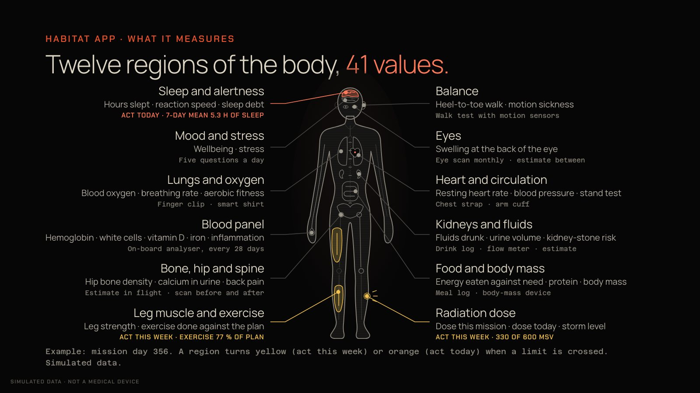
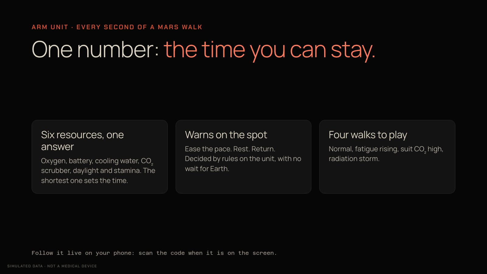

# Site, habitat app, arm unit and live view

> The pages people see: eight tabs that explain the project, the habitat app for every day of the mission, the arm unit for every second of a Mars walk, a presentation mode with a slide for each tab, and the live view that puts the arm unit on the audience's phones.

## 1. Purpose

The apps show what continuous monitoring looks like when Earth is up to 21.5 minutes away: limits that warn on the spot, Earth's delayed daily instruction, and an assistant the crew can simply ask. The content pages explain where every number comes from. All pages read one simulated mission; none of them decides anything. Rules in the generator decided every state, flag and plan beforehand.

## 2. Scope

- **In:** every page in `mocks/`, what it reads, its main parts, controls and states; the four walk scenarios; the habitat app's body board and Earth's instruction; presentation mode and its slides; the live view; the team's link list; the screenshot list.
- **Out:** server routes ([`07_server_api.md`](07_server_api.md)), the assistant's prompts and context ([`09_assistant.md`](09_assistant.md)), table columns ([`06_database_schema.md`](06_database_schema.md)), colours and type ([`10_design.md`](10_design.md)), value labels ([`11_provenance.md`](11_provenance.md)).

## 3. How it works

1. Every page loads `assets/nav.js`, which draws the top bar in the order of the story: Overview, How it works, Mission, Risks, Measures; then Data, Simulation, Database; then Habitat app and Arm unit; and the note "Simulated data". `context.html` is not in the bar; the apps and the How it works tab link to it as "What the assistant knows". For the presenter, `nav.js` also loads the presentation layer (§4.5).
2. Pages that need data load `vendor/sqljs/sql-wasm.js` and `assets/simdb.js`. `SimDB.ready` downloads `db/mission_sim.sqlite` once, opens it in memory and caches `meta`, `variable` and `crew`. Pages then call `SimDB.q(sql, params)` or `SimDB.one(...)`.
3. If the database cannot be loaded, `simdb.js` shows a banner: open the page through `python3 -I tools/serve_preview.py`.
4. The apps also load `assets/assistant.js` for the context text, the rule-built briefing, the voice (in and out) and the AI call ([`09_assistant.md`](09_assistant.md)).
5. The pages only show what the generator stored: rule results (`assessment`), readiness and its costs, the plan, Earth's instruction (`uplink`), walk states (`eva_sample.state`). The arm unit mirrors the generator's cue thresholds only to decide which readout to light up.

### 3.1 States shown

| Where | States | Source |
|---|---|---|
| Habitat: any value | OK, Watch, Warning, Critical (icon and colour; only Critical is solid) | `assessment.status` |
| Habitat: readiness | 85+ ready; 70 to 84 ready with limits; 50 to 69 restricted; under 50 stand down. Crew-switch dot: none from 85, watch from 70, warning below | `body_day.readiness`, `readiness_band` |
| Habitat: link to Earth | Link ok, Weak link (short text only), No link (blackout, day x of 12), In person (on Earth) | `day.comm`: `ok`, `degraded`, `blackout`; phase |
| Habitat: Earth's instruction | Received, Short, None (standing orders, age in days), In person | `uplink.status`: `received`, `short`, `none`, `in_person` |
| Arm unit | Go, Caution, Return, Emergency, Airlock | `eva_sample.state` holds `go`, `caution`, `return`; the page shows Airlock when `stay_min` is empty (inside phases). Emergency is supported by the page but never occurs in the data |

## 4. Interfaces

### 4.1 Pages

| Page | Purpose | Data it reads | Main parts | Controls and URL parameters |
|---|---|---|---|---|
| `index.html` Overview | Who we are, what we built, the problem | No database. All text inline; the delay line uses a fixed 21.543 min; `api/health` says whether the film is there | **Hero:** team Health Signal, our mission (the one goal: bring the astronauts back from Mars alive, in as good health as possible), our vision (share what we learn to improve life on Earth), the message, and beside them the 30-second pitch film (`mocks/media/pitch.mp4`; until the file exists the frame says the film is being made). **What we built:** two app cards with icon, screenshot and an Open button. **The problem:** "A question to the doctor can take 43 minutes" with the animated delay line and three facts. Then What changes (four steps), what the assistant knows, how we built it, how to read the numbers, From Mars to Earth | Pause / Play; `?at=0.35` freezes the delay line |
| `system.html` How it works | The whole idea and the whole system as blocks | No database. All text inline | The one goal; "The idea, as blocks" (on Mars at once: crew, measure, rules on board, two screens, the astronaut acts; the assistant with its three inputs; the radio link; on Earth a day later); "Who decides what"; "One day, step by step"; "How it is built" (real data, generator, one database file, server, what you see; AI model, voice, live view) | Links to the other tabs |
| `mission.html` Mission | The planned 2037 mission | No database. Inline object `D` copied from the mission planner | Five tiles, orbit view with day slider and readout, light delay over the mission, solar activity, launch-year comparison, other trajectories, method | Day slider, play |
| `risks.html` Risks | NASA's 22 risks in three tiers: survive, work, come home healthy | No database. Inline JSON from `mocks/content/risks.json` (put in by `mocks/content/embed_risks.py`) and a hand-written label map `VAR` | Tier ladder, filters, risk list with details, "Risks we do not watch", "Watched, although not on NASA's risk list", method | Tier switch, search, coverage filter; `?tier=`, `?q=`, `?open=id,id`, `#id`; value chips link to `measures.html#<var_id>` |
| `measures.html` Measures | The 76 values: why each, its rule, source and course | `variable`, `day`, `body_day`, `env_day`, `lab`, `eva_sample` (normal walk only, every 20 s) | Four tests, counts, label key, value list with a chart per value | Scope chips (All, Environment, Body every day, Blood and urine, Arm unit every second), search, crew for charts; `#<var_id>` opens a value |
| `sources.html` Data | The data we chose: what, why, what we took, where it shows | `source_use`, `learned_param`, `variable`, `meta`, `crew`, `env_day`, `body_day` | A funnel (57 sources looked at, 40 datasets collected, 20 used, 76 values); four worked chains from real data to a value on the screen, each with a chart (radiation: replayed; bone density: modelled; heart rate through a day: a shape learned; reaction speed: a size learned); "All the data we chose, and why" (the 20 used sources, grouped by purpose, with the values they feed); a folded list of the datasets collected but not used; what real data cannot tell us; a link to Simulation | Value chips link to `measures.html#<var_id>` |
| `simulation.html` Simulation | How the simulated mission is made | `meta`, `variable`, `event`, `eva_scenario`, `body_day`, `day`, row counts of 15 tables | Four facts; six steps, each with what goes in and which tables come out (linked to the Database tab); the scenarios written in on purpose (scripted events and the four walks, linked to the apps) and those happening by chance (medical events at NASA's odds); six checks of the simulated crew against real crews, computed from the database on load; what is assumed | Table links open `database.html?table=<name>`; scenario cards open the habitat app on that day or the arm unit on that walk |
| `database.html` Database | The simulated mission as one SQLite file, open to explore | Every table, through sql.js; `content/schema.json` for the meaning of tables and columns | Five facts; where the file sits (real data, this file, apps); the 22 tables in six groups with row counts and one line each; for the chosen table its columns with meanings, filters and 50 rows a page; "Ask the database yourself": a read-only SQL box with five examples | Table list; crew, day and walk filters; column headers sort; Previous and Next; Run (also Cmd or Ctrl + Enter); "Download the file"; `?table=<name>` |
| `context.html` What the assistant knows | The exact text the assistant gets for any moment | Through `assistant.js`: see [`09_assistant.md`](09_assistant.md) | Controls, context text with character count, ask box, rule-built briefing | App, day, crew, walk, second, Show; `?day=&crew=`, `?scenario=&t=` |
| `habitat.html` Habitat app | Every day of the mission for one crew member | §4.2 | §4.2 | §4.2 |
| `arm_unit.html` Arm unit | Every second of four Mars walks | §4.3 | §4.3 | §4.3 |
| `/live` | The arm unit on the audience's phones | §4.4 | §4.4 | §4.4 |

**Navigation bar (`assets/nav.js`).** Left: the mark and the name Health Signal. Middle: eight tabs that explain (Overview, How it works, Mission, Risks, Measures · Data, Simulation, Database). Right: the two apps as app buttons with their icons (Habitat App, Arm Unit), always in view and not part of the scrolling tabs; on a phone they show as icons. The icons are `design/brand/app-habitat.svg` and `app-arm.svg`. Product names are written Habitat App and Arm Unit on the site.

### 4.2 Habitat app (`habitat.html`)



**Opens on** mission day 356 (sol 180), crew `C1` (KESTREL), tab Body board, speed one week per second.

**Fits the screen.** `fit()` scales the whole console as one piece (CSS `zoom`, between 0.45 and 1.4). On the Body board it fits width and height, so the figure, all twelve cards and the legend are on the screen without scrolling, and the page itself does not scroll. Checked on 2026-11-14 at 1280 × 720, 1440 × 900, 1512 × 860, 1920 × 940, 1920 × 1080 and 2560 × 1440. The Today tab uses the same scale and scrolls.

**Data.** Tables `day`, `env_day`, `env_hour`, `event`, `eva`, `snapshot`, `assessment` (crew and `ENV` rows), `body_day`, `body_hour`, `lab`, `readiness_cost`, `plan`; through `assistant.js` also `uplink`. Per crew member the page caches all days at once, so playing the timeline needs no new queries except for the slower texts.

**Top bar.** "Crew health console", crew switch (four call signs, dot coloured by readiness), tabs Body board and Today, and a clock: where (sol, deep-space day, or Earth), one-way signal time, link state.

**Body board.** A body figure with twelve regions, each with a callout and a leader line:

| Left side | Right side |
|---|---|
| Sleep and alertness (`sleep_h`) | Balance (`balance_pct`) |
| Mood and stress (`mood_who5`) | Eyes (`sans_trt_um`, optic-disc swelling) |
| Lungs and oxygen (`spo2_pct`) | Heart and circulation (`hr_rest_bpm`) |
| Blood panel (`hemoglobin_g_dl`, last panel) | Kidneys and fluids (`urine_l`) |
| Bone, hip and spine (`bmd_hip_pct`) | Food and body mass (`energy_pct`) |
| Leg muscle and exercise (`leg_strength_pct`) | Radiation dose (`dose_cum_msv`) |

Each callout shows the main value, its label badge, the worst status of the region's values, a trend against the 30-day mean (or the last blood panel), and a short line of related values. Hover highlights the region; click or Enter pins it and opens a detail panel. Escape clears.

**Today tab.** Cabin air gauges (CO₂, inspired oxygen, temperature, humidity against their limits), outside (Mars weather from the Curiosity replay, deep-space distances, or Earth), link to Earth, mission dose against the 600 mSv career limit with the projection to Earth return ("above the limit: known before launch"), "Why this day matters" (written analysis on the 24 snapshot days, otherwise "Today in short", built by rules), "Logged today" (activity, symptoms, EVA, events), "Through the day" (hourly heart rate, core temperature, cabin CO₂ and inspired oxygen against the person's usual range of the previous 30 days), "Against your own trend" (13 values: today, 7-day and 30-day mean, sparkline, status), "Tomorrow" (the plan by the rules on board).

**Rail.** Readiness (number, band, last 14 days, what costs points today), then the health assistant:

- **From Earth** card: received this morning, from data up to which day, signal time, headline, two points with "Why" (more on request), and the flight surgeon's letter on snapshot days. During the blackout: "No link to Earth. The last instruction is N days old", standing orders apply. On Earth: the flight surgeon is there in person.
- **Rules on board, today**: up to four flagged values with reason; click opens the body region.
- Suggested questions (from `snapshot.questions_json` on key days, otherwise built from the flags), a text field and a microphone. Answers carry "AI model, from this day's data only." or "Built by the rules on board. No AI model is connected.". Every answer is spoken in the ElevenLabs voice while the voice switch is on, and shown as text; there is no Read aloud ([`09_assistant.md`](09_assistant.md) §4.5, D-31). Changing the day clears the conversation.
- The badge beside "Health assistant" says **DEMO**. Its tooltip: on the mission the assistant runs on the habitat computer; in this demo an AI model in the cloud stands in for it.

**Timeline dock.** Previous key day, one day back, play or pause, one day forward, next key day; speeds 1 day, 1 week, 1 month per second; readout of day, place and key-day label; "Jump to a key day" list (from `day.key_label`); a draggable band with phases, the blackout (hatched) and solar storms (S1 yellow, S2 and above orange). The phase labels use the mission plan's lengths (172, 561 and 190 days), the same numbers as on the Mission tab.

**Keyboard.** Space play or pause; left and right arrows one day; Shift plus arrows previous or next key day; Home and End on the band; Escape clears the pinned region.

**URL parameters.** `day`, `crew`, `speed`, `tab=today`, `focus=<region>`, `play=1`.

**Remote hooks.** `window.HS_APP = { mic(), play() }`: the presenter's remote presses the microphone and play or pause through these (§4.5).

### 4.3 Arm unit (`arm_unit.html`)



**The four walks** (table `eva_scenario`, in this order):

| Id | Title | Sol (mission day) | Length | Outcome | Key moment | Default trace |
|---|---|---|---|---|---|---|
| `nominal` | Normal walk | 9 (181) | 3 h 35 min 36 s | nominal | 1:42:18 | Stamina |
| `fatigue` | Fatigue rising | 178 (354) | 2 h 27 min 58 s | shortened: fatigue | 1:48:40 | Heart rate |
| `co2` | Suit CO₂ high | 301 (481) | 1 h 51 min 7 s | terminated: CO2 scrubber fault | 1:27:08 | Suit CO₂ |
| `storm` | Radiation storm warning | 438 (622) | 2 h 36 min 59 s | terminated: solar storm warning | 2:13:00 | Dose rate |

What happens in each walk is described in `kb/25` §6 and [`05_simulation.md`](05_simulation.md).

**Data.** `eva_scenario`, `eva_sample` (every second), `eva_text` (next-action texts), `eva_event` (cautions, alarms, phases), `variable` rows with id `eva.*`, `meta`, `crew`. Audience phones get the same walk as a pack from the server instead.

**The unit screen** (drawn as a device on a suit forearm):

- Status bar: EVA number and suit time, sol and local time, call sign, "Habitat link OK", "1 Hz".
- Hero: state word with icon, the question ("Time to stay" or the current step), one big number (stay time in h:min, or the step's time), what limits it, and the walk back to the airlock.
- Read view: "Time left, by resource" (oxygen, battery, cooling water, CO₂ scrubber, daylight, stamina) with the walk back plus 30-minute reserve shaded; twelve readouts (heart rate, core temperature, lactate, stamina, balance, faint risk, dose rate, EVA dose, suit pressure, oxygen, suit CO₂, suit temperature), each with its label badge.
- Route view: map with distance rings at 250, 500, 750 m, sites A and B, the position, and the walk back.
- Next strip: the next action from `eva_text`. It turns yellow on Caution and orange on Return or Emergency, and shows "acknowledged" after Acknowledge.
- Answer panel: question, answer, note on where it came from, Close.
- Keys: **Acknowledge**, **Ask** (press to speak, press again to stop), **Route home** (switch views), and a crown (decoration).

**Lit readouts.** The page lights a readout when its cue trips, mirroring `tools/sim/eva.py`: heart rate above 140 bpm for 2 min; core 0.6 °C over the pre-walk value (level 2 at 39.0 °C); lactate 4 mmol/L or more; stamina under 35 % (level 2 under 20 %); balance under 65; faint risk 10 % or more (level 2 at 20 %); suit CO₂ above 8 mmHg or after the CO₂ caution event; dose rate after the radiation caution or alarm event. A tripped cue stays lit up to 5 min while the state is not Go.

**Beside the unit.** Scenario card (title, sol, day, date, outcome tag, summary, the morning's readiness, sleep and sleep debt, link "Mission day N in the habitat app"), route map, "Ask the unit" (text field, Ask, spoken-answer switch, chips "How long can I stay?" and "What do I do now?", AI status, link to the context for this second). Below: log of the walk (click a line to jump there), the limits behind the warnings with their sources, and where the numbers come from.

**Player dock.** Play or pause, "From the airlock", "Key moment" (`eva_scenario.snapshot_t_s`), speeds 1×, 10×, 60× (default), 300×, "Beeps" switch, time and length, current caption, "Trace" (one of 19 values drawn on the timeline with its threshold line). The timeline shows the walk's phases and tasks as bands and marks every caution and alarm; drag to any second.

**Sound.** With Beeps on: a sound on each new state, a tick on each new step, a reminder every 7 s while Return or Emergency is not acknowledged, a chime when an answer appears, and an acknowledgement sound.

**Keyboard.** Space play or pause; arrows one second (Shift: one minute); Home and End.

**URL parameters.** `scenario`, `t`, `speed`, `trace`, `view=route`, `play=1`, `ask=<question>` (asks at once, for demos), `presenter=1`, `qr=1`, `live=1`, `audience`. The page keeps `scenario` and `t` in the address bar while paused.

**Remote hooks.** `window.HS_APP = { mic(), play() }` (the Ask key and play or pause) and, in presenter mode, `window.ArmLive = { set(on), on(), viewers(), qr() }` for the controls in the top bar (§4.5).

### 4.4 Live view

| Piece | How it works |
|---|---|
| Presenter mode | The arm unit is in presenter mode when the **Present** switch is on (§4.5) or the address has `?presenter=1` (the link the server prints, with `#key=`). With the Present switch on, the controls are **Phones** and **Live** in the top bar, and the unit's own Go live and QR code buttons are hidden. With `?presenter=1` alone, **Go live**, **QR code** and the number of phones following sit in the player dock. The key is moved to `sessionStorage`; a trusted browser can also fetch it from `/api/live/key` |
| QR screen | Full-screen code (qrcode-generator), three steps ("Scan the code", "Tap Follow", "Turn the phone sideways"), the address, phones following (refreshed every 2 s), Start or Stop the live view, Close (also Escape). The address is `public_url + /live` from `/api/live/info`; it can be edited and is then remembered in `localStorage.liveUrl`. A warning appears when the address is local only. For the event, set the address once to `https://monitordemo.healthsignal.space/live` (the browser remembers it per address the page is opened from); the bridge must be running (`python3 -I tools/live_bridge.py --check`) |
| Publishing | Every 100 ms the page compares its state with the last one sent. It posts on any change, on a seek while playing, and as a heartbeat every 1 s (playing) or 3 s (paused). Mirrored: walk, second, play or pause, speed, route view, trace, acknowledged step, and the open answer panel (question, answer, note). Going live first aligns the clock. Each state sent is also kept in `sessionStorage` (`hs.liveState`, `hs.liveOn`) |
| Stream across tabs | With the Present switch on, leaving the arm unit for another tab does **not** stop the stream: the other tab posts the stored state again every 2.5 s, and the phones run on by themselves from the shared clock. Back on the arm unit, the page resumes at the second the phones have reached and goes live again. Checked on 2026-11-14 in a scripted run: stream on while the habitat tab was open, and the unit resumed 11 s of walk time (0.2 s of real time at 60×) from the expected second. Without the Present switch, leaving the page switches live off, as before |
| Audience view | `/live` (or `?audience`). No site bar, no controls: the unit alone, scaled to the phone, always landscape (turned 90° when the phone is upright), and inert to touches. A start overlay offers "Follow with sound" or "Follow silently", then tries full screen, landscape lock and a screen wake lock. A badge shows Waiting, Live, or Reconnecting (no message for 8 s). Overlay texts: "Waiting for the presenter", "Loading the walk", "The live view is paused" |
| Following | The phone loads the walk pack once per walk, opens `/api/live/events`, and computes the presenter's current second from the shared clock. It polls `/api/live/state` if the stream is silent for 6 s. `?start=1` skips the tap (no sound), for a second screen; `?poll=1` polls every 0.8 s instead of streaming |
| AI on phones | Phones never call the AI. The presenter's answer is mirrored to them as text |

### 4.5 Presentation mode (`assets/present.js`, `slides.js`, `sr1.js`)

For the presenter only. `nav.js` loads the layer when `/api/health` says `presenter: true` (this machine, the tailnet, or a browser holding the presenter key), or when the page was opened with `?present=1`. `?present=0` switches it off. The choice is kept in `localStorage["hs.present"]`, so it holds across tabs.

| Control in the top bar | What it does | Key | Remote (SR-1) |
|---|---|---|---|
| **Present** | The master switch. Off: the plain site, with only this button. On: the three controls below. On the arm unit the page reloads to enter or leave presenter mode | | |
| **Slide** | Shows the slide of the current tab full screen (browser full screen where allowed). Pressed again, or Escape: back on the site, where it was. Arrows, Page Up/Down and Space move between the slides of a tab | F | Hyper F; Hyper N / Hyper P next and previous slide |
| **Phones** | The QR code the audience scans. On the arm unit it opens the QR screen; from another tab it goes to `arm_unit.html?qr=1` | | |
| **Live** | The stream to the phones, on or off, with the number following. Stays on across tabs (§4.4). Off works from any tab; on from another tab goes to `arm_unit.html?live=1`, because the arm unit is what is streamed | | |
| Black screen | Blanks the screen; any click, B or Escape brings it back | B | Hyper B |
| Microphone | Presses the app's microphone (`HS_APP.mic`) | | Hyper M |
| Play or pause | The app's timeline (`HS_APP.play`), when no slide is open | | Hyper K |
| Stop | Closes an open slide; with no slide open, stops the voice | | Hyper X |

"Hyper" is Ctrl + Alt + Shift + Cmd, the combination the parent's Logitech Spotlight remote sends; `sr1.js` is a copy of his standard script. After a click on a top-bar control the button gives up the focus, so the space bar still plays the walk.

**Slides** (`assets/slides.js`): plain HTML on a 1600 × 900 stage, scaled to the screen. One message each. Kept in step with the pitch deck by hand. A slide with `cls: "sl-compact"` has a smaller title, to leave room for a figure.

**The body figure is one drawing** (`assets/bodyfig.js`, `HS_BODY.svg()`): the habitat app draws its Body board from it, and two slides use the same drawing with label lines (`figure()` in `slides.js`). The habitat slide shows the twelve regions with their main values, how each is measured, and the flags of mission day 356 as the example (sleep: act today; exercise and radiation: act this week). The arm-unit slide shows the same body in a suit outline with what the unit records every second.

| Tab | Slides |
|---|---|
| Overview | "On Mars, the doctor is 43 minutes away." (21.5 min, 43 min, 12 days) · "One goal": the goal and the four steps · "Three things are real today. Each one can only get better." (the data, the apps, the advisor, each with what comes next; `00_overview.md` §3.5) |
| How it works | "Rules decide. Earth advises. The assistant explains." · "Nobody has flown to Mars. So we built the mission from real data." |
| Mission | "923 days away from Earth. 561 of them on Mars." |
| Risks | "NASA's 22 health risks, sorted the way a crew would." (6, 12, 4) |
| Measures | "76 values. Each one says how it was made." (REPLAY 11, SIM 45, MODEL 17, COMPUTED 3) |
| Data | "Real data in, simulated mission out." (three chains) |
| Simulation | "One run builds the whole mission." (six steps) |
| Database | "Simulated, and really there." (1.9 million values; 108,000 per astronaut; 569 a day; the four Mars walks with records and values each) · "One clean file. Swap the source, keep the apps." (today the simulation writes the tables; next a connector for real sensors, not built yet) |
| Habitat app | "Twelve regions of the body, 41 values." (the body figure) · "One picture of your health." · "Every answer is made live, from four things it is given." (the advisor) |
| Arm unit | "Body, suit and the way back, every second." (the body figure in a suit) · "One number: the time you can stay." |
| What the assistant knows | "Every answer is made live, from four things it is given." (health values, limits and plans, Earth's instruction, knowledge notes) |

The counts on the Database slide are typed into `slides.js`. The Database tab counts the same numbers live ("How much data is this?"), so after the mission is regenerated compare the two.

Deep link for rehearsal and screenshots: `?present=1&slide=1`.

### 4.5b German version (`assets/i18n.js`, `content/i18n/`)

The site can be read in German. The pages stay English at source; `assets/i18n.js` (loaded by `nav.js`) swaps English text for German in the browser. English is the default. The small grey `DE · EN` switch at the right end of the top bar changes the language (tooltip "Deutsch (KI-Übersetzung, noch nicht geprüft)"); `?lang=de` and `?lang=en` in the address do the same. The choice is kept in `localStorage["hs.lang"]`.

- **Dictionaries:** `content/i18n/de.common.json` (navigation, presenter buttons, shared labels, glossary) and one `de.<page>.json` per page. Each maps the English text (whitespace normalised; whole sentences with their inline tags) to German; `patterns` handle texts with numbers (`"{1} of {2}": "{1} von {2}"`); `skip` lists parts that stay English. A text not in the dictionary stays English, so a changed page never breaks, it only shows a gap.
- **Stays English on purpose:** the screens of the two apps (habitat console, arm unit), `/live`, data values, units, dates, database table and column names, SQL, NASA's verbatim risk statements, source titles, text inside charts and drawings (SVG), and the assistant's answers and voice (German answers would need a server change; not built).
- **Search boxes** on Risks and Measures still search the English text; their German hint says so ("(Englisch)").
- **Top up after a page changed:** `PW="$(npm root -g)/@playwright/mcp/node_modules/playwright-core"; node tools/i18n_coverage.js "$PW" --gaps [page …]` opens every page in German at 1440 × 900 and 390 × 844 and every slide at 1600 × 900, and lists per page the texts still English, dictionary entries no longer used, overflow German adds compared with English, and JS errors. Add the gaps to the page's dictionary and run it again. Where German is too wide, shorten the German (or put a soft hyphen, U+00AD, into a long word); never change layout or fonts.
- **Status:** all tabs, the text around both apps and all slides translated by AI on 2026-11-14 (about 2,200 entries); 0 gaps, fit check passed. The wording is accepted without a review (D-30): the German version is secondary, for our co-designer to read and test and for German-speaking visitors.
- **Key dialog (public site):** on `habitat` and `arm_unit` the check also opens the visitor key dialog and its messages (pass link, saving, removing, voice key used up / not accepted / rate-limited, AI key status line, the "No voice" sign), in English and German at both sizes. On this Mac the server says `"byo": false`, so only the headless test answers `/api/health` with `"byo": true` and the voice and AI calls with fake key errors; nothing reaches a provider. The dialog, its chips and the message at the bottom are German; the answer notes and messages inside the app screens stay English.
- **Kept current (D-30):** a full run of the coverage check writes `tools/i18n_coverage.last.json` (when it ran, how many gaps). `tools/check_docs.py` warns when a page, `slides.js`, `nav.js`, `present.js`, `assistant.js` or `content/risks.json` changed after that run, or when the run left gaps. The session that sees the warning runs the coverage check and, if texts are still English, starts the translation agent (`.claude/agents/translator-de.md`) in the background.

### 4.6 Team link list (`/launch/`)

`launcher/index.html`, for trusted viewers only. A plain list, no design: every page with its address and one line on what it is, in six groups (present, the site tabs, the two apps, what we hand in, research and background, documentation), one status line (server, AI model, voice, live stream) and four "if something does not work" hints.

### 4.7 Screenshots (`mocks/screens/`)

Five screenshots of the current apps, all used. The older screenshots of the first design (the old navigation) were deleted on 2026-11-15 because nothing used them.

| File | Shows | Used by |
|---|---|---|
| `app_habitat.jpg` | The Habitat App on mission day 356 | The app card on the Overview |
| `app_arm.jpg` | The Arm Unit during walk 1 | The app card on the Overview |
| `habitat_body.png` | The Habitat App's body board | Pitch deck |
| `arm_storm.png` | The Arm Unit during the storm walk | Pitch deck, slide and video templates |
| `live_phone_landscape.png` | The audience view on a phone, landscape | Image list of the project page (`deliverables/project/images.md`) |

Screenshots for the manuals live in `manuals/img/` (§4.8).

### 4.8 Manuals (`manuals/`, `mocks/manuals/`)

Two practical user manuals, one per app, for judges and visitors (parent, 2026-11-14). Each starts with the AI use and how to connect one's own limited, throwaway OpenRouter and ElevenLabs keys, then quick start, the screen part by part (numbered callouts), tasks, colours and signs, troubleshooting, limits. English only. They are not a menu point: each app has one small link **Manual (PDF)** (`download`): the Habitat App in the assistant's footer (`.afoot`, second line, right), the Arm Unit at the end of "Where the numbers come from" below the unit (not in `/live`, which covers the page); the Overview has the same link under each app card. The repository `README.md` links both PDFs.

| What | Where |
|---|---|
| Sources (A4, light theme on `design/templates/doc.html`) | `manuals/habitat_app.html`, `manuals/arm_unit.html`, shared `manuals/manual.css`, `manuals/manual.js` (places the numbered callouts) |
| Screenshots (JPEG) and callout boxes | `manuals/img/*.jpg`, `manuals/img/shots.js` (written by the build, do not edit) |
| PDFs (served by the site, offered for download) | `mocks/manuals/health_signal_habitat_app_manual.pdf`, `mocks/manuals/health_signal_arm_unit_manual.pdf` |
| Build | `tools/build_manuals.js` |

**Rebuild after a UI change** (the preview must be running on 8037): `node tools/build_manuals.js "$(npm root -g)/@playwright/mcp/node_modules/playwright-core"`. It takes fresh screenshots in a private headless Chromium (English, presentation off, 1440 × 900, crops at 2× or 1.5×) and prints both PDFs with page numbers. The screens show the public site's visitor view: inside that browser only, `/api/health` is answered with `byo: true, presenter: false`, and the keys are made-up examples (`sk-or-v1-EXAMPLE…`). Because this Mac is trusted, the server ignores those keys and answers with its own model: two questions per build. The voice is a silent stand-in clip (no ElevenLabs call), the microphone a fake device, `/api/stt` answers empty. Options: `--rules` (no AI call; the rule-built briefing answers), `--pdf-only` (keep the screenshots, print again), `--debug` (PNG copies in `/tmp/hs_manuals_debug/`). After a change to the wording only, `--pdf-only` is enough. If a part moved, check the callouts in the PDF; their selectors are in `tools/build_manuals.js`.

## 5. Run it

```sh
python3 -I tools/serve_preview.py
# http://127.0.0.1:8037/                       overview
# http://127.0.0.1:8037/?present=1             the site in presentation mode (Slide, Phones, Live in the top bar)
# http://127.0.0.1:8037/launch/                the team's link list
# http://127.0.0.1:8037/habitat.html?day=356   habitat app on sol 180
# http://127.0.0.1:8037/arm_unit.html?scenario=fatigue&t=6520
# presenter link: printed by the server; audience: /live
```

## 6. Data and provenance

| What | Label shown | Source |
|---|---|---|
| Body, cabin, suit and walk values | Badge per value: REPLAY, SIM, MODEL, COMPUTED (from `variable.kind`) | Generator |
| Readiness, mission dose | MODEL badge | Generator rules |
| Rule results, plan, walk states, next actions | Shown as rules ("Rules on board", "by the rules on board") | Generator |
| Earth's instruction and letter | "From Earth", with its age | Generator (`uplink`, `snapshot`); text built from the day's numbers |
| Assistant answers | "AI model, from this day's data only." / "AI answer from the values of h:mm:ss. The rules decide; the assistant explains." | OpenRouter model |
| The voice | A small sign "Speaking · ElevenLabs v4" while it speaks, "No voice · answer on screen" when ElevenLabs gives nothing | ElevenLabs through the server only |
| Data, Simulation and Database tabs | Badges REPLAY, SIM, MODEL, COMPUTED; "Real data" in green, "In the simulated mission" in amber | `source_use`, `learned_param`, `variable` |
| Rule-built briefing | "Built by the rules on board. No AI model is connected." / "this is the briefing the unit builds from its rules" | `assistant.js` |
| Mission page, overview numbers | Computed | Inline copies of the planner output |
| Risk ratings and wording | NASA's, with our tiers and texts marked as ours | `mocks/content/risks.json` |

## 7. Decisions and assumptions

- Two apps on one simulated mission; no family feature (`13_decisions.md`, D-06).
- Live audience view on phones (D-08).
- The one goal on the overview, the system page, the slides and the deck (D-15).
- The site explains only the chosen data; the simulation database is shown as its own explorable file (D-16, D-17).
- Presentation mode with a slide per tab and a master switch for the phone stream (D-18).
- Every page ends in a decision; Earth's instruction shows its age; one page shows exactly what the assistant gets (`kb/24` §5).
- Under-18 rule: fictional call signs only; no name, voice or likeness of our 12-year-old co-designer anywhere.

## 8. Open questions

1. **Screenshots:** the old screenshots were deleted on 2026-11-15; `live_phone_landscape.png` still shows the first design of the audience view. Retake it before it goes into the project page.
2. **"On board" label. Partly closed 2026-11-14:** the habitat app's badge now says "DEMO" with an honest tooltip, and `system.html` ends with the same statement. Still open: `index.html` says "A voice assistant running on board" without that note (see [`09_assistant.md`](09_assistant.md)).
3. **Hand-written example answer.** `index.html` quotes an answer for sol 180 ("You averaged 5.3 hours this week..."). It is not read from the database; `kb/25` §11.3 warns that hand-written examples drifted before. Check it against day 356.
4. **72 or 76.** `index.html` and `risks.html` speak of "72 indicators" / "72 measured indicators"; `measures.html` and the table `variable` have 76 values. Probably the catalog versus the simulation; say which.
5. **Duplicated logic.** `risks.html` keeps its own label map `VAR` ("the authoritative table is `variable`"), and the arm unit re-implements the cue thresholds of `tools/sim/eva.py` to light readouts. Both can drift from the generator.
6. **Static copies.** `mission.html` holds a copy of the planner output (2026-11-10) and `risks.html` a copy of `risks.json` (re-run `embed_risks.py` after edits). Neither updates itself.
7. **Fixed status bar.** The arm unit always shows "Habitat link OK" and "1 Hz", also during the storm and CO₂ walks.
8. **Emergency never shown.** The page supports an Emergency state the data never contains.
9. **`context.html` is not in the site bar**, and its `<title>` and `mission.html`'s ("Mars mission plan") do not follow the "· Mars 2037 crew health" pattern. `nav.js` still says "Mars 2037 crew health", not the working name HealthSignal (`design/README.md` §5).
10. **Voice input outside Chrome needs the voice service.** A browser without speech recognition records the question and sends it to `/api/stt`. That path was tested against a stand-in only, and it needs the ElevenLabs key. Not tested on the iPad.
11. **Live view untested on real phones.** Only simulated phones and a phone-sized window were tested (`kb/24` §3b). iPhones cannot lock orientation or go full screen.
12. **Remembered QR address.** An address typed into the QR screen is kept in `localStorage.liveUrl` and wins over the server's public address on later days. A stale tunnel address could end up in the QR code.
13. **Arm-unit charts on `measures.html`** use the normal walk only.
14. **Walk numbers in `kb/25` §6 are stale.** It gives `eva_sample` 38,561 rows and the storm walk 2 h 38; the database of 2026-11-11 holds 37,900 rows and the storm walk lasts 2 h 36 min 59 s.

15. **Slides and deck hold the same numbers by hand.** `assets/slides.js` and `deliverables/pitch_deck/deck.json` are two files. After a change to one, check the other.
16. **Presentation mode is untested with the real remote and a real projector.** The key mappings were checked with a keyboard in a scripted browser. The Options+ layout of the remote is not recorded yet.
17. **Full screen needs a click or a key.** A slide opened by the deep link `?slide=1` cannot enter browser full screen by itself; it still covers the page.

## 9. Change log

| Date | Change |
|---|---|
| 2026-11-13 | Created from the pages as of 2026-11-13 |
| 2026-11-14 | New top bar and tabs (How it works, Data rewritten, Simulation, Database); presentation mode with slides and remote keys; live stream across tabs; habitat app fits the screen; DEMO badge; team link list |
| 2026-11-14 | Body figure moved into `assets/bodyfig.js` (one drawing for the app and the slides); new slides: what we built, the data counted, the connector, what each app measures, the advisor; "How much data is this?" on the Database tab; "What is real today" on the How it works tab |
| 2026-11-14 | Overview: "From Mars to Earth" section at the end (vision, not built) |
| 2026-11-14 | German version of the site and slides as a layer (§4.5b): `assets/i18n.js`, `content/i18n/`, switch in the top bar, coverage check `tools/i18n_coverage.js` |
| 2026-11-14 | Navigation: brand Health Signal, eight tabs, the two apps as app buttons with icons. Overview: hero with team, mission, vision and the film slot; app cards with screenshots; the 43-minute problem as its own section. Habitat App: every answer spoken like on the Arm Unit, voice on/off switch, words appear while written |
| 2026-11-14 | German layer topped up for the capitalised app names, the new page titles, the app buttons and the new Overview top; stale keys renamed or removed; the assistant's status sign (Listening, Thinking, Speaking) now in German; the voice switch and the model line on the Habitat App screen stay English (inside the app screen) |
| 2026-11-14 | German version: secondary and accepted without review (D-30); the coverage check leaves a stamp and `check_docs.py` warns when the German is behind the site (§4.5b) |
| 2026-11-14 | Habitat App: both Read aloud buttons removed (Earth's instruction, each answer); no browser voice in either app (D-31) |
| 2026-11-14 | German layer: the visitor key dialog, its messages and the "No voice · answer on screen" sign in German; AI key status lines shortened to fit the Arm Unit card; stale "browser voice" entry removed; the coverage check now opens the key dialog (§4.5b) |
| 2026-11-14 | §4.8 Manuals: one PDF user manual per app (sources in `manuals/`, build `tools/build_manuals.js`), a "Manual (PDF)" link in each app and on the Overview's app cards (German "Handbuch (PDF)" in `de.common.json`), repository `README.md` with a Manuals section |
| 2026-11-14 | Arm Unit: moving or playing the time starts a fresh conversation with the assistant (before, only a new walk did); Habitat App: the same guard for day and crew member |
| 2026-11-15 | Overview: mission and vision as an equal pair (same size; Mars orange, Earth blue); the Earth dot of the delay track back in place (the From Mars to Earth section style had pushed it beside the Pause button). Database: the seed as a big number, no generation date. Mission: no generation date |
| 2026-11-15 | Database: the seed left out of the facts row (parent: not obvious to a visitor); it stays in the Settings table (`meta`) |
| 2026-11-15 | Risks: the date the NASA list was read is no longer named in the page text (intro and source line) |
| 2026-11-15 | Risks and Mission: the unused hidden dates removed from the page data (`retrieved` in `content/risks.json` and the embedded copy; `generated_utc` in the Mission page's plan copy) |
| 2026-11-15 | Deleted 17 unused screenshots of the first design from `mocks/screens/`; §4.7 lists the five that remain |
