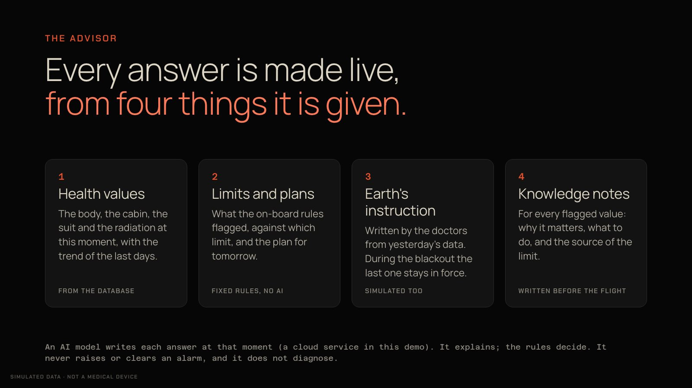
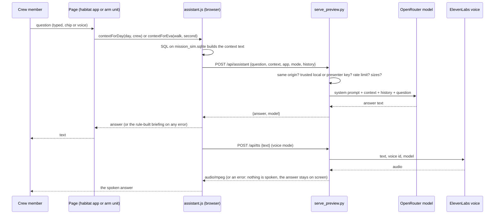

# On-board health assistant



> The crew member asks in plain words; the assistant answers from the values of that moment, the on-board rule results, Earth's instruction and the knowledge base. Rules decide, the assistant only explains.

## 1. Purpose

Astronauts do not want to read pages of analysis, and Earth is up to 43 minutes away for a question and its answer. The assistant turns everything the system knows about one moment into a short spoken or written answer. It never makes a decision: every warning, limit and plan was set by rules before anyone asks.

## 2. Scope

- **In:** where each step runs, the request and reply, the exact prompts, the context text, the modes, the voice in and out, the guardrails, the fallbacks without a model or a voice, cost and abuse limits, and logging.
- **Out:** server routes and status codes ([`07_server_api.md`](07_server_api.md)), how the pages show answers ([`08_apps.md`](08_apps.md)), how the rule results are made ([`05_simulation.md`](05_simulation.md)).

## 3. How it works



| Step | Runs in | Code |
|---|---|---|
| Build the context text | Browser | `Assistant.contextForDay()`, `Assistant.contextForEva()` in `mocks/assets/assistant.js` |
| Speech to text | Browser (its speech recognition service); if it has none or the service fails, the server and ElevenLabs (`POST /api/stt`) | `Assistant.listen()`; `transcribe()` in `tools/serve_preview.py` |
| Access check, prompt, model call | Server | `do_POST()`, `ask_model()` in `tools/serve_preview.py` |
| The language model | OpenRouter's cloud; default `anthropic/claude-haiku-5.5`, set by `OPENROUTER_MODEL` | n/a |
| Show the answer | Browser | the page |
| Speak the answer | Server and ElevenLabs (`POST /api/tts`), played in the browser; no other voice (D-31) | `Assistant.speakStream()`; `speak()` in `tools/serve_preview.py` |
| Rule-built briefing (no AI) | Browser | `Assistant.briefing()` |

## 4. Interfaces

### 4.1 Request and reply

Browser to server (`POST /api/assistant`, header `X-Presenter-Key` when the server is exposed):

```json
{ "question": "How long can I stay?", "context": "SITUATION: ...", "app": "arm", "mode": "voice",
  "history": [ { "role": "user", "content": "..." }, { "role": "assistant", "content": "..." } ] }
```

Reply: `{"answer": "...", "model": "<model name reported by OpenRouter>"}`. Errors: [`07_server_api.md`](07_server_api.md) §4.6.

Server to OpenRouter (`https://openrouter.ai/api/v1/chat/completions`), body `{"model", "messages", "max_tokens": 600, "temperature": 0.3}`, timeout 60 s, and `"reasoning": {"enabled": false}`: with the model's hidden reasoning left on, it used up to all 600 tokens before the first word (measured 2026-11-14: 3.4 s and sometimes an empty answer with it; 1.2 to 1.9 s and a full answer without). With `"stream": true` in the request the server asks OpenRouter for a stream and passes the answer on as plain text (`text/plain`, header `X-Model`), piece by piece; an empty answer is an error, so the browser shows the rule-built briefing instead of an empty bubble. If the reply was cut by the token limit, the server shortens it to its last whole sentence. The message list:

| # | Role | Content |
|---|---|---|
| 1 | `system` | `SYSTEM` plus one reply rule: `ARM` if `app` is `"arm"`, else `VOICE` if `mode` is `"voice"`, else `CHAT` |
| 2 | `user` | `CONTEXT FOR THIS MOMENT (the crew member does not see this text):` and the context (at most 30,000 characters) |
| 3 | `assistant` | `Understood. I will answer from this context only.` |
| 4 | `user` / `assistant` | Up to the last 6 turns of history, each at most 1,500 characters. The history belongs to one moment: the Habitat App sends it only for the same day and crew member, the Arm Unit only for the same second of the same walk. A question asked at another moment (day moved, crew switched, time played or moved, another walk) starts with no history, so the answer uses only the values shown |
| 5 | `user` | The question (at most 600 characters) |

### 4.2 The prompts (verbatim from `tools/serve_preview.py`)

`SYSTEM`:

```text
You are the on-board health assistant of a crewed Mars mission. You talk with one crew member.

What you are given: the crew member's measured and estimated values for this exact moment, the results of the on-board rules, the instruction the flight surgeon team on Earth sent for today (or the standing orders if the link is down), tomorrow's plan, and knowledge-base notes for whatever is flagged. Everything is simulated mission data.

How to answer:
- Use only what is in the context. Never invent a value, a limit or an instruction. If the context does not hold the answer, say so in one sentence.
- The on-board rules and Earth's instruction decide. You explain them and help the crew member act on them; you do not overrule them and you do not clear a warning.
- Start with the answer. Then the one or two numbers that support it. Then what to do next. Plain words, no jargon, no lists unless asked.
- Say where an instruction comes from: "the rule on board says" or "Earth's instruction this morning says". If the last instruction from Earth is days old, say how old.
- Values marked MODEL are estimates, not measurements: say "estimated".
- For anything that needs a medical decision, point to the crew medical officer. You are not a doctor and this is not a medical device.
- Be calm and brief. The crew member is busy and does not want to read analytics.
```

`VOICE`:

```text
This is a spoken conversation: answer in two to four short sentences, no symbols or abbreviations that are hard to say aloud. Make the first sentence very short (under ten words) and let it give the answer: it is spoken while you write the rest.
```

`CHAT`:

```text
This is a text chat: answer in at most six sentences.
```

`ARM`:

```text
The crew member is outside in a spacesuit and reads or hears you on the arm unit: at most two short sentences, the action first. Keep the first sentence under ten words: it is spoken while you write the second.
```

### 4.3 The context sent

The browser builds plain text from the database. `context.html` shows the exact text for any moment, so nothing is hidden.

**In the pitch this is said as four things the assistant is given** (slide "Every answer is made live, from four things it is given", `00_overview.md` §3.5): the health values of the moment with their trend; the limits and plans (the rule results and tomorrow's plan); Earth's instruction (simulated, like the rest); and the knowledge notes for every flagged value (why it matters, what to do, the source of the limit; they come from the `variable` table). With a model connected, every answer is generated at that moment from this text; nothing is pre-written. Without a model, the rule-built briefing answers (§4.6).

**Habitat app: `contextForDay(day, crewId)`** (about 8,000 characters for a day, `kb/25` §7). Sections in order:

| Section | Content | Tables |
|---|---|---|
| `MISSION` | Mission name, "Simulated data", day, date, where the crew is (sol and gravity, or deep-space day) | `day`, `meta` |
| `LINK TO EARTH` | One-way signal minutes, minutes for a question and answer, link state | `day` |
| `CREW MEMBER` | Call sign, role, sex, age, today's activity, symptoms | `crew`, `body_day` |
| `READINESS` | Score and band, what costs points, the readiness rule, "An EVA is allowed from readiness 70; between 70 and 84 with limits." | `body_day`, `readiness_cost`, `variable` |
| `VALUES` | 26 values with label kind (`[SIM]`, `[MODEL]`, ...): today, 7-day mean, 30-day mean | `body_day`, `variable` |
| `LAST BLOOD AND URINE PANEL` | Latest panel up to this day | `lab`, `variable` |
| `ENVIRONMENT` | Cabin CO₂ (24-h mean, 1-h peak), inspired oxygen, temperature, humidity, dose today, storm level, shelter hours, Mars temperatures and sunset | `env_day` |
| `RULE RESULTS` | Each flag: label, WATCH / WARNING / CRITICAL, reason. Headed "on-board rules, these are decisions" | `assessment`, `variable` |
| `EVENTS TODAY` | Title, severity, days, detail | `event` |
| `EVA TODAY` | Number, minutes, outcome, summary; or "postponed" | `eva` |
| `INSTRUCTION FROM EARTH` | Received this morning (data up to which day, signal minutes, weak link note) and headline; or none during the blackout with its age and "Standing orders"; or the flight surgeon on site. Then each item with topic, text and reason, and the flight surgeon's letter on snapshot days | `uplink` |
| `PLAN FOR TOMORROW` | Topic, text, reason | `plan` |
| `WHY THIS DAY MATTERS` | Snapshot days only | `snapshot` |
| `COMING UP` | Next three key days | `day` |
| `KNOWLEDGE BASE` | For each flagged value: why it matters, what to do, the rule, the source tag (NASA, CLIN, RES, INF) | `variable` |

**Arm unit: `contextForEva(scenarioId, second)`.** Sections in order:

| Section | Content |
|---|---|
| `SITUATION` | EVA number, landing site, sol, mission day, "Simulated data", call sign, time since suit seal, local time |
| `MORNING STATE` | Readiness and band, sleep last night, sleep debt |
| `NOW` | Task and phase, unit state, time to stay and what limits it, walk back distance and minutes |
| `UNIT SAYS` | The next-action text on the unit |
| `BODY` | Heart rate, core temperature, stored heat (limit 3.0 kJ/kg), work rate, lactate, stamina, balance and faint risk (each marked `[MODEL]`), water drunk |
| `SUIT` | Pressure, oxygen tank, helmet CO₂ (limit 20 mmHg for 1 h), battery, cooling water and level, scrubber |
| `TIME LEFT (min)` | Oxygen, battery, cooling water, scrubber, daylight, stamina, event limit; "Reserve kept: 30 min." |
| `RADIATION` | Dose rate (usual on Mars about 21 µSv/h), dose of this walk |
| `LOG SO FAR` | Every caution and alarm up to this second |
| `SCENARIO NOTE` | The walk's summary |
| `RULES OF THE UNIT` | Fixed text: heat cues and their actions [NASA V2 11011], when to return, helmet CO₂ limit [NASA V2 11040] |

Tables: `eva_scenario` (with `context_json`), `eva_sample`, `eva_event`, `eva_text`, plus `meta`. Length not measured; shorter than a day context.

### 4.4 Modes

| Where | `app` | `mode` sent | Reply rule | Question from | Answer shown |
|---|---|---|---|---|---|
| Habitat app: microphone, text field, chips | `habitat` | `voice` while the voice is on, `chat` when it is switched off | `VOICE` or `CHAT` | Speech (§4.5) or text | Text that appears while it is written, spoken from the first sentence on unless the voice is switched off (speaker button beside Ask); no Read aloud (D-31) |
| Arm unit: Ask key, text field, chips, `?ask=` | `arm` | `voice` | `ARM` (the app wins over the mode) | Speech or text | Answer panel on the unit, spoken unless muted, mirrored as text to audience phones |
| `context.html` | `habitat` or `arm` | `chat` | `CHAT` or `ARM` | Text box | Text, plus the rule-built briefing next to it |

**History.** The habitat app keeps the conversation of the shown day and clears it when the day or crew member changes; an answer that arrives after the day changed is dropped. The arm unit keeps the conversation of the current walk. Both send the last 6 turns. `context.html` sends none.

### 4.5 Voice, in and out

One voice for both apps, used only to answer a question (voice to voice; there is no "Read aloud" and no other voice, D-31): a deep male synthetic voice from ElevenLabs, reached only through the server (`07_server_api.md` §4.1). Nothing listens unless it was switched on: press once to talk, press again (or stop talking) to send.

| Step | How | Fallback |
|---|---|---|
| Listen | The browser's `SpeechRecognition` (`en-GB`); the words appear while you speak | No recognition in the browser, or its service fails (`network`, `service-not-allowed`, `language-not-supported`): the page records with `getUserMedia` and `MediaRecorder` and posts the recording to `/api/stt`. The turn ends after 1.4 s of quiet, after 7 s with nothing said, or after 25 s |
| Speak | Sentence by sentence: `Assistant.speakStream()` takes the answer while it is written, posts the first whole sentence (at least 24 characters) to `/api/tts` at once and the next pieces while the first plays; one shared `Audio` element plays them in order. At most 1,500 characters are spoken | The browser's own voice (`speechSynthesis`) is never used (D-31). The server answers 503 (no key) or 403 (not the presenter): nothing is spoken, the sign says "No voice · answer on screen" for a few seconds, and the page asks the server again after 20 s (never off for good, so a page that was open before the key was added finds the voice by itself). Another error on one sentence: that sentence is skipped, the rest is spoken. The browser blocks the sound: the rest of that answer stays text |
| One turn | `Assistant.askAloud(question, context, history, mode, {speak, onText})`: the same in both apps. It shows the words while they arrive and feeds them to the voice. The sign says "Thinking", then "Speaking" | Stop cancels the turn |
| Say it right | Before speaking, units and symbols become words: `CO₂`, `µSv/h`, `µSv`, `mSv`, `mmHg`, `mmol/L`, `kJ/kg`, `kPa`, `bpm`, `°C`, `EVA`, `SpO2`, `HRV` | |
| Show it | A small sign at the top: "Listening", or "Thinking", "Speaking · ElevenLabs v4", or "No voice · answer on screen", with a Stop button. `Assistant.voiceLabel()` gives the name | |
| Stop | `Assistant.stopSpeaking()`: the Stop button, a new question, the voice switch of either app, a change of day | |
| First sound | Browsers allow sound only after a tap or a key press. The page wakes its audio element on the first one | |

Which voice and which model: `07_server_api.md` §4.1 and `01_architecture.md` §4.4b. In short: `eleven_v4` first, then `eleven_v3`, then `eleven_multilingual_v2`; the voice is `ELEVENLABS_VOICE_ID`, or the deepest male English voice of the account.

**Status on 2026-11-14 (afternoon).** The ElevenLabs key is in `.env`; both apps answer in the ElevenLabs v4 voice. Measured in a scripted browser with a simulated spoken question: the first sound comes about 2.5 s after the question ends in both apps (0.5 s to the model's first words, about 2 s for the first sentence of speech); before the change it was 5.6 s (Habitat App) and 6.5 s (Arm Unit), because the whole answer was written and then turned into speech in one piece. Not measured: a real microphone and the browser's own speech recognition.

**What was wrong (parent's report, 2026-11-14).** The Habitat App did not answer like the Arm Unit. Three causes were found: a page that had been opened before the voice key was added kept the browser's voice until it was reloaded; only microphone questions were spoken in the Habitat App, typed ones and the Ask button were silent; and the model's hidden reasoning made answers slow and now and then empty.

### 4.6 Fallback without a model

`Assistant.ask()` catches every failure (no server, 403, 429, 503, model error, timeout) and returns the rule-built briefing instead, marked `offline`. The page says so: "Built by the rules on board. No AI model is connected." (habitat) or "No AI model connected: this is the briefing the unit builds from its rules." (arm unit).

| App | Briefing |
|---|---|
| Arm unit | Inside: the current step. Outside: "State go. You can stay 1 hours 40 minutes, limited by stamina." (on Return: the margin after the walk back), then the next action, then heart rate, core temperature and helmet CO₂ |
| Habitat app | Readiness and band; up to three flagged values that are not just Watch, with reasons (or "N values to watch, nothing urgent", or "Every value is inside its limits"); during the blackout "No link to Earth. The last instruction is N days old; standing orders apply."; otherwise Earth's first point |

The habitat app also shows this briefing as "Today in short" on days without a written analysis.

### 4.7 Guardrails

| Guardrail | How it is enforced |
|---|---|
| Rules decide, AI only explains (D-01) | By design: every state, flag, readiness score, plan and Earth instruction is computed by the generator before any question. The page takes nothing from the answer except text to show. Only the crew's Acknowledge key changes the unit |
| Answer only from the context | Prompt (`SYSTEM`), plus the fixed acknowledgement turn. The full context is visible on `context.html` |
| Do not overrule or clear a warning | Prompt only |
| Name the source of an instruction and its age | Prompt only; the age is in the context |
| Estimates said as estimates | `[MODEL]` marks in the context, plus the prompt |
| Not a medical device; medical decisions go to the crew medical officer | Prompt; also stated on the site and in `meta.disclaimer` |
| Short answers | Reply rule per mode, `max_tokens` 600; an answer cut by the limit ends on its last whole sentence |
| Honest labels on answers | Pages label AI answers and rule-built briefings differently ([`08_apps.md`](08_apps.md) §6). The habitat app's badge says DEMO: on the mission the assistant runs on the habitat computer; in this demo a cloud model stands in |
| A synthetic voice only | The voice is ElevenLabs' or the browser's. No recording of a person is played, and never the voice of our 12-year-old co-designer |
| No personal data | The crew is fictional; the context holds only simulated values |

Nothing checks the answer itself against the context or the rules. A validation panel is described in `kb/11` but not built (`kb/25` §9.11).

### 4.8 Cost and abuse limits

| Limit | Value |
|---|---|
| Who may ask, and who gets the voice | A browser on the server's own machine or on the team's tailnet, or the presenter (key). Visitors of a public server get the briefing only, as text, unless they bring their own keys (§4.10) |
| Rate | 20 questions per 60 s for the whole server |
| Request | Body at most 42,000 bytes; question 600, context 30,000, history 6 × 1,500 characters |
| Reply | `max_tokens` 600 |
| Voice | 40 calls per 60 s for the whole server (speaking and recognising together); 1,500 characters per spoken text; a recording of at most 8 MB; the last 80 clips are kept in memory |
| Rough size of one call | System prompt about 1,500 characters, a day context about 8,000, history up to 9,000: roughly 2,500 to 5,000 input tokens and at most 600 output tokens (estimate at about 4 characters per token, not measured) |
| Worst case per hour at the rate limit | 1,200 calls |
| Money | Price per token and per spoken character not checked here (see OpenRouter's and ElevenLabs' price pages). `.env.example` advises a separate OpenRouter key with a credit limit; whether the real key has one is not verified |

### 4.9 What is logged

- **Server:** one access line per request on stderr, for example `12:01:07 "POST /api/assistant HTTP/1.1" 200 -` (the same for `/api/tts` and `/api/stt`). The question, context, answer, spoken text, recording, model, token count and keys are never logged. Spoken clips sit in memory until the server restarts; recordings are passed on and not kept.
- **Exception:** a question sent with the arm unit's `?ask=` deep link is part of the page address, so it appears in that GET line.
- **Browser:** the conversation lives only in the page's memory. Nothing is stored.
- **Phones:** during the live demo the presenter's question and answer are mirrored to every phone.
- **OpenRouter and ElevenLabs:** keep their own records of calls per key (their services; not checked here). A recorded question sent to `/api/stt` is real audio of the person asking.

### 4.10 Visitor keys on the public site

The public site (https://healthsignal.space) carries no AI or voice key of ours. Visitors bring their own ("use and throw"): the parent hands judges capped test keys (OpenRouter about US$1, ElevenLabs about 5 minutes of speech). On the laptop, the tailnet and for the presenter nothing of this shows. This replaces the first row of §4.8 for the public site. Built in `mocks/assets/assistant.js`; the server side is `07_server_api.md`.

| Part | Browser side |
|---|---|
| Who brings keys | `GET /api/health` answers `"byo": true` on the public site. `byo: false` (laptop, tailnet, presenter): no key dialog, no hints, behaviour as before |
| Storage | `localStorage["hs.keys"]` = `{"or": "...", "el": "..."}` (either may be missing), only in that browser. A key the provider refused is marked in `localStorage["hs.keys.state"]` (`{"or": "key_used_up"}` and so on) and not sent again until the visitor replaces or removes it. No accounts |
| Sent how | Headers `X-OpenRouter-Key` and `X-ElevenLabs-Key` on `/api/health`, `/api/assistant`, `/api/tts` and `/api/stt` (next to the optional `X-Presenter-Key`), built in one place (`keyHeader()`). Never in a URL sent to a server, a log, `console.log`, an error text or the page: the dialog never puts a stored key back into its fields |
| Pass link | Any page opened with `#or=<key>&el=<key>` (either or both, URL-encoded), for example `https://healthsignal.space/#or=sk-or-…&el=sk_…`. The keys are stored, `or` and `el` are removed from the address at once (`history.replaceState`; other fragment parts stay), and a note says "Test keys added. The AI assistant and the voice are switched on in this browser." A fragment never reaches a server. The two apps run this from `assistant.js`; every other page loads `assistant.js` through `nav.js` only when such a fragment is there. Not in the audience view (`/live`) |
| Key dialog "AI and voice keys" | Only when `byo` is true. Habitat App: the key button at the right of the assistant's status in the panel header. Arm Unit: the "Keys" button under the status line of "Ask the unit". Also from the line under an answer and from the voice notes. Two password fields with where to get a key (openrouter.ai/keys; elevenlabs.io → API keys, with Text to Speech and Speech to Text access), Save and Remove keys, and: "Kept only in this browser. Sent with each question to this site's server, which passes it on to OpenRouter or ElevenLabs and does not store it." An empty field keeps the stored key |
| Status labels | Habitat App: "AI model · your key", "No AI key: rules", "AI key used up: rules", "AI key not accepted: rules", then the voice as before. Arm Unit: "AI connected with your key: <model>", "No AI key: the rule-built briefing answers", and so on. They update after every key change |

| Case | What the visitor sees | Fallback |
|---|---|---|
| No OpenRouter key | Under the answer: "The AI assistant needs a key. Add a test key or your own." (the second sentence opens the dialog). No request is sent | Rule-built briefing (§4.6) |
| OpenRouter `key_used_up` (402) | Once, under that answer: "This key is used up. The AI assistant was available for a short test. Add your own key to continue." Later answers carry the no-key line | Rule-built briefing for this and later questions; the key is not sent again |
| `key_invalid` (401) | "This key was not accepted. Check it in the key dialog." | The same |
| `rate` (429) | "Too many requests at once. Try again in a moment." The key stays in use | Rule-built briefing for this question |
| No ElevenLabs key | Nothing is spoken; the answer stays on screen. The microphone keeps the browser's own speech recognition where it exists; where the page would have to record and send to `/api/stt`, it says "Voice input needs a key. Add a test key or your own. You can type the question." and opens the dialog | Text on screen; typed question |
| ElevenLabs `key_used_up` | Once, a note at the bottom: "Voice was available for a short test time. Add your own key to continue." | Text on screen only; the key is not sent again |
| ElevenLabs `key_invalid` / `rate` | "This voice key was not accepted. Check it in the key dialog." / "Too many requests at once. Try again in a moment." | Text on screen only |

Strings inside the apps stay English (`08_apps.md` §4.5b); the pass-link note, which can appear on any site page, has a German entry in `content/i18n/de.common.json`.

## 5. Run it

```sh
# .env holds OPENROUTER_API_KEY (and optionally OPENROUTER_MODEL), and ELEVENLABS_API_KEY for the voice. Never print or commit it.
python3 -I tools/serve_preview.py
# http://127.0.0.1:8037/context.html?day=356&crew=C1     the context, a question box and the briefing
# http://127.0.0.1:8037/arm_unit.html?scenario=fatigue&t=6520&ask=What%20do%20I%20do%20now%3F
```

To change the model: set `OPENROUTER_MODEL` in `.env` and restart the server. `/api/health` and the apps show the model in use. To switch the voice on: paste the key after `ELEVENLABS_API_KEY=` in `.env` and restart; `/api/health` then shows `"voice": true` and the name of the voice model.

## 6. Data and provenance

| What | Label | Source |
|---|---|---|
| Context text | SIM, with per-value kinds (`[SIM]`, `[MODEL]`, `[REPLAY]`, `[COMPUTED]`) | `mission_sim.sqlite` via `assistant.js` |
| Rule results, plan, Earth's instruction in the context | Rules (generator) | `tools/sim/` |
| Answers | AI | OpenRouter model named in the reply |
| The spoken answer | AI (synthetic voice) | ElevenLabs model named in the `X-Voice-Model` header |
| Briefing | Rules, no AI | `Assistant.briefing()` |
| Prompts | Written with Claude Code | `tools/serve_preview.py` (`12_ai_usage_log.md`) |

## 7. Decisions and assumptions

- Rules decide, AI only explains; runtime AI through a server-side proxy to OpenRouter, keys never in the browser (`13_decisions.md`, D-01).
- The story: an on-board assistant the crew talks to (D-05).
- One ElevenLabs deep male voice (v4) for voice-to-voice in both apps, through the server (`13_decisions.md`, D-19). No Read aloud and no fallback voice: without ElevenLabs the answer is text only (D-31). For the demo, say which parts stand in for a future on-board model (`kb/24` §4.4).
- The default model is small and fast on purpose: a spoken answer must come back within a second or two (tested 2026-11-14: `anthropic/claude-haiku-5.5` 1.6 s, `anthropic/claude-sonnet-5.5` 3.6 s for the same question).
- Assumption: a hosted model today stands in for an on-board model in the mission (`kb/16`).

## 8. Open questions

1. **Voice-to-voice: built on 2026-11-14, not yet heard.** It is recognition, then the text model, then synthesis (§4.5), with the keys on the server. Still open: the ElevenLabs key is not in `.env`, so the real voice has not been tested; the delay from the end of the question to the first sound is unmeasured; the phones get the answer as text only; cost per minute is unchecked; the iPad is untested. Any voice must be synthetic, never the voice of our 12-year-old co-designer.
2. **"On board" label. Partly closed 2026-11-14:** the habitat app's badge is now "DEMO" with a tooltip that says a cloud model stands in, and `system.html` says so too. Still open: `index.html` says "running on board" without that note.
3. **Default model retires soon. Closed 2026-11-14:** the default is now `anthropic/claude-haiku-5.5`. Before: the model reference in Claude Code (cached 2026-11-03) lists Claude Sonnet 4.5 as deprecated, retiring 2026-11-30, before global judging ends. Pick and test a current model and set `OPENROUTER_MODEL` explicitly.
4. **`temperature` may break newer models. Closed for two models on 2026-11-14:** `anthropic/claude-haiku-5.5` and `anthropic/claude-sonnet-5.5` both answered through OpenRouter with `temperature: 0.3`. Test again after any other model change. Before: the server always sends `temperature: 0.3`. Anthropic's own API rejects sampling parameters on its newest models. Whether OpenRouter drops the field or passes the error on is not verified. Test after any model change.
5. **No runtime log of AI use.** Nothing records questions, answers, model or tokens. The submission must describe AI use (`12_ai_usage_log.md`); consider a local log of model, time and token counts (no context text).
6. **Guardrails are prompt-only.** Nothing checks that an answer's numbers appear in the context or that it does not contradict a rule. The question is user text and could try to override the prompt (600 characters at most).
7. **Truncation cuts the knowledge base first.** If a context exceeds 30,000 characters, the server cuts the end, where the knowledge-base notes are. Today's contexts are far below that.
8. **Cut answers. Closed 2026-11-14:** the limit is 600 tokens, and a reply with `finish_reason` `length` is shortened to its last whole sentence. Still open: there is no streaming and no cancel during the 60 s timeout.
9. **Stale comment in `.env.example`.** It says runtime AI is "Default plan: none" and should live "only inside a serverless proxy"; today the preview server is the proxy (`kb/10`: "no serverless function is needed").
10. **Overview promise versus prompt.** `index.html` says the assistant names whether a statement comes from "a measured value, the knowledge base, or Earth". The prompt asks only for the source of instructions (rule on board or Earth).
11. **Speech recognition needs a network and sends real audio out.** In Chrome it normally runs on Google's servers (not verified for the current version); the recording fallback goes to ElevenLabs. Both conflict with an "on board" story and send the speaker's voice to a third party. If our co-designer asks the question on stage, his voice goes to that service: decide whether the parent asks instead, or the question is typed.
12. **Follow-up by voice is one press each.** After a spoken answer the microphone stays off until it is pressed again. That is on purpose for a loud room; a hands-free mode is not built.

## 9. Change log

| Date | Change |
|---|---|
| 2026-11-13 | Created from `tools/serve_preview.py` and `mocks/assets/assistant.js` as of 2026-11-13 |
| 2026-11-14 | Voice in and out through the server (ElevenLabs) with browser fallbacks; default model `anthropic/claude-haiku-5.5`; `max_tokens` 600 with a sentence-safe cut; DEMO badge; four open questions closed or narrowed |
| 2026-11-14 | §4.3: the four inputs as they are named in the pitch |
| 2026-11-14 | One spoken turn for both apps (`askAloud`): streamed answer, speech sentence by sentence, voice on/off switch in the Habitat App, the voice is asked for again after 20 s; hidden reasoning switched off; prompts ask for a short first sentence |
| 2026-11-14 | §4.10 Visitor keys on the public site: own keys per browser (`hs.keys`), pass link `#or=…&el=…`, key dialog in both apps, messages and fallbacks for `no_key`, `key_used_up`, `key_invalid`, `rate` |
| 2026-11-14 | No browser voice and no Read aloud (D-31): `browserSpeak` and `Assistant.speak` removed; a failed sentence is skipped, "No voice · answer on screen" when nothing could be spoken |
| 2026-11-14 | The conversation belongs to one moment: the Arm Unit no longer sends earlier questions and answers after the time moved within a walk (it only reset on a new walk); the Habitat App checks day and crew member before it sends the history |
