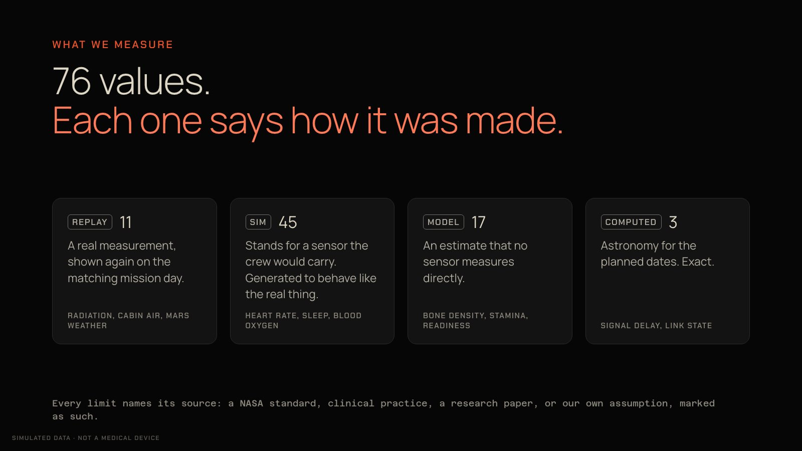

# Provenance labels

> Every value, text and picture says where it comes from. Nothing simulated is passed off as measured.

## 1. Purpose
Judges, crew and readers must be able to tell at a glance what is real, what is replayed, what is estimated and what is invented. This is also a Space Apps rule for AI-made content.

## 2. Scope
All values in the apps, all numbers in slides, video and texts, all pictures, sounds and generated text.

## 3. The labels

| Label | Means | Typical example | Say it as |
|---|---|---|---|
| **REAL** | Measured by a mission or instrument and published | ISS dosimeter record, Inspiration4 blood panel | "measured" |
| **LIVE** | Fetched from the source right now | ISS cabin CO₂ feed, NOAA space weather today | "live" |
| **CACHED** | A saved snapshot of a live source, with its date | DONKI events fetched 2026-11-10 | "as of <date>" |
| **REPLAY** | Real history replayed onto our mission calendar | 2015–2018 solar activity replayed onto 2037–2040 | "real data, replayed" |
| **MODEL** | Calculated from a published model or formula | dose from NASA effective-dose rates, bone loss per month | "estimated" |
| **SIM** | Simulated for the fictional crew; stands for a sensor | heart rate, sleep, suit pressure | "simulated" |
| **AI** | Written, drawn, spoken or composed by an AI model | assistant answers, generated video shots | "AI-generated" |

How the generator's four ways of making a value map to labels (`kb/23`): computed from a formula → MODEL; replay → REPLAY; model → MODEL; learned shape (synthetic values shaped on real datasets) → SIM.

## 3b. A second, separate label: how the value is measured in the mission
Provenance says where our data comes from. A second tag says how the crew would get the value on the mission, so the dashboard shows sensor values and the astronaut's own measurements side by side without contradiction (`variable.sensor`, `variable.cadence`):

| Tag | Means | Body and lab values (of 42) |
|---|---|---|
| **SENSOR** | Measured automatically, around the clock | 9: wrist actigraph, chest strap, smart shirt, heat-flux sensor, toilet flow meter, exercise device |
| **MEASURED BY YOU** | The astronaut takes it, on a schedule, and it can be entered in the app | 24: arm cuff, body-mass device, reaction test, 5-question check-in, self-ratings, meal and drink log, blood and urine analyser every 28 days |
| **ESTIMATE** | Calculated from other values or a model | 9: readiness, sleep debt, bone density, aerobic fitness and others |

In the demo every value is still SIM or MODEL in provenance; "measured by you" describes the mission routine, not where our data came from. Showing both tags is planned for the weekend (`deliverables/strategy.md`, M1).

## 4. Where labels show
| Place | How |
|---|---|
| Apps | An outline badge next to each value (`.hs-prov` in `design/components.css`; the apps' own `.badge` today) |
| Site | Data tab: each chain carries its badge, real data is marked green and the simulated value amber. Simulation tab: badges with counts per step. Measures tab: a badge per value. Database tab: the label is part of each column's meaning |
| Voice | A sign names the voice while it speaks: "Speaking · ElevenLabs v4". It is synthetic (AI); no other voice is used |
| Slides | Badges under the claim or in the source line |
| Video | Burned-in caption "simulated data" on app screens; **AI-generated** mark on every AI shot |
| Texts | The project page lists data per label (`deliverables/project/project_page.md`) |
| Pictures | `design/ASSETS.md` row per file: REAL, OWN or AI |
| Database | Each variable's source and method (`06_database_schema.md`) |

## 5. Rules
- MODEL is "estimated", never "measured". SIM is "simulated", never "measured".
- Severity colours never encode provenance; provenance badges are outline only.
- AI pictures and video: visible **AI-generated** watermark; AI audio and code: acknowledged in text and metadata (Space Apps 2025 rules, `kb/03` §4).
- Every number in a deliverable traces to a source in `docs/` or `kb/`.

## 6. Open questions
- The apps also show `COMPUTED` (three values) and, beside the habitat app's assistant, `DEMO` (since 2026-11-14; it was `ON BOARD`): a note on where the assistant runs, not a provenance. Decide: fold `COMPUTED` into MODEL; give `DEMO` a different style from the provenance badges.

## 7. Change log
| Date | Change |
|---|---|
| 2026-11-13 | Created |
| 2026-11-14 | Where labels show on the new tabs and for the voice; `ON BOARD` became `DEMO` |
