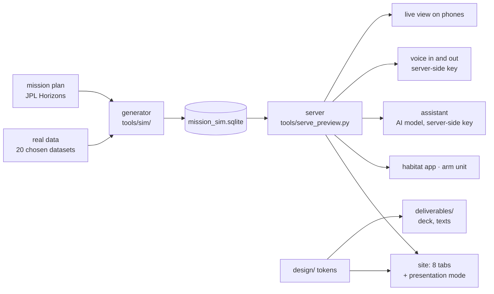

# Documentation: start here

Every part of the project has one spec in this folder. Read `00_overview.md` first: it explains the goal, the idea and the system on one page.

In the public repository some references point to working folders that are not published: `kb/` (research notes), `deliverables/` (working texts of the submission), `design/` (the design module), the source data under `data/`, and the internal logs `12_ai_usage_log.md` and `13_decisions.md`. The illustrations in `images/` are the slides of the website's presentation mode.

**AI agents:** read this file, `00_overview.md`, then the spec of the part you are about to change. After a change, update that spec and run `python3 -I tools/check_docs.py`.

## 1. Map

| # | File | What it explains |
|---|---|---|
| 00 | `00_overview.md` | The goal, the idea as blocks, who decides what, how it is built, where to look |
| 01 | `01_architecture.md` | Components, tech stack, hosting, AI model, voice, security |
| 02 | `02_data_sources.md` | The sources we looked at and the 20 datasets the simulation uses, with licences |
| 03 | `03_reference_data.md` | The downloaded real data and the reference database |
| 04 | `04_mission_plan.md` | The planned 2037 mission: dates, delay, radiation budget |
| 05 | `05_simulation.md` | The generator: what it makes and how |
| 06 | `06_database_schema.md` | Tables and columns of `mission_sim.sqlite` |
| 07 | `07_server_api.md` | The server: routes, keys, limits, voice, live relay |
| 08 | `08_apps.md` | The site, both apps, presentation mode, the live view |
| 09 | `09_assistant.md` | The assistant: model, prompts, voice, guardrails |
| 10 | `10_design.md` | The look (pointer to `design/`) |
| 11 | `11_provenance.md` | The labels REAL, REPLAY, MODEL, SIM, AI and where they show |
| 12 | `12_ai_usage_log.md` | Every use of AI, with dates |
| 13 | `13_decisions.md` | What we decided, when and why |
| 14 | `14_publishing.md` | What goes public, what stays private, licences |

Other folders: `kb/` (research notes behind the specs), `design/` (the look), `deliverables/` (what we hand in), `mocks/` (the site and apps), `tools/` (all code), `launcher/` (the team's link list at `/launch/`).

## 2. The standard every doc follows

**Front matter** (YAML, first lines of the file):

| Key | Values | Meaning |
|---|---|---|
| `id` | short, unique, kebab-case | Used in `depends_on` and `index.json` |
| `title` | text | Same as the H1 |
| `status` | `template` · `mock` · `draft` · `reviewed` · `final` | The status ladder, below |
| `updated` | `YYYY-MM-DD` | Last real change |
| `owner` | `parent` · `co-designer` · `team` | Who decides about the content |
| `made_with` | e.g. `Claude Code (Claude Opus 5.5)` or `by hand` | For the AI-use log |
| `public` | `true` · `false` | Goes into the public repository |
| `sources` | list of paths or URLs | Code and notes the doc describes |
| `depends_on` | list of doc ids | Docs to read first |

**Sections of a spec** (use the ones that apply, in this order; template in `templates/spec_template.md`): Purpose · Scope · How it works · Interfaces · Run it · Data and provenance · Decisions and assumptions · Open questions · Change log.

**Status ladder:** `template` (structure only) → `mock` (stand-in content, marked `[MOCK]`) → `draft` (real content, may change) → `reviewed` (checked against the code and the sources) → `final` (frozen for the submission). The front matter shows the lowest level in the doc.

**Writing rules:**
- Plain English, short sentences, the point first. Numbers with units and a source.
- Exact names in backticks: files, tables, columns, routes, commands.
- Dates as `YYYY-MM-DD`. Never rewrite past dates.
- No keys, tokens or passwords. No personal data. The team's 12-year-old is "our 12-year-old co-designer", never by name.
- Say what is unknown or unverified instead of guessing. Describe what the code does now; mark plans as planned.

## 3. Keeping it in sync

`python3 -I tools/check_docs.py` checks every file in `docs/` and `deliverables/`: front matter, linked files, `depends_on` ids, forbidden terms (private list in `.private/forbidden_terms.txt`) and the length of the submission fields. It writes `docs/index.json` and `deliverables/board.html`. `python3 -I tools/export_schema.py` rewrites the generated part of `06_database_schema.md` and `mocks/content/schema.json`. The `sync-docs` skill in `.claude/skills/` lists what to update after each kind of change.
